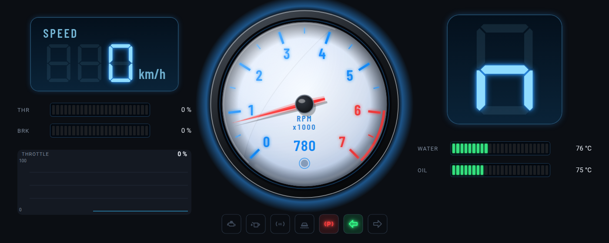

# ThrashDash

**Every drive in BeamNG.Earth, recorded and mapped: replay it, follow it live, share it. With customisable dashboards for everything else the car is doing.**


[BeamNG.Earth](https://github.com/TecnaGamer/BeamNG.Earth) lets you drive anywhere on the real Earth in BeamNG.drive. ThrashDash keeps a log of those drives, and shows them on a map in an ordinary browser window next to the game: where you went, how fast, how much fuel it took, where you were over the speed limit, and what the weather was doing. It also puts the car on the map as it drives, as close to real time as the game allows, and it still does what it did first: live gauges on a second monitor or a phone.

- **A trip log you do not have to think about.** Trips start when the car moves and end when you park, teleport or leave. Each is saved as it is driven, so a crash loses nothing, and gets a name ("Courtenay Place to Hutt Road") and a summary.
- **A map of every trip.** The route coloured by speed, with a red edge where you were over a *posted* limit; a speed and height graph; the figures; and a replay you can scrub, speed up, and watch with the map turning so the car always points up.
- **What happened on the way.** Stops (and the places you stopped at), refuels, impacts (marked by how hard you hit, not only by the damage), peak G, how a route you set went, and **waypoints** you drop with a key and add notes to.
- **A live map.** The Trips page opens each new trip by itself and follows the car; the same map can sit on any dashboard as a widget.
- **All your driving added up.** A **Stats** view (totals, records, each vehicle's economy), search and favourites, **compare** two drives of the same route, **join** and **cut** trips, delete several at once, **back up** and **restore** the lot, and **import** a drive recorded elsewhere as a GPX file.
- **Take trips with you.** Download a trip as **GPX**, **KML** (Google Earth) or **CSV** (a spreadsheet), or as **one web page** that anyone can open with nothing installed.
- **Popups in the game** when a trip ends (or starts), and ThrashDash can **start BeamNG.Earth for you** (the newest version in a folder) and quit when it closes.
- **Dashboards**, the original half: a drag-and-drop editor, thirteen widget types, ten ready-made dashboards, four looks, tyres, damage, alerts, trip meters, per-vehicle dashboards, and phones and tablets over your network.
- **Your windows come back as you left them**, the map window included, and close when ThrashDash does.
- **No accounts and no cloud.** Everything runs on your computer. The one thing that uses the internet is the map pictures (OpenStreetMap, or EOX's satellite picture); nothing about your trips is sent anywhere.

> [!NOTE]
> ThrashDash is at version 0.1.3. It has been developed and tested against BeamNG.drive 0.40.5 and BeamNG.Earth 1.9 on Linux. The Windows build has been compiled and run once on Windows 11 and worked, but has had much less use than the Linux one (see [Known limitations](#known-limitations)).

## Contents

- [How it works](#how-it-works)
- [Requirements](#requirements)
- [Installation](#installation)
- [Quick start](#quick-start)
- [The trip log](#the-trip-log)
- [The Trips page](#the-trips-page)
- [Planning a GPS route](#planning-a-gps-route)
- [Lap and sector timing](#lap-and-sector-timing)
- [Taking trips with you](#taking-trips-with-you)
- [Starting BeamNG.Earth with ThrashDash](#starting-beamngearth-with-thrashdash)
- [Windows: remembering, saving and closing](#windows-remembering-saving-and-closing)
- [Dashboards](#dashboards)
- [Phones and tablets](#phones-and-tablets)
- [Privacy and security](#privacy-and-security)
- [More documentation](#more-documentation)
- [Troubleshooting](#troubleshooting)
- [Known limitations](#known-limitations)
- [Licence and credits](#licence-and-credits)

## How it works

```
  BeamNG.drive                       this computer                           any browser window
┌─────────────────────┐  UDP JSON  ┌─────────────────────────────┐ WebSocket ┌──────────────────────┐
│ vehicle mod (Lua)   │ ─────────▶ │ relay (Python)              │ ────────▶ │ Trips page (map)     │
│  the car's data     │ 127.0.0.1  │  writes the trip log,       │  + HTTP   │ dashboards (gauges)  │
│ game extension (Lua)│   :4568    │  works out the summaries,   │  :8765    │ the editor           │
│  position, place,   │ ◀───────── │  serves the pages, remembers│           └──────────────────────┘
│  limit, weather     │   popups   │  your windows               │
└─────────────────────┘            └─────────────────────────────┘
```

| Part | Where | What it does |
|:---|:---|:---|
| **Vehicle mod** | [`mod/lua/vehicle/`](mod/lua/vehicle/) | Loaded into every vehicle. Sends that car's data (30 times a second) for the gauges. It reads, never writes. |
| **Game extension** | [`mod/lua/ge/`](mod/lua/ge/) | Runs in the game itself, only when BeamNG.Earth's level is loaded. Asks BeamNG.Earth where the car is (ten times a second for the live map, once a second for the log), and every second the speed limit, every two the street and place, every ten the weather. It asks the game for the places near a stop, drops a waypoint when you press its key, and shows the popups the relay sends back. |
| **Relay** | [`relay/`](relay/) | A small Python program. Cuts the stream of positions into trips and writes them to disk, works out each trip's summary, serves the pages and a JSON API, and remembers your windows. |
| **Pages** | [`web/`](web/) | The Trips page and the dashboards: plain ES modules, no framework, no build step. Everything they need is served by the relay. |

Everything stays on your computer. The game talks only to `127.0.0.1`, and the pages are served on `127.0.0.1` until you choose to switch on [network access for a phone](#phones-and-tablets).

## Requirements

| | The AppImage | From the source |
|:---|:---|:---|
| **Game** | BeamNG.drive (tested on 0.40.5, native Linux build) | the same |
| **Trip log and map** | [BeamNG.Earth](https://github.com/TecnaGamer/BeamNG.Earth) installed and its level loaded (tested with the Earth app 1.9) | the same |
| **Operating system** | Linux, x86_64, any distribution from about 2022 on. A Windows 10/11 64-bit zip is built from the same code (lightly tested). | Linux or Windows; anything Python runs on |
| **Python** | Not needed: it is inside the AppImage | 3.10 or newer (developed on 3.13), plus [`aiohttp`](https://docs.aiohttp.org/) 3.9 or newer |
| **Browser** | A Chromium-based browser for the borderless windows: Chrome, Edge, Brave or Chromium. Without one, ThrashDash opens your default browser. | the same (Edge comes with Windows) |
| **Internet** | Only for the map pictures. The route, figures and graph work without it. | the same |

The gauges need only BeamNG.drive; the trip log and the map need BeamNG.Earth. Without it the trip log does nothing and costs nothing.

## Installation

There are three ways to get ThrashDash: the single-file **AppImage** for Linux, a **zip for Windows**, or running it **from the source** on any system that has Python. The first two need nothing installed except a browser.

### Option A: the AppImage (Linux)

The AppImage is one file that contains the program, Python and the pages. ThrashDash opens its windows for you.

1. Download `ThrashDash-<version>-x86_64.AppImage` from the project's [Releases page](https://github.com/thrashcardiom/thrashdash/releases). Each release lists the file's SHA-256 checksum; to check your download matches it:

   ```sh
   sha256sum ThrashDash-0.1.3-x86_64.AppImage
   ```

2. Make the file executable (once), then run it:

   ```sh
   chmod +x ThrashDash-0.1.3-x86_64.AppImage
   ./ThrashDash-0.1.3-x86_64.AppImage
   ```

   Or double-click it in your file manager. A window opens by itself.

3. Install the mod into the game, with one command (the mod is inside the AppImage):

   ```sh
   ./ThrashDash-0.1.3-x86_64.AppImage --install-mod
   ```

   It looks for BeamNG.drive's user folder by itself. If it cannot find it, name the folder: `--install-mod /path/to/BeamNG.drive` (in the game launcher, **Manage User Folder** opens it). It never replaces a link, and it only replaces an earlier *copy* of the mod, never a folder it does not recognise. A copy installed under an earlier name of this program is removed too, otherwise the game would load both and every packet would be sent twice.

4. **Restart the game, and remove your car and spawn it again.** The game loads the trip log's extension when it starts and the vehicle part when a car is spawned.

Things to know about the AppImage:

- **It quits by itself** when you close the last window, and there is a **Quit** button next to **Edit** (move the mouse over a dashboard window and it appears). (Phones looking at the pages do not keep it running.) If no window ever opens, it quits after about a minute and a half rather than running unseen.
- **Messages** go to `thrashdash.log` in [the data folder](docs/reference.md#where-things-are-stored) when it is started from a desktop (only the latest run is kept), and to the terminal when started from one.
- **No Chromium-based browser?** ThrashDash opens your default browser instead. It works there too, in an ordinary window rather than a borderless one.
- It needs FUSE to run, like all AppImages. If it will not start, try `./ThrashDash-0.1.3-x86_64.AppImage --appimage-extract-and-run`, or install FUSE 2 (`libfuse2`).
- To update, replace the file and run `--install-mod` again if the release notes say the mod changed.

### Option B: the Windows zip

> [!NOTE]
> The Windows program is built from the same code. It has been built and run on Windows, but far less than the Linux one, so expect some rough edges and please report them.

Download `ThrashDash-<version>-windows-x64.zip` from the project's [Releases page](https://github.com/thrashcardiom/thrashdash/releases) (or build it yourself: [Building the Windows program](docs/reference.md#building-the-windows-program)), unzip it anywhere, and open the folder. It uses Microsoft Edge, Chrome or Brave for its windows; Edge comes with Windows.

1. **Install the mod** into the game. In PowerShell or cmd, in the unzipped folder:

   ```bat
   .\thrashdash-cli.exe --install-mod
   ```

   `thrashdash-cli.exe` is the same program with a console window, for commands that print something (`--help`, `--version`, `--install-mod`). It looks for BeamNG.drive's user folder by itself; if it cannot find it, name the folder: `--install-mod "C:\path\to\BeamNG.drive"` (in the game launcher, **Manage User Folder** opens it).
2. **Restart the game**, and remove your car and spawn it again.
3. **Double-click `thrashdash.exe`.** A window opens. Closing the last window quits ThrashDash (add `--keep-running` to stop that). Try it without the game first: `.\thrashdash-cli.exe --simulate`.

Things to know:

- **Windows SmartScreen** may say "Windows protected your PC" the first time, and some antivirus programs distrust any program made with PyInstaller. The program is not code-signed. Choose *More info, Run anyway*, or check the file against the checksum on the Releases page.
- **Windows Defender Firewall** asks if ThrashDash may accept connections the first time it starts listening for other devices, which is when you switch on network access for phones (after choosing a PIN). That is Windows' own question and your decision; for a phone on your home network, **Private networks** is what is needed. Nothing is asked if you never switch network access on.
- **Messages** from `thrashdash.exe` (which has no console window) go to `thrashdash.log` in `%LOCALAPPDATA%\ThrashDash`; the same folder holds your dashboards, settings and trips.

### Option C: from the source

#### 1. Get the code

```sh
git clone <this repository> beamng-dash
cd beamng-dash
```

#### 2. Install the mod

BeamNG loads mods from `mods/unpacked/` in its user folder. Put (or link) the [`mod/`](mod/) folder there as `thrashdash`. In the game launcher, **Manage User Folder** opens the user folder.

**Linux** (a symlink works and means updates to the mod are picked up from the repository):

```sh
ln -s "$(pwd)/mod" ~/.local/share/BeamNG/BeamNG.drive/current/mods/unpacked/thrashdash
```

**Windows** (the path is a best guess; use *Manage User Folder* to confirm it, and copy rather than link to avoid needing administrator rights):

```bat
xcopy /E /I mod "%LOCALAPPDATA%\BeamNG\BeamNG.drive\current\mods\unpacked\thrashdash"
```

> [!IMPORTANT]
> The game loads the trip log's extension **when it starts**, and a vehicle loads the mod's vehicle code when it is **spawned**. After installing or updating the mod, restart the game, then remove your car and spawn it again. (Ctrl+L reloads the game's own Lua, not the vehicles', so it is not enough.)

To check that it loaded, look in the game's `beamng.log` for lines like:

```
thrashdash_trips: trip log ready -> 127.0.0.1:4568 (BeamNG.Earth API found)
thrashdash: telemetry ready for /vehicles/etkc/ -> 127.0.0.1:4568 @ 30 Hz
```

(At game start the first line may say the Earth API is *not found*: BeamNG.Earth's level has not loaded yet. It is found once you are in the level.)

#### 3. Install the relay

**Linux**

```sh
python3 -m venv .venv
.venv/bin/pip install -r requirements.txt
```

**Windows** (PowerShell or cmd)

```bat
py -m venv .venv
.venv\Scripts\pip install -r requirements.txt
```

## Quick start

Try it without the game first. The simulator drives a fake car through gears, braking, tyre punctures and damage, so every dashboard comes alive (it keeps no trips):

```sh
./ThrashDash-0.1.3-x86_64.AppImage --simulate                 # the AppImage
.venv/bin/python relay/run.py --simulate                      # from the source (Windows: .venv\Scripts\python relay\run.py --simulate)
```

Then, for real:

1. Install the mod once (see [Installation](#installation)), restart the game, and spawn your car.
2. Start BeamNG, start BeamNG.Earth, and load its level.
3. Start ThrashDash: run the AppImage, or from the source `.venv/bin/python relay/run.py`. A dashboard window opens.
4. Move the mouse over the window and click **Trips** (beside **Edit**, top right). The Trips window opens.
5. Drive. After a few seconds the Trips page opens the new trip by itself and the car moves along the map. Stop, teleport or leave the level and the trip is finished: it appears in the list with its name and figures, and a message tells you in the game.

## The trip log

The relay turns a stream of positions from BeamNG.Earth into **trips**, one file each, in the `triplog/` folder of [the data folder](docs/reference.md#where-things-are-stored). This is separate from the two trip *meters* A and B on the dashboards, which count until you reset them.

**What starts and ends a trip.** A trip starts when the car moves. It ends when:

| It ends when | Notes |
|:---|:---|
| the car has been **parked** for 2 minutes | Your choice of 1, 2, 5, 10 or 30 minutes in **Popups and settings** on the Trips page; it applies at once, even to a trip being driven. The trip ends at the moment you stopped. |
| you **teleport** | The next drive is a new trip. |
| your position **jumps** | Back to the spawn point, or moved some other way: ThrashDash notices a jump in position even when the game sends no event. |
| you take **another vehicle**, or **leave the level** | |
| the game stops sending | Closed, or on the free camera, for 90 seconds. |

A trip under 50 m or 20 s (a nudge of the car) is not kept. Pressing the R key does not end a trip.

**What a trip holds.** A point about every 4 m, every 10 s, or when the car turns (so corners keep their shape and a parked car still leaves a trace), with its speed, heading and altitude, and fuel or charge and body damage while the car is sending. The **distance** is added up from every sample, so keeping fewer points loses none of it. Alongside the points, the world around the car: the **speed limit every second**, the street, place, region and country every two seconds, and the weather and route progress every ten. A reading is written down only when it changed, or every ten seconds regardless, so reading often costs the file little. Only real **latitude and longitude** are kept: the game moves its own origin when you teleport, so its x and y mean nothing later.

**Crash-safe.** A trip is written one line at a time as it is driven. If ThrashDash is closed or killed mid-trip, it ends the trip where it stopped the next time it starts.

**Summary.** When a trip ends, ThrashDash works out and stores:

- a **name**: from the street at the start (once the game has settled) and at the end, such as "Courtenay Place to Hutt Road", "Around Oriental Parade" for a loop, or the town when the street is a road number. You can rename it.
- distance, time moving and stopped, average and top speed;
- the countries and towns passed through;
- altitude gained and lost;
- fuel or charge used, and per 100 km;
- **stops** in the middle of the trip (standing still for half a minute or more, named by where, and by the places the game found within 100 m: "Stopped 3 min at Courtenay Place (Z, Cafe Roma)") and **refuels** (fuel or charge taken on while stopped, and how much);
- **peak G**: the strongest force on the car, in g, and where it was (the car's acceleration is watched in every frame, not once a second, so a short hit is not missed);
- **impacts**: hard knocks, each marked on the map with an orange "!" and listed under the figures with when, how hard and where (click a row to see it on the map). A knock is an impact when it damaged the body by at least a set percentage, **or** the car felt a force of at least a set number of g. The two numbers are under **Popups and settings**, **What counts as an impact** (they start at 1% and 4 g; 0 turns the force rule off). Both are needed because a real crash can barely mark the body (a 7.5 g hit moved it by 0.9%). A crash lasting a few seconds counts once. Changing a number re-works every trip at once: each trip keeps every knock it felt (damage of 0.1% or more, or 2 g or more) and the setting only decides which show;
- **the route**, when you set one in the game: the length planned, what the game estimated at the start against how long it really took, how often it was replanned, and how far you strayed;
- **waypoints** you dropped (below);
- body damage;
- weather: temperature, wind, time in rain, poorest visibility;
- **time over the speed limit**, counted **only where the limit is posted**. BeamNG.Earth reports a limit for most roads, but only about one in ten is a real posted one (the rest are guessed from the kind of road), so a guess is never counted as speeding. The summary says how many seconds of the trip had a posted limit to check against, with a 3.6 km/h allowance for the game's speed reading.

The summary is worked out again whenever its rules change, so every old trip benefits.

**Popups.** When a trip ends, a message appears in the game (the way BeamNG.Earth shows its own messages) and a banner on your dashboard windows, for 12 seconds: *Trip finished: Courtenay Place to Hutt Road: 2.12 km, 2 min 26 s, top 110 km/h, 1 min 19 s over the limit, 0.45 L*, in your units. Optionally the game also says when a trip starts (off by default; a trip counts as started once it is 50 m and 20 seconds long, so a nudge says nothing). Choose in **Popups and settings** on the Trips page. **Send a test popup** sends one now, whatever is ticked, to see which way works (the game only gets it once it has sent a position, so the Earth level must be loaded). The game writes *message from ThrashDash shown* to `beamng.log` for each one it receives. The relay answers the game at the address its positions come from (the extension binds to `127.0.0.1`, so only this computer can reach it), and the extension believes only that address and shows only plain text, cut short.

## The Trips page

Open it with the **Trips** button at the top right of a dashboard window (move the mouse over the window to see it), or press **T** on a dashboard, or go to `http://127.0.0.1:8765/trips`. A phone on your network opens the same address with the PIN. The list of trips is on the left (one screen at a time on a phone); the one you pick is on the right. **Recording now** shows while a trip is being driven, and the browser tab's title says **Recording** too, so a window hidden behind the game still shows it in the taskbar.

### Waypoints

A **waypoint** is a pin you drop on the trip you are driving: "good coffee here", "bad road". It needs a key, which BeamNG's controls do not have until you choose one:

1. In BeamNG, open **Options, Controls**, and search the list for **ThrashDash: drop a waypoint** (it is unbound by default, so it cannot clash with a key you use).
2. Bind a key (or a button on your wheel) to it.
3. While a trip is being recorded, press it. A message in the game says the waypoint is saved, or that no trip is being recorded.

The waypoint is kept in the trip with where it was. Afterwards, on the Trips page, **Waypoints** under the figures lists them with the time and place and a box to **add a note** (press Enter or click away to save it). The notes show when you hover the purple pins on the map. A phone can see the notes but not write them. A note is a line added to the trip's file, like a name.

### Finding a trip

- **Last 7 days** at the top of the list adds up the trips, distance and driving time of the past week.
- **Stats** (the button at the top of the list) adds up all your finished trips: trips, days driven, distance, driving time, countries, places and fuel used; your **records** (longest trip, longest drive, top speed, highest point, biggest climb, most countries in one trip, each opening its trip); each **vehicle's** trips, distance and average economy; and distance by month. Filter it by when, vehicle, country and tag, as on the all-trips map.
- **Search** (above the list) narrows it to the trips whose name, vehicle or date contain every word you type, in any order. **Esc** clears it.
- **Star** a trip (the button beside its name) to mark it as a favourite; it gets a star in the list, and **Starred only** appears above the list to show just those. The mark is a line added to the trip's file, like a name.
- **Tags** are short labels on a trip, such as *Commute* or *Track*. Under a finished trip's header (on the computer running ThrashDash) there is a row of buttons: a fixed set to begin with (**Commute, Tour, Track, Off-road, Test, Event**) that switch on and off, and a **New tag** box for one of your own, which is offered as a button from then on, for every trip. A trip can have up to eight tags of up to 24 letters; typing the name of a fixed tag in any case gives its usual spelling. Tags show under the trip in the list, are found by the search box, and can be filtered: **Tag** above the list, and on the all-trips map and the Stats view (so **Stats with the Track tag chosen** is the totals for your track days). A tag button for one you made disappears when no trip has it any more. Joining two trips gives the result both trips' tags; cutting one gives both halves its tags. Tags are a line added to the trip's file, like a name, so they come with a backup.
- **Tick boxes** beside each trip (on the computer running ThrashDash) select several at once, to delete them together: see [Deleting several trips at once](#rename-join-cut-and-delete).
- **Arrow keys:** **Down** from the search box goes to the first trip, then **Up** and **Down** step through the trips and open each one (**Home** and **End** go to the first and last).
- **Quit** (at the top of the list, this computer only) stops ThrashDash from the Trips window, with an extra click to confirm.

### Popups and settings

The **Popups and settings** box (above the list) holds what you can change about the trip log, on the computer running ThrashDash (a phone sees them but cannot change them):

| Setting | What it does |
|:---|:---|
| **End a trip after the car has been parked for** | 1, 2, 5, 10 or 30 minutes (default 2). Applies at once, even to a trip being driven. |
| **Popup messages** | In the game when a trip ends, in the game when one starts, and a banner on the dashboard windows when one ends. **Send a test popup** tries them now. |
| **What counts as an impact** | Body damage of at least a percentage (default 1%), **or** a force of at least some g (default 4; 0 ignores force). See [Summary](#the-trip-log). Changes every trip's impacts at once. |
| **BeamNG.Earth** | The folder ThrashDash starts Earth from. See [Starting BeamNG.Earth](#starting-beamngearth-with-thrashdash). |

### The map


- The route is **coloured from slow to fast** (a dark edge makes it show on any map), with the start and end marked, and a **red edge where the car was over a posted limit**.
- **Street** is the default and the one for following a route. **Satellite** is Sentinel-2 imagery; it is about 10 metres a pixel, so it goes blurry when you zoom in close (the map stops adding detail past zoom 13). Your choice is remembered by the browser.
- **Map size.** Drag the bar just under the map to make it taller or shorter (arrow keys work on it too, and double-clicking puts it back). The **−** and **+** buttons at the top right of the map change the height a step at a time, and the third button **fills the window** with the map; **Esc** goes back. The height is remembered by the browser.

### Figures and graph

Distance, time, average and top speed, fuel, climb, damage, weather, time over the limit, stops, refuels and places, as tiles under the map. Stops show on the map as grey dots, refuels as amber ones, impacts as orange "!" pins and waypoints as purple dots; hover one to see where and for how long (or how much, or what you noted); an impact's text says when in the trip, how fast, how hard and where, and clicking it keeps that text open. Below them a **speed and height graph** along the trip with the posted limits drawn on it. Move over it (or touch it) and it shows the speed, distance, time and height at that point and marks the place on the map.

### What a drive cost

Set the price of fuel under **Popups and settings → Fuel price**: per litre, per kWh (for an electric car) and a currency symbol or code (`$`, `NZ$`, `EUR`). Leave a price at 0 for none. **Each trip is given the price as it is when it starts, and keeps it**, so changing the price later never changes what an old drive cost. A trip with a price shows a **Fuel cost** tile (or **Energy cost**) with the cost over 100 km (or 100 miles), worked out from the fuel it used: a trip with no price, or no fuel reading, has no cost, and nothing is guessed. A hybrid's two kinds of energy are not told apart, so it has no cost.

The **Fuel price for this trip** box under a finished trip's tags changes that one trip's price: a trip recorded before you set a price, or one that began with the wrong one. **No price** takes it away. It is a line added to the trip's file, like a name, so it comes with a backup.

**Stats** add the costs up (**Fuel cost**, with how many trips were priced and the cost per 100 km), one tile for each currency if the price was ever in more than one. Trips with no price are left out and counted, so the total is never mistaken for the whole; trips under half a kilometre are left out, as they are from **Fuel used**.

**Download as CSV** (top right of Stats) saves one row for each trip shown, so the filters apply: the id, start time (UTC), name, vehicle, tags, whether it is starred or imported, how it ended, distance, time, moving and stopped time, average and top speed, climb and descent, energy used (with its unit) and per 100 km, the price, the cost and its currency, countries, places, peak G, impacts, body damage at the end, time over the posted limit and refuels. As in the per-trip file, everything is in metres, seconds and metres a second.

### Replay

The bar under the map drives the route again with a car marker pointing the way it was heading.

- **Play** and **Pause** (or the space bar), a **slider** to go anywhere in the trip, and a speed of 1×, 4×, 16× or 64×.
- **Follow** keeps the car in view.
- **Heading up** keeps the car in the middle of the map pointing straight up while the map turns round it (zoom with the + and − buttons or the wheel; the map follows the car, so dragging is off while it is on). The choice is remembered.
- While it runs it shows the speed, the posted limit where one was read, and the distance. The readout turns red where the car was over the limit, and a line on the graph shows the same moment.

### A trip being driven

- **New trips open by themselves.** When a trip starts, the page opens it and takes the map there, once per trip so you can look elsewhere afterwards. A window hidden behind the game notices at once, because the relay tells the page the moment a trip file is made. Untick **Open new trips automatically** above the list to stop it. It does not jump while you are typing a name, and the **All trips** map only adds the new trip in green without switching away.
- **The car is shown as the game reports it**: the game sends its position ten times a second, the page draws it about a tenth of a second behind the newest one and smooths between them, so it keeps up with the game's own minimap. (If no live positions are arriving, it falls back to the recorded points, about two seconds behind.)
- **The speed limit** where the car is shows as a road sign in the corner of the map, but only where the limit is a posted one. It flashes red while the car is over it.
- **Re-centre on the car** appears if you have moved the map so the car is out of view; it centres the map on the car and follows it again.
- **Follow or heading up** works on it as in a replay. **Pause**, the slider or the space bar leaves the live view to look at something, and **Go live** comes back. When the trip ends the car finishes the stretch it has not yet shown.
- A trip that turns out too short to keep (a nudge) is dropped from the page when it goes.

### All trips


The **All trips** button above the list draws every trip's route on one map (thinned to the route's shape, so hundreds of trips stay quick), so the roads you drive most are brightest. Filter by **when** (last 7 or 30 days, this year), **vehicle** and **country**; totals for what is shown (trips, distance, driving time, longest trip, top speed) are underneath. Hover a route to see which trip it is, click it to open it. A trip being driven shows in green and grows.

### Rename, join, cut and delete

**Rename** keeps your name, and **Star** keeps its mark, as lines added to the trip's file (nothing is rewritten). **Delete** moves the file into a `trash` folder inside `triplog/`; nothing is erased, so a trip can be put back by moving the file out. Both work only on the computer running ThrashDash, like every change; a phone can look but not change.

**Deleting several trips at once:** each trip in the list has a tick box (on the computer running ThrashDash; a trip still being recorded has none). Tick the ones you want, and a bar above the list says how many are selected, with **Select all shown** (it ticks what the search and **Starred only** leave showing), **Clear** and **Delete**. While any are ticked, the Delete button on an open trip reads **Delete 3 selected** and deletes those, not the open trip. Either Delete button asks twice ("Really delete 3?"), and the trips go to the `trash` folder as one does.

**Join with previous / Join with next** makes one trip of two when something split a drive in two, such as a long stop. The buttons show for the trip before and after this one; the relay has checked each, and one that could not be one drive with this trip is greyed out, and says why when you point at it or press it (so a button never just vanishes). A join works when both trips are the same vehicle model and the second begins within an hour and within 500 m of where the first ended. How the first trip ended does not matter, only where the car was, so a position jump that landed close by can be joined and a teleport to the other side of the world cannot. The wait between them is kept, so the joined trip shows the stop and its clock is the real one. **You can override those rules.** If you know two trips belong together (a long break, or the car was moved), press the greyed-out button: it says why it does not look like one drive and the button changes to **Join anyway?**; press it again to do it. The gap between them is kept as a stop (a 10-hour break shows as a 10-hour stop, and the route is drawn straight across), and the joined trip takes the first trip's vehicle. Only things that make no sense cannot be overridden: a trip with itself, the later trip first, or two trips that overlap in time. Only the trips immediately before and after are offered; a trip with none finished before or after it has no button on that side.

**Cut here** cuts the open trip in two at the replay position: press Play or move the slider to where you want the cut, then press **Cut here** (it asks again, showing the time). The first part keeps the name and star; the second becomes a trip of its own from that moment. Each part gets its own summary, and neither can be shorter than 5 seconds.

What an edit did, or why it could not be done, shows in a line under the trip's title. Neither rewrites anything: the joined or cut trips are new files, and the trips they were made from go to the `trash` folder, so move them back to undo.

### Comparing two trips

**Compare** (beside GPX and KML) puts the open trip beside another one you choose. Trips with the same name (the same route, driven again) are listed first. You get both routes on one map, a table of the figures side by side (time, time moving, stops, speeds, fuel, time over the limit) with the better of each marked, and a graph of who was ahead along the way, measured by distance driven: above the dotted line the other trip was behind. It is exact where both drives followed the same road, and approximate after a detour.

### Backup and restore

**Backup, restore and import** (above the list, this computer only) downloads every finished trip as one zip, and restores from one (and imports a GPX file: see [below](#importing-a-drive-from-a-gpx-file)). A restore adds the trips that are not here already and never overwrites or changes one that is; anything in the zip that is not a plain trip file is ignored and counted. The zip is just the trip files, so you can also copy them into the `triplog` folder by hand.

### A live map on a dashboard

The **Live map (BeamNG.Earth)** widget puts the same map on any dashboard, placed and sized like a gauge and saved with the dashboard. It follows the trip being driven, turns heading up, and opens each new trip by itself. See [the widget reference](docs/dashboards.md#live-map-beamngearth).

## Planning a GPS route

BeamNG.Earth's own map is the only place to set a GPS route in the game. The **Route** view (the **Route** button at the top of the Trips list) lets you plan one on a big map, on the second monitor, and send it to the game.

1. **Add stops.** Click the map, or press a **saved destination**, or pick a **place from your trips** (where each of your trips began and ended, by name, newest first) and press **Add**. The stops are numbered; the last one is the destination. A route can have up to **11 stops**. Move a stop earlier or later with the arrow buttons, or take it away with ✕. The ☆ beside a stop **saves** it under a name (kept in `destinations.json`), so it is one click away next time.
2. **Send to the game.** BeamNG.Earth plans the real road route, so ThrashDash cannot show it before sending: the dashed line between your stops is only the order. When the game has taken the stops, the planned route comes back and is drawn (a solid line, the stops on the way in amber and the destination in red), with where it goes, how far and how long. If the game refuses (stops too far apart, say) it says why. The game must be running with the BeamNG.Earth level loaded, and BeamNG restarted since ThrashDash was updated.
3. **Clear the route in the game** clears it.

**The route line.** ThrashDash draws the line BeamNG.Earth itself planned. Earth takes the road geometry from its routing service and keeps only the points that shape it, to within about 4 m, so a long straight has few points and a bend has many. A route with more than 1,500 points (usually a very long one) is simplified further by shape, so bends are kept while the line can sit a little farther from the road. ThrashDash asks no outside service about your route.

**On the live map.** While a route is set, the map of the trip being driven (the Trips page, and the live map widget on a dashboard) draws it: a dashed line from the car to the destination, a red pin at the destination, and a chip saying where to and how far. It goes when the route does. A trip that has ended shows no route: it is about now.

Only the **computer running ThrashDash** can send or clear a route or save a destination: another device on the network can look at the route but not change it. ThrashDash does not look up addresses (that would send what you type to an outside service): use BeamNG.Earth's own search in the game, or click the map.

## Lap and sector timing

BeamNG has no lap timer in the world BeamNG.Earth streams, so ThrashDash times laps itself, from where the car is. You draw a **circuit** (a few lines across the road) on a drive you have already recorded, and from then on every time the car crosses them the laps are timed, with no further setup.

**Making a circuit.** Open a trip and press **Make a circuit** (or press **Circuits**, then **New circuit**, and pick a trip you drove it on). The trip's route is drawn on a map. Press **Start/finish line**, then click the route where the lap begins: a line is drawn across the road, facing the way you were driving, so it counts the right way round. Press **Add a sector line** and click the route for each split (two lines make three sectors; put them in the order a lap meets them, with the arrow buttons if need be). A **stage** is a run from a start line to a separate finish line, such as a hill climb. **Line width** is how wide a new line is, 30 m to begin with: wide enough to cover the road, not so wide it reaches a neighbouring one. The **⇄** button turns a line round if it counts the wrong way.

**Timing.** All circuits that are switched on are watched at once, and the one whose start line you cross is the one timed. The first crossing only starts the clock: that lap began wherever you were, so it is not timed. After that each crossing of the start line ends a lap and starts the next. A lap needs every sector line crossed in order; one missed (a shortcut) still records the lap, marked **not valid**, and it is never a best. Times are the **game's own time**, so pausing the game mid-lap does not lengthen the lap.

**What spoils a lap.** A reset (R), a teleport, changing car or level, the car's position jumping, or the game going quiet for two seconds, ends the run: the lap in progress is dropped, and the next crossing of the start line starts again. A lap that a reset helped is not a lap.

**How exact is it?** The position arrives ten times a second, which is 3 m apart at 100 km/h. The moment a line is crossed is worked out between the two positions either side of it, so times do not jump in whole tenths of a second. It is still a position fed to a clock by a game: good to a few hundredths of a second, not to the millisecond, and the dashboard shows tenths for that reason.

**Bests are per vehicle**: a hatchback and a supercar do not share a best lap. The gap shown while you drive is against your best lap in the car you are in, measured by how far round you are (so it works without any sector lines, and moves smoothly). Each circuit's page lists its laps, with sector times, the vehicle and the best marked ★. **Change the lines** edits a circuit; because the old laps were timed over other lines, changing them clears the laps (it asks first). Renaming, or the **Time laps here** box, does not.

**On a dashboard** the **Lap timer** widget shows this lap's clock, the gap to your best, the last and best laps, and each sector (purple for a new best). The numbers are also channels (`lap.time`, `lap.delta`, `lap.best`, `lap.s1.last` and so on, under **Lap timing** in the channel picker) for any gauge or readout. See [the widget reference](docs/dashboards.md#lap-timer).

Circuits and laps are kept in the data folder (`circuits.json`, and `laps/`), so they are in your backups of that folder; they are not part of the trips backup zip.

## Taking trips with you

Four buttons beside a trip's title (any device that can open the page can use them, a phone included):

- **GPX** is for GPS and mapping programs: a timed track with speed and height, and a start and end point.
- **KML** is for **Google Earth** (the web version works, and no account or key is needed): the route as a line on the ground with a pin at each end, and the trip's summary when you click it. The times are real, and the path is laid on the ground, so a wrong height cannot bury it in the terrain. The file also holds a timed track for the time slider of the desktop version; it is hidden until you tick it, because Earth would draw it over the line.
- **CSV** is for a spreadsheet: one row for each recorded point (about one a second) with the time (UTC), position, altitude, speed, heading, distance driven, the speed limit there (and whether it was read from a real sign), the street and town, the fuel (or charge) left, body damage and the strongest force since the previous point. Everything is in **metres, seconds and metres a second**, with the unit in the column's name, so the file does not depend on the units you chose on the page; a figure the game did not give is an empty cell. The file is UTF-8 with a byte order mark (so Excel on Windows reads names with macrons right), and a street name that could be taken for a formula is made plain text.
- **Share** (for a finished trip) downloads **one `.html` file** holding the route on a map, the figures, the speed graph and the replay, with nothing to install and no ThrashDash needed. Send it by email or chat, or put it on a web server.
  - It is the Trips page's own program joined into one script (not a copy that could drift), with the map library, the styles and the trip's data inside.
  - It contains the trip's **positions**, speeds, heights, name and summary. It leaves out the car's id, fuel and damage readings, and your settings except your units.
  - A policy written into the file lets it run only its own scripts, load pictures only from the two map servers, and make no other requests.
  - The map pictures need the internet; the route and figures do not. A file opened from disk starts on the **satellite** picture, because OpenStreetMap refuses tile requests that carry no Referer and a page opened from disk sends none. On a web server the street map works too.

Names are escaped and file names kept plain, so an odd trip name cannot make a file other programs refuse.

### Importing a drive from a GPX file

The **Backup, restore and import** box can **import a GPX file**: a drive recorded by a phone, a GPS or another program. Each track in the file becomes a trip you can replay, compare and join like any other. Times, speeds and heights come from the file where it has them; a file with no times gets estimated ones (50 km/h) and the trip says so. Imported trips have an **Imported** mark in the list and are left out of the Stats, which are about your game drives. A file is checked before it is read (one that declares entities, is over 20 MB or has over 300 000 points is refused), tracks under 50 m are skipped, and importing the same file twice adds nothing the second time.

## Starting BeamNG.Earth with ThrashDash

The trip log needs BeamNG.Earth running, which starts BeamNG.drive itself. If you always start them together, ThrashDash can start Earth for you:

1. On the Trips page, open **Popups and settings**, and under **BeamNG.Earth** type the **folder** Earth is kept in (for example `/home/you/Downloads`, or `C:\Users\you\Downloads` on Windows) and press **Save**. The note shows which file would be started.
2. From then on, starting ThrashDash starts Earth too. Earth starts the game as it always does.

- **The newest version is chosen.** Earth is updated often and its file name carries the version, so the setting is a folder, and ThrashDash starts the **highest version number** in it (1.10.1 before 1.9.1), not the most recently downloaded file. It ignores the update notes, checksums and partial downloads. You can also name one file.
- **It must already be executable.** On Linux ThrashDash only starts a file that is marked executable, and will not mark a download executable for you (`chmod +x`); the note tells you if the newest one is not.
- **It quits when Earth does.** ThrashDash follows Earth: when Earth has closed, ThrashDash closes its windows and quits, as the Quit button does. **ThrashDash never closes Earth**; quit ThrashDash first and Earth carries on. If Earth is already running, a second copy is not started, and ThrashDash still follows the one that is.
- **Earth's messages** go to `earth.log` in [the data folder](docs/reference.md#where-things-are-stored) (the latest run).
- **From the command line**: `--with-earth /path/to/folder-or-file` for one run (it overrides the setting), `--no-earth` to skip it for one run. A launcher or shortcut that runs ThrashDash with `--with-earth` works without setting anything.
- **Windows**: the same, looking for `BeamNG.Earth*.exe` files. Tested on Windows 11 with the real BeamNG.Earth: with the folder set, starting `thrashdash.exe` starts Earth, and so does `thrashdash-cli.exe --with-earth`.

## Windows: remembering, saving and closing

ThrashDash can run several windows at once: a dashboard in each (on different monitors, say) and the Trips window. It remembers them.

- **They reopen as you left them.** Every window tells ThrashDash which page it shows and how big it is. Next start, the windows that were open come back. Switch it off with **Reopen my windows when ThrashDash starts** in the editor, under **Windows**.
- **Window config.** The **Window config** section of the Dashboards menu saves the windows open now, the dashboards **and the map window**, each with its size and (where the system reports one) its place, as a named set. **Save** overwrites the config that is loaded; **Save as…** asks for a name and makes a new one (the same way the dashboard editor saves); **Delete** removes the loaded one. The menu says when the windows have changed since the save, and which config Save would overwrite. The config last saved or picked is the one **opened when ThrashDash starts**; with none saved, the windows open last time reopen as before. Picking a config while ThrashDash runs makes it the one that opens and opens its windows that are not open yet (a window that is open stays: ThrashDash cannot close another program's window). What a dashboard window *shows*, its gauges and live map, is saved with the dashboard itself, in the editor.
- **The Trips window remembers its size** (and where it was, where the system allows) for the next time you open it with the **Trips** button or **T**, and so does the map height inside it (the bar under the map). Both are kept by the browser ThrashDash runs in, per computer. Windows that ThrashDash reopens itself at start-up come from the saved window config instead.
- **Quit.** The **Quit** button next to **Edit** (top right of a dashboard window, shown when you move the mouse) stops ThrashDash. It asks again first, because it sits beside Edit. Pressing Ctrl-C does the same.
- **Closing ThrashDash closes its windows**, and they stay remembered so they come back next time. Switch it off with **Close my windows when ThrashDash closes** (editor, **Windows**); the windows then stay open, show that ThrashDash has gone, and reconnect when it is back. Phones are never closed. A page in an ordinary browser tab cannot be closed by a page, so it just shows that ThrashDash has stopped.
- **Positions.** Size and page are always restored. *Where* a window goes depends on the system. On Windows, and on Linux under X11, positions are saved and restored. Under **Linux with Wayland** a program cannot place its own windows or read where they are, so the desktop decides. Tick **Place windows exactly** (editor, **Windows**) to run the windows in X11 compatibility mode (`--ozone-platform=x11`, through XWayland): positions are then saved, and each window moves and sizes itself to its own remembered place as it opens. It is off by default because XWayland can look softer on scaled displays.

All of this is for the computer running ThrashDash: phones are never part of it, and cannot save or quit.

## Dashboards

The original half of ThrashDash. A dashboard is a layout of widgets you design yourself, drawn in its own window; you can open as many windows as you like and show a different dashboard in each.


- **A drag-and-drop editor** (press **E**): move and resize widgets, search every channel the game sends, save, import and export your own dashboards.
- **Thirteen widget types**: round gauges, bars, gear, lamps, readouts, history graphs, text, tyres, car damage, driver inputs, a G-force meter, a trip computer, and the live map.
- **Ten ready-made dashboards**, from a full instrument cluster to a minimal speed-and-gear display, and **four looks** that turn any dashboard into chrome-and-glass instruments.
- **Tyres, damage and component states**, with an alert banner when something goes wrong.
- **Two trip meters** (A and B) with fuel or battery economy and range, kept across restarts.
- **Per-vehicle dashboards** that switch by themselves when you change car.

| | |
|:---|:---|
|  |  |
|  |  |

Everything about dashboards (the shortcuts, every widget and its properties, the looks, units, alerts, the layout format) is in **[docs/dashboards.md](docs/dashboards.md)**.

## Phones and tablets

Open the Dashboards menu and find **Phones and other devices**.

1. **Choose a PIN** (4 to 8 digits) and press **Save PIN**. Network access cannot be switched on without one.
2. Tick **Serve to devices on my network**. It takes effect at once (no restart) and is remembered. The menu then shows the address, for example `http://192.168.1.20:8765/?d=minimal`, and a **QR code**.
3. On the phone, **scan the QR code** with its camera: it signs in at once, with no typing, and opens the dashboard you have open. Or type the address into the phone's browser: it asks for the PIN. The Trips page is at the same address with `/trips`.

A phone stays signed in for **30 days**. The QR code carries a sign-in token that works **once and for about 5 minutes**: it is a fresh one each time you open the menu, so for a second phone close and reopen the menu. Saving a new PIN (even the same one) signs every phone out at once. A device that gets the PIN wrong five times in a row is made to wait, and the wait doubles with each further miss.

- The phone and the computer must be on the same network. Guest networks that isolate devices, and some routers' "AP isolation", block this.
- **Firewall:** ThrashDash only opens its own port (8765 unless you changed it). It does not read or change any firewall setting. If a phone shows "unable to connect" while the address is right, the computer's firewall is most likely not letting other devices reach that port, and whether to allow it is a decision for whoever administers the computer. Some systems, such as Windows, ask the first time a program starts listening.
- A phone can **look but not touch**: no Edit button, no deleting or renaming, no saving a window config, no quitting, no resetting trips, no vehicle rules, no default, no opening windows. It can choose which dashboard to show and its own look (remembered on that phone only), browse trips, and download GPX, KML and shared pages. It cannot read or change the PIN. Switch network access off on networks you do not trust.
- **What the PIN does and does not do.** ThrashDash speaks plain http on your network, so the PIN and the sign-in cookie are not encrypted in transit. The PIN keeps out anyone who merely finds the address; it does not stop someone who can watch the network's traffic. The PIN is kept in `auth.json` in [the data folder](docs/reference.md#where-things-are-stored), readable only by your user.
- The built-in **Phone (portrait)** dashboard is laid out for an upright phone; the others suit a phone held sideways. On an iPhone, *Share, Add to Home Screen* gives a full-screen app. Phones may dim their screen, and browsers only allow keeping it awake on secure (https) pages, so set the phone's auto-lock to a longer time while driving.
- If you forget the PIN, open the Dashboards menu on the computer: it is shown in the PIN box, and you can change it there.
- To try the phone view without a phone: start with `--simulate --lan`, choose a PIN in the menu on this computer, and open the printed address in another browser. Network access stays off until a PIN has been chosen.

## Privacy and security

ThrashDash is designed to be safe to leave running on a home computer: it listens on this computer only until you switch on network access, other devices can only look, and other websites cannot reach it.

- **Your trips stay on your computer.** The log, your names and your summaries are files in the data folder. Nothing about a trip is sent anywhere, and there are no accounts. A shared `.html` file contains the trip's positions, so it is only made when you press **Share**.
- **The map pictures are the one thing that uses the internet.** The browser asks OpenStreetMap (street map) or EOX (satellite) for pictures of the area on screen, so they can see your address and the area you are looking at, not your trips. OpenStreetMap refuses requests that carry no Referer, so for the Trips page only, the browser is allowed to send the page's *origin* (for example `http://127.0.0.1:8765/`, never the trip or a sign-in token); every other page sends none. The Trips page may load pictures from those two servers and nothing else.
- **Local by default.** The relay listens on `127.0.0.1` only. With network access on it also listens on this computer's *private* addresses (never `0.0.0.0`, so VPN and public interfaces are not exposed).
- **Devices on the network need the PIN, and can then only view.** Every change needs this computer. Network access cannot be switched on without a PIN. Guessing is slowed, sign-in is a signed cookie, and other websites cannot reach the relay (`Host` and `Origin` checking, and a header on every write that no other website can send).
- **A strict page.** A strict Content-Security-Policy, no `innerHTML`, and imported dashboards checked twice. The game mod only reads and sends UDP to localhost.
- **Not provided:** https. The PIN keeps casual visitors out; it does not protect against someone who can watch your network.

The full list is in [the reference](docs/reference.md#security).

## More documentation

| | |
|:---|:---|
| **[docs/dashboards.md](docs/dashboards.md)** | Dashboards: the editor, every widget and its properties, looks, channels and units, alerts, per-vehicle dashboards, the layout format. |
| **[docs/reference.md](docs/reference.md)** | Settings and files, the command line, the HTTP and WebSocket API, the packets the game sends, the trip file format, the code map, building the AppImage and the Windows program, the tests, security. |

Useful command-line options (the full list is in the reference): `--simulate` (fake data, no game), `--lan` (serve to phones from the start), `--no-window` (do not open windows), `--keep-running`, `--install-mod`, `--http-port` and `--udp-port`.

## Troubleshooting

| Symptom | Likely cause and fix |
|:---|:---|
| The Trips page has no trips and nothing records | The trip log needs BeamNG.Earth's level loaded and the game extension installed. Check `beamng.log` for `thrashdash_trips: trip log ready ... (BeamNG.Earth API found)`. The extension loads when the game **starts**: after installing or updating the mod, restart the game. |
| A new trip does not open on the map by itself | Is **Open new trips automatically** ticked (above the list) and the page not on **All trips**? Reload the Trips page after updating ThrashDash: a window opened before the update keeps its old code. |
| The map is blank, or shows "Access blocked" | The map pictures come from the internet. Offline you still get the route and figures on a blank map. "Access blocked" means a map server refused the request: use the Trips page in ThrashDash (it sends what OpenStreetMap needs); a shared page opened from disk uses the satellite picture for the same reason. |
| The satellite picture is blurry | It is about 10 m a pixel. Use **Street** for anything close up. |
| No popups in the game | Press **Send a test popup** (Trips page, **Popups and settings**). It says whether the game could be reached. The game must be in the Earth level and have sent a position, and must have been restarted since the mod was installed or updated. `beamng.log` shows *message from ThrashDash shown* for each one received. |
| I crashed and the trip has no impact marker | A knock is an impact only if it damaged the body by the set percentage (default 1%) **or** was at least the set force (default 4 g). A real crash can mark the body very little. Lower the numbers under **Popups and settings, What counts as an impact**: the trip keeps every knock it felt (down to 0.1% or 2 g), so nothing needs recording again. Force (g) is only recorded by this version of ThrashDash, so a trip driven before it has damage alone; older trips are worked out again the first time they are read, so restart ThrashDash after updating. |
| There is no "ThrashDash: drop a waypoint" in the game's controls, or the key does nothing | It is unbound until you bind it (**Options, Controls**), and the game finds it when it **starts**: restart the game after installing or updating the mod. A waypoint is only saved while a trip is being recorded; the game says so when none is. |
| The tick boxes beside the trips are missing | They show only on the computer running ThrashDash (a phone cannot delete), and not for a trip being recorded. |
| A **Join** button is greyed out | It says why when you point at it: different vehicle, more than an hour or 500 m apart, and so on. Press it to override the rules that can be overridden (**Join anyway?**). |
| ThrashDash did not start BeamNG.Earth | Look at the note under **Popups and settings, BeamNG.Earth**: the folder may not exist, hold no Earth program, or the newest file may not be marked executable (`chmod +x`). `earth.log` in the data folder has Earth's own messages. |
| ThrashDash quit by itself soon after I closed BeamNG.Earth | That is what starting Earth through ThrashDash does: it follows Earth, and quits about 15 seconds after it closes. Clear the BeamNG.Earth folder in the settings (or start with `--no-earth`) to stop that. |
| A GPX file will not import | The message says why: not a GPX file, over 20 MB or 300 000 points, declares entities, or no track at least 50 m long. |
| A trip ended when I stopped for a short while | It ends after 2 minutes parked by default. Change it in **Popups and settings** (1, 2, 5, 10 or 30 minutes). |
| Over-the-limit shows "Not checked" | The route had no *posted* speed limit in the map data (only about one road in ten does), and a guess is never counted. |
| Windows reopen at the right size but all in one place | On Wayland programs cannot place windows. Tick **Place windows exactly** (editor, **Windows**), arrange the windows, use **Window config → Save**, and restart ThrashDash. |
| The window says **Waiting for BeamNG...** | The relay is running but no data has arrived. Is a car spawned and are you sitting in it? Is the mod installed (look for `telemetry ready` in `beamng.log`)? Does `--udp-port` match the mod's port? |
| Nothing opens when I start the relay | No Chromium-based browser was found. Pass `--browser /path/to/browser`, or open `http://127.0.0.1:8765/` yourself. |
| *Cannot listen on port 8765* | Another ThrashDash (or program) is using it. Stop it, or pass `--http-port`. |
| *Cannot listen for BeamNG on UDP port 4568* | Another listener has the port (a second ThrashDash, or `spike_listen.py`). |
| I updated the mod but nothing changed | The vehicle part loads when a car is **spawned**; the trip log's extension loads when the **game starts**. Restart the game and respawn the car. Ctrl+L is not enough. |
| `--install-mod` cannot find the game | Name its user folder: `--install-mod /path/to/BeamNG.drive` (the game launcher's *Manage User Folder* opens it). |
| Tyres, damage or states are empty | They come from the mod's slow packets: respawn the car after updating the mod. Some cars have no tyre or state data. |
| Fuel used, economy and range show `--` | The mod has not reported the energy type: respawn the car. Economy and range also need about half a kilometre of driving. |
| Windows says "Windows protected your PC" | The program is not code-signed. *More info*, then *Run anyway*, or check the zip against the checksum on the Releases page. |
| On Windows nothing seems to happen when I double-click `thrashdash.exe` | It has no console window. Look at `thrashdash.log` in `%LOCALAPPDATA%\ThrashDash`. For commands that print something, use `thrashdash-cli.exe`. |
| The AppImage will not start | AppImages need FUSE. Try `./ThrashDash-...AppImage --appimage-extract-and-run`, or install `libfuse2`. Make sure the file is executable (`chmod +x`). |
| The AppImage quit and I did not want it to | It ends when the last window closes, or when you press **Quit**. Keep one open, or run from the source, which keeps running until you stop it. |
| A phone shows the PIN page | That is the PIN doing its job: enter the PIN shown in the Dashboards menu on the computer, or scan the QR code there. A sign-in lasts 30 days, and changing the PIN signs every phone out. |
| A phone shows "unable to connect" | Is network access switched on, are both devices on the same network, and does the computer's firewall let the port through? That last one is for the computer's administrator. |
| An imported dashboard is refused | The message names the property at fault. Layouts must be `format: 1` and within the [limits](docs/dashboards.md#the-layout-format). |

## Known limitations

- **Windows is lightly tested.** The Windows build recipe (`packaging/build.ps1`) has been used to build `thrashdash.exe` and it ran and worked on one Windows machine, but it has seen far less use than the Linux version. If `--install-mod` cannot find the game's user folder, name it yourself.
- **What has been tried in the real game.** Positions, places, limits, weather, peak G and impacts have been seen in real drives. Waypoints and the places named at stops have so far been tested against a stand-in (a fake game extension), not the real thing, so report anything that differs. Starting BeamNG.Earth along with ThrashDash has been tried with the real Earth on both Linux and Windows 11.
- **The trip log needs BeamNG.Earth** and was developed against its modding API, version 1.8 (the Earth app 1.9). A future change to that API could stop the log until ThrashDash is updated: the game extension does nothing, harmlessly, when the API is not there.
- **Speeding is counted only where a limit is posted**, which is about one road in ten in BeamNG.Earth's data. The figure is honest about how much of the trip it covers, but it is not a full picture.
- **Peak G includes crashes.** It is the strongest force on the car in the trip, from the car's own smoothed acceleration, so a hard impact can be the peak. It is the strongest second, not a single instant.
- **The satellite picture is blurry up close** (about 10 m a pixel), and map pictures need the internet.
- **Wayland** cannot place windows without the opt-in X11 mode.
- **Electric and hybrid cars** are covered by tests but have not been tried in the real game. Hybrids show the percentage of tank or battery used, not litres or kWh.
- **Network access** is protected by a PIN but not encrypted (no https), so it deters casual visitors rather than someone watching the network; and phones cannot keep the screen awake without https.
- **Dashboards:** alerts are a banner only (no sound), looks cannot yet be made from your own images, and a dashboard is a fixed canvas that scales rather than reflowing for different screen shapes. Showing the game's camera views in a separate window was investigated and dropped: the game offers no fast way to read the picture back.
- **Not planned for now:** lap timing, and an in-page Google Maps option (Google Earth works through the KML file).

## Licence and credits

ThrashDash is released under the MIT licence: **Copyright (c) 2026 Thrash Cardiom**. See [LICENSE](LICENSE).

**Map data and pictures.** Street maps: © [OpenStreetMap](https://www.openstreetmap.org/copyright) contributors (ODbL). Satellite picture: [Sentinel-2 cloudless](https://s2maps.eu) 2016 by EOX IT Services GmbH, containing modified Copernicus Sentinel data 2016 (CC BY 4.0). Both credits are shown on the map. The map is drawn with [Leaflet](https://leafletjs.com/) (BSD-2-Clause), bundled in `web/vendor/leaflet/` and inside every shared page, with its licence.

The packaged program (the AppImage) also contains other people's software: Python, its libraries, and the bundled fonts. [THIRD_PARTY_NOTICES.md](THIRD_PARTY_NOTICES.md) lists all of it with each licence, and the complete licence texts travel inside the AppImage. To read them:

```sh
./ThrashDash-0.1.3-x86_64.AppImage --appimage-extract 'usr/share/licenses/*'   # unpacks to ./squashfs-root/usr/share/licenses/thrashdash/
```

The notices file and that folder are generated during the build by [`packaging/collect_licenses.py`](packaging/collect_licenses.py) from what was actually bundled, so they cannot drift from the program. If a build includes a native library the script does not know, the build stops and says which, so nothing is shipped without its licence.

Bundled fonts are used under the SIL Open Font Licence (licences are in [`web/fonts/`](web/fonts/)): **Jost**, **Barlow Condensed** and **DSEG7 Classic**. The QR code encoder in `web/js/qr.js` is ThrashDash's own. BeamNG.drive is a trademark of BeamNG GmbH, and BeamNG.Earth is its own project; ThrashDash is an independent project and is not affiliated with or endorsed by either.
