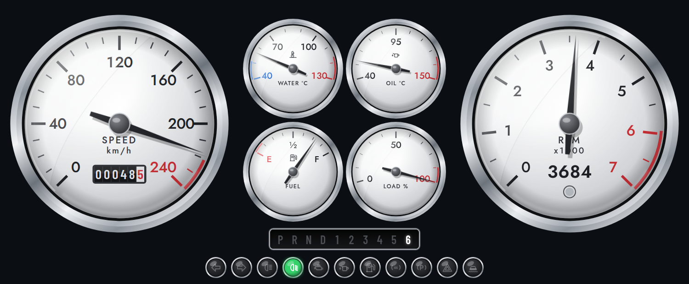
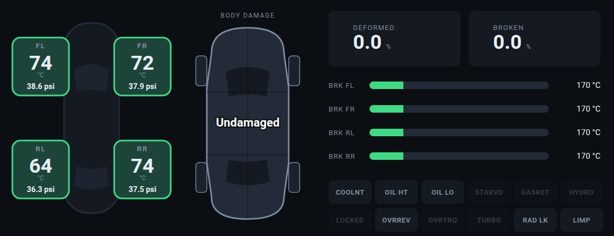
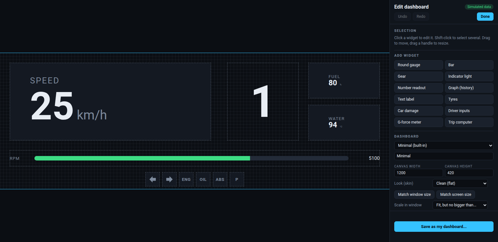
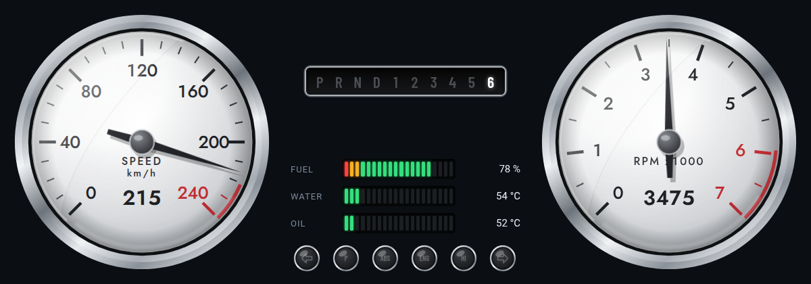

# ThrashDash

**Live gauges for BeamNG.drive in their own window: on a second monitor, a tablet, or your phone.**



ThrashDash shows what your car is doing (speed, revs, temperatures, tyres, damage, controls, fuel and trips) as a dashboard you design yourself. It runs outside the game, in an ordinary browser window with no title bar clutter, so you can drag it to any monitor, resize it freely, open several at once, and show a different dashboard in each.

- **Drag-and-drop editor** built in: move and resize widgets, search every channel the game sends, save, import and export your own dashboards.
- **Twelve widget types**: round gauges, bars, gear, lamps, readouts, history graphs, text, tyres, car damage, driver inputs, a G-force meter and a trip computer.
- **Ten ready-made dashboards**, from a full instrument cluster to a minimal speed-and-gear display, and **four looks** that turn any dashboard into chrome-and-glass instruments.
- **Tyre temperature and pressure, body damage and component states**, with an alert banner when something goes wrong.
- **Two trip meters** (A and B) with fuel or battery economy and range, kept across restarts.
- **Per-vehicle dashboards** that switch by themselves when you change car, and **remembered windows** that reopen as you left them.
- **Phones and tablets**: choose a PIN, switch on network access from the menu, scan a QR code, and the dashboard is on your phone. Nothing is shown to a device that doesn't have the PIN.
- **No build step, no internet, no accounts.** The dashboard is plain JavaScript served from your own computer, and nothing leaves it.

> [!NOTE]
> ThrashDash is at version 0.1.0. It has been developed and tested against BeamNG.drive 0.40.5 on Linux. Windows should work but is untested (see [Known limitations](#known-limitations)).

## Contents

- [How it works](#how-it-works)
- [Requirements](#requirements)
- [Installation](#installation)
- [Quick start](#quick-start)
- [Using ThrashDash](#using-thrashdash)
- [Built-in dashboards](#built-in-dashboards)
- [The editor](#the-editor)
- [Widget reference](#widget-reference)
- [Looks (skins)](#looks-skins)
- [Data: channels and units](#data-channels-and-units)
- [Features in depth](#features-in-depth)
- [Settings and files](#settings-and-files)
- [Command line](#command-line)
- [HTTP and WebSocket API](#http-and-websocket-api)
- [Telemetry protocol](#telemetry-protocol)
- [Development](#development)
- [Security](#security)
- [Troubleshooting](#troubleshooting)
- [Known limitations](#known-limitations)
- [Licence and credits](#licence-and-credits)

## How it works

```
  BeamNG.drive                      this computer                         any browser window
┌───────────────────┐  UDP JSON  ┌───────────────────────────┐  WebSocket ┌────────────────────┐
│  mod (Lua)        │ ─────────▶ │  relay (Python)           │ ─────────▶ │  dashboard (JS)    │
│  reads the car,   │ 127.0.0.1  │  holds the live data,     │  + HTTP    │  draws the widgets │
│  sends 30×/s      │   :4568    │  saves layouts, settings, │  :8765     │  and the editor    │
└───────────────────┘            │  trips and windows        │            └────────────────────┘
                                 └───────────────────────────┘
```

| Part | Where | What it does |
|:---|:---|:---|
| **Mod** | [`mod/`](mod/) | One Lua file that BeamNG loads into every vehicle. When you are sitting in a car it sends that car's data as small JSON packets to `127.0.0.1` only. It reads, never writes. |
| **Relay** | [`relay/`](relay/) | A small Python program. It listens for the mod, keeps the latest values, serves the dashboard and a WebSocket, stores your layouts and settings, counts your trips and remembers your windows. It also opens the dashboard window for you. |
| **Dashboard** | [`web/`](web/) | The front end: plain ES modules, no framework and no build step. Everything it needs is served by the relay. |

Why it is built this way: the game stays untouched apart from one small mod, the dashboard can be any shape and as many windows as you like, and because the relay serves ordinary web pages a phone is just another window.

## Requirements

| | The AppImage | From the source |
|:---|:---|:---|
| **Game** | BeamNG.drive (tested on 0.40.5, native Linux build) | the same |
| **Operating system** | Linux, x86_64, any distribution from about 2022 on. A Windows 10/11 64-bit zip is built from the same code (see Option B below; untested). | Linux, or Windows (untested); anything Python runs on |
| **Python** | Not needed: it is inside the AppImage | 3.10 or newer (developed on 3.13), plus [`aiohttp`](https://docs.aiohttp.org/) 3.9 or newer |
| **Browser** | A Chromium-based browser for the borderless app window: Chrome, Edge, Brave or Chromium. Without one, the dashboard opens in your default browser. | the same (Edge comes with Windows) |
| **Optional** | | Node.js 22+ and LuaJIT, only to run the tests; `fonttools`, `brotli` and `qrcode` (see `requirements-dev.txt`) only for developer tools |

Other browsers can open the dashboard at its address but are untested.

## Installation

There are three ways to get ThrashDash: the single-file **AppImage** for Linux, a **zip for Windows**, or running it **from the source** on any system that has Python. The first two need nothing installed except a browser.

### Option A: the AppImage (Linux)

The AppImage is one file that contains the program, Python and the dashboard. A Chromium-based browser (Chrome, Chromium, Edge or Brave) gives you the borderless dashboard window, and ThrashDash opens it for you.

1. Download `ThrashDash-<version>-x86_64.AppImage` from the project's [Releases page](https://github.com/thrashcardiom/thrashdash/releases). Each release lists the file's SHA-256 checksum; to check your download matches it:

   ```sh
   sha256sum ThrashDash-0.1.0-x86_64.AppImage
   ```

2. Make the file executable (once), then run it:

   ```sh
   chmod +x ThrashDash-0.1.0-x86_64.AppImage
   ./ThrashDash-0.1.0-x86_64.AppImage
   ```

   Or double-click it in your file manager. The dashboard window opens by itself.

3. Install the mod into the game, with one command (the mod is inside the AppImage):

   ```sh
   ./ThrashDash-0.1.0-x86_64.AppImage --install-mod
   ```

   It looks for BeamNG.drive's user folder by itself. If it cannot find it, name the folder: `--install-mod /path/to/BeamNG.drive` (in the game launcher, **Manage User Folder** opens it). It never replaces a link, and it only replaces an earlier *copy* of the mod, never a folder it does not recognise. A copy installed under an earlier name of this program is removed too, otherwise the game would load both and every packet would be sent twice. Then **remove your car and spawn it again** so the game loads the mod.

4. Start the game, get into a car, and the gauges come alive.

Things to know about the AppImage:

- **It quits by itself** when you close the last dashboard window, so there is nothing to stop. (Phones looking at the dashboard do not keep it running.) If no window ever opens, it quits after about a minute and a half rather than running unseen.
- **Messages** go to `thrashdash.log` in [the data folder](#where-things-are-stored) when it is started from a desktop (only the latest run is kept), and to the terminal when started from one.
- **No Chromium-based browser?** ThrashDash opens the dashboard in your default browser instead. It works there too, in an ordinary window rather than a borderless one.
- It needs FUSE to run, like all AppImages. If it will not start, try `./ThrashDash-0.1.0-x86_64.AppImage --appimage-extract-and-run`, or install FUSE 2 (`libfuse2`).
- To update, replace the file and run `--install-mod` again if the release notes say the mod changed.

### Option B: the Windows zip

> [!NOTE]
> The Windows program is built from the same code, but it has not been run on Windows yet. Expect rough edges and please report them.

Download `ThrashDash-<version>-windows-x64.zip` from the project's [Releases page](https://github.com/thrashcardiom/thrashdash/releases) (or build it yourself: [Building the Windows program](#building-the-windows-program)), unzip it anywhere, and open the folder. It uses Microsoft Edge, Chrome or Brave for the dashboard window; Edge comes with Windows.

1. **Install the mod** into the game. In PowerShell or cmd, in the unzipped folder:

   ```bat
   .\thrashdash-cli.exe --install-mod
   ```

   `thrashdash-cli.exe` is the same program with a console window, for commands that print something (`--help`, `--version`, `--install-mod`). It looks for BeamNG.drive's user folder by itself; if it cannot find it, name the folder: `--install-mod "C:\path\to\BeamNG.drive"` (in the game launcher, **Manage User Folder** opens it). Then **remove your car and spawn it again**.
2. **Double-click `thrashdash.exe`.** A dashboard window opens. Closing the last dashboard window quits ThrashDash (add `--keep-running` to stop that). Try it without the game first: `.\thrashdash-cli.exe --simulate`.
3. Start the game and get into a car.

Things to know:

- **Windows SmartScreen** may say "Windows protected your PC" the first time, and some antivirus programs distrust any program made with PyInstaller. The program is not code-signed. Choose *More info, Run anyway*, or check the file against the checksum on the Releases page.
- **Windows Defender Firewall** asks the first time if ThrashDash may accept connections, when you switch on network access for phones. That is Windows' own question, and your decision.
- **Messages** from `thrashdash.exe` (which has no console window) go to `thrashdash.log` in `%LOCALAPPDATA%\ThrashDash`; the same folder holds your dashboards and settings.

### Option C: from the source

The rest of this section is for running from the source code.

#### 1. Get the code

```sh
git clone <this repository> beamng-dash
cd beamng-dash
```

#### 2. Install the mod

BeamNG loads mods from `mods/unpacked/` in its user folder. Put (or link) the [`mod/`](mod/) folder there as `thrashdash`. In the game launcher, **Manage User Folder** opens the user folder.

**Linux** (a symlink works and means updates to the mod are picked up from the repository):

```sh
ln -s "$(pwd)/mod" ~/.local/share/BeamNG/BeamNG.drive/current/mods/unpacked/thrashdash
```

**Windows** (the path is a best guess; use *Manage User Folder* to confirm it, and copy rather than link to avoid needing administrator rights):

```bat
xcopy /E /I mod "%LOCALAPPDATA%\BeamNG\BeamNG.drive\current\mods\unpacked\thrashdash"
```

> [!IMPORTANT]
> A vehicle only loads the mod's code when it is **spawned**. After installing or updating the mod, remove your car and spawn it again. (Ctrl+L in the game reloads the game's own Lua, not the vehicles', so it is not enough.)

To check that it loaded, look in the game's `beamng.log` for a line like:

```
thrashdash: telemetry ready for /vehicles/etkc/ -> 127.0.0.1:4568 @ 30 Hz
```

#### 3. Install the relay

**Linux**

```sh
python3 -m venv .venv
.venv/bin/pip install -r requirements.txt
```

**Windows** (PowerShell or cmd)

```bat
py -m venv .venv
.venv\Scripts\pip install -r requirements.txt
```

## Quick start

Try it without the game first. The simulator drives a fake car through gears, braking, tyre punctures and damage, so every dashboard comes alive:

```sh
./ThrashDash-0.1.0-x86_64.AppImage --simulate                 # the AppImage
.venv/bin/python relay/run.py --simulate                      # from the source (Windows: .venv\Scripts\python relay\run.py --simulate)
```

A dashboard window opens by itself. Then, for real:

1. Install the mod once (see [Installation](#installation)) and spawn your car after installing it.
2. Start BeamNG and load a map.
3. Start ThrashDash: run the AppImage, or from the source `.venv/bin/python relay/run.py`.
4. Get into a car. The window shows **Waiting for BeamNG...** until the first data arrives, then the gauges come alive.

Move the mouse over the window to see the **Dashboards** and **Edit** buttons. Drag the window to another monitor, resize it, and double-click it (or press F11) for fullscreen. With the AppImage, closing the last window quits the program.

## Using ThrashDash

### The window

The dashboard is drawn on a fixed-size canvas that scales to fit the window. By default a dashboard is shown **no bigger than its design size** and centred (so fullscreen does not blow it up); each dashboard can instead *fill the window* or be a *fixed size* (see [Scale](#scale)). Outside the editor, **+** and **-** (or Ctrl+scroll) zoom the window and **0** resets it. The zoom is remembered per dashboard on this computer.

### Keyboard shortcuts

| Key | In the dashboard window |
|:---|:---|
| **D** | Open or close the Dashboards menu |
| **E** | Edit this dashboard (this computer only) |
| **S** | Cycle through the looks |
| **N** | Open a new window the same size as this one (this computer only) |
| **+** / **-** / **0** | Zoom in, zoom out, reset (also Ctrl+scroll) |
| **Double-click** or **F11** | Fullscreen |

| Key | In the Dashboards menu |
|:---|:---|
| **1**–**9** | Show that dashboard |
| **Up** / **Down** | Move through the list |
| **Delete** | Delete the selected saved dashboard (after asking) |
| **Esc** | Close the menu |

### The Dashboards menu

Press **D** or click **Dashboards**. From top to bottom:

- **The list**: Default first, then your own dashboards by name, then the built-in templates A to Z. Click one (or press its number) to load it into this window. A trash button deletes a saved dashboard; built-ins cannot be deleted.
- **Look of this dashboard**: the four [looks](#looks-skins).
- **Vehicle**: which car you are driving, *Use this dashboard for this vehicle*, *Switch automatically when the vehicle changes*, and *Follow the vehicle rules in this window*. See [per-vehicle dashboards](#per-vehicle-dashboards).
- **Phones and other devices**: choose the PIN, switch on network access and get the address and QR code. See [phones and tablets](#phones-and-tablets).
- **Use as default** and **New window** at the foot.


### Several windows

**New window** (the menu button, the editor button, or **N**) opens another window **the same size as the one you are in**, slightly down and to the right, showing the same dashboard with the Dashboards menu already open so you can pick something else. A window you pick a dashboard for is **pinned** to it, which is how you keep different dashboards on different monitors. Windows without a pinned dashboard follow your [vehicle rules](#per-vehicle-dashboards).

ThrashDash also [remembers your windows](#remembered-windows) and reopens them next time it starts.

## Built-in dashboards

These are ordinary dashboards that ship with ThrashDash. They are read-only: use **Save as** in the editor to make your own copy. They are generated by [`tools/make_templates.py`](tools/make_templates.py), and each works in every look.

| Dashboard | What it is for |
|:---|:---|
| **Default** | A plain starter: speed and rpm dials, gear, fuel and temperatures, lamps. |
| **Instrument cluster** | Big speedometer and tachometer, four small gauges, gear strip and warning lamps. |
| **Off-road / truck** | The cluster plus driveline lamps: 4WD, low range, diff locks. |
| **Minimal** | A big speed readout, gear, an rpm bar and a few lamps. |
| **Drift / track** | Big tachometer with shift light, gear digit, speed, throttle and brake bars and a throttle history. |
| **Telemetry (graphs)** | Readouts plus six history graphs. |
| **Phone (portrait)** | Laid out for an upright phone. |
| **Vehicle health** | Tyres, body damage, brake temperatures and engine warning lamps. |
| **Driver inputs and G-force** | Steering wheel, pedals, a G-force meter, speed, gear and rpm. |
| **Trip computer** | Trips A and B with speed, gear, fuel and temperature. |

| | |
|:---|:---|
|  |  |
|  |  |

## The editor

Press **E** (or click **Edit**) to edit in place; the gauges keep running on live data.



**Working on the canvas**

- Click a widget to select it; **Shift-click** to select several.
- **Drag** to move (hold **Alt** to skip snapping). Drag a **handle** to resize (hold **Shift** to keep the shape).
- **Arrow keys** nudge by 1 px (**Shift** = 10 px).
- Copy, paste and duplicate with **Ctrl+C**, **Ctrl+V**, **Ctrl+D**; **Delete** removes. **[** and **]** send a widget backward or forward.
- **Ctrl+Z** and **Ctrl+Y** undo and redo, **Ctrl+S** saves, **Esc** cancels a drag or deselects, **E** or **Done** leaves.

**The right-hand panel**

| Section | What is in it |
|:---|:---|
| **Selection** | The selected widget's properties. Channel properties open the **channel picker**: search every channel the game is sending, with its live value. You can also type a channel name that is not in the current data. |
| **Add widget** | One button per [widget type](#widget-reference). |
| **Dashboard** | Choose, rename, save, save as, create, delete, import, export a dashboard; canvas size, **Look (skin)**, **Match window size** and **Match screen size**, and **Scale in window**. |
| **Display** | Units and snap-to-grid. |
| **Vehicle dashboards** | Every per-vehicle rule, with a button to remove it. |
| **Windows** | Whether to [reopen your windows](#remembered-windows) at startup, and exact placement. |
| **Alerts** | Which [alerts](#alerts) you want. |

The built-in **Default** is read-only; saving it creates your own copy. A dashboard with unsaved changes asks before you leave or switch.

### Scale

Each dashboard has a **Scale in window** setting:

| Mode | Behaviour |
|:---|:---|
| **Fit, but no bigger than N%** (default, 100%) | Shrinks to fit a small window, never grows beyond N% of its design size. Fullscreen stays at design size and is centred. |
| **Always fill the window** | A bigger window means bigger gauges. |
| **Fixed size** | Always N%. |

To use a whole monitor, press **Match screen size** (or **Match window size**) to set the canvas to that resolution, then place the gauges at the size you want. Editing always shows the whole canvas.

### Saving, importing and exporting

Your dashboards are plain JSON files (see [the layout format](#the-layout-format)). **Export** downloads one; **Import** reads one. Imported files are checked twice, once by the relay for structure and size and once by the page for meaning (widget types, value ranges, colours), so a file from a stranger cannot inject anything into the page.

## Widget reference

Every widget has a position and size (`x`, `y`, `w`, `h`, in canvas pixels) plus the properties below. A property marked *look only* appears in the editor only when a [look](#looks-skins) is active; *flat only* only in the original flat look.

Property types: **channel** is a channel name; **number or per-unit** is a number or an object keyed by unit (for example `{"kmh": 240, "mph": 150}`), so one dashboard works in both unit systems; **unit type** chooses how a value is converted (see [units](#units)).

### Round gauge

A dial with a needle, tick scale, optional red zone and the value. In a look it becomes a real instrument. Layout type: `roundGauge`. Default size 300 × 300.

| Property | Type | What it does | Values |
|:---|:---|:---|:---|
| `channel` | channel | Channel |  |
| `kind` | unit type | Unit type | `none`, `speed`, `temp`, `distance`, `pressure`, `fraction` |
| `label` | text | Title |  |
| `showUnit` | text | Unit text |  |
| `decimals` | number | Decimals | 0 to 4 |
| `min` | number or per-unit | Scale minimum |  |
| `max` | number or per-unit | Scale maximum |  |
| `maxChannel` | channel | Scale max from channel |  |
| `maxRound` | number | Round scale up to | 1 to 100000 |
| `majorStep` | number or per-unit | Major tick every |  |
| `minorDiv` | number | Minor ticks per major | 1 to 10 |
| `labelDiv` | number | Divide tick labels by | 0.001 to 100000 |
| `redFrom` | number | Red zone from (0-1) | 0 to 1 |
| `startAngle` | number | Sweep start (deg) (look only) | -180 to 180 |
| `endAngle` | number | Sweep end (deg) (look only) | -180 to 180 |
| `labels` | list of text | Labels (comma separated) (look only) |  |
| `icon` | choice | Face icon (look only) | (none), `fuel`, `temp`, `battery`, `oil`, `engine`, `highbeam`, `lowbeam`, `hazard`, `esc`, `parking`, `brake`, `abs`, `left`, `right` |
| `amberFrom` | number | Amber zone from (0-1) (look only) | 0 to 1 |
| `coldTo` | number | Blue zone up to (0-1) (look only) | 0 to 1 |
| `lowTo` | number | Red low zone up to (0-1) (look only) | 0 to 1 |
| `sub` | choice | Display window (look only) | (none), `odometer`, `lcd` |
| `subChannel` | channel | Window channel (look only) |  |
| `subKind` | unit type | Window unit type (look only) | `none`, `speed`, `temp`, `distance`, `pressure`, `fraction` |
| `subLabel` | text | Window caption (look only) |  |
| `shiftFrom` | number | Shift light from (0-1) (look only) | 0 to 1 |
| `compact` | on/off | Compact (small dial) (look only) |  |
| `showValue` | on/off | Show the value on the face (look only) |  |

### Bar

A horizontal bar (LED segments in a look) with amber and red thresholds. A "low is bad" bar suits fuel. Layout type: `bar`. Default size 340 × 30.

| Property | Type | What it does | Values |
|:---|:---|:---|:---|
| `channel` | channel | Channel |  |
| `kind` | unit type | Unit type | `none`, `speed`, `temp`, `distance`, `pressure`, `fraction` |
| `label` | text | Title |  |
| `decimals` | number | Decimals | 0 to 4 |
| `min` | number or per-unit | Scale minimum |  |
| `max` | number or per-unit | Scale maximum |  |
| `warnFrom` | number or per-unit | Amber at |  |
| `critFrom` | number or per-unit | Red at |  |
| `invert` | on/off | Low is bad (amber/red below) |  |
| `maxChannel` | channel | Scale max from channel |  |
| `maxRound` | number | Round scale up to | 1 to 100000 |
| `segments` | number | LED segments (look only) | 6 to 60 |

### Gear

The current gear. In a look, a P R N D / 1-6 strip or a 7-segment digit. Layout type: `gear`. Default size 300 × 190.

| Property | Type | What it does | Values |
|:---|:---|:---|:---|
| `channel` | channel | Channel |  |
| `label` | text | Caption (flat only) |  |
| `style` | choice | Display (look only) | `strip`, `digit` |
| `letters` | list of text | Strip letters (comma separated) (look only) |  |

### Indicator light

A lamp that lights when its channel is on. It can watch several channels at once. Layout type: `light`. Default size 48 × 40.

| Property | Type | What it does | Values |
|:---|:---|:---|:---|
| `channel` | channel | Channel |  |
| `channels` | list of channels | Any of these channels |  |
| `text` | text | Text |  |
| `arrow` | choice | Arrow | (none), `left`, `right` |
| `color` | colour | Colour when on (flat only) |  |
| `icon` | choice | Symbol (look only) | (none), `fuel`, `temp`, `battery`, `oil`, `engine`, `highbeam`, `lowbeam`, `hazard`, `esc`, `parking`, `brake`, `abs`, `left`, `right` |
| `lampColor` | choice | Lamp colour (look only) | `red`, `amber`, `green`, `blue` |

### Number readout

A number with its unit. Layout type: `readout`. Default size 180 × 90.

| Property | Type | What it does | Values |
|:---|:---|:---|:---|
| `channel` | channel | Channel |  |
| `kind` | unit type | Unit type | `none`, `speed`, `temp`, `distance`, `pressure`, `fraction` |
| `label` | text | Title |  |
| `showUnit` | text | Unit text |  |
| `decimals` | number | Decimals | 0 to 4 |
| `color` | colour | Value colour (flat only) |  |
| `digits` | number | Digits (look only) | 3 to 10 |

### Graph (history)

A line graph of one channel over a history window you choose (5 to 120 seconds). Layout type: `graph`. Default size 360 × 140.

| Property | Type | What it does | Values |
|:---|:---|:---|:---|
| `channel` | channel | Channel |  |
| `kind` | unit type | Unit type | `none`, `speed`, `temp`, `distance`, `pressure`, `fraction` |
| `label` | text | Title |  |
| `min` | number or per-unit | Scale minimum |  |
| `max` | number or per-unit | Scale maximum |  |
| `seconds` | number | History (seconds) | 5 to 120 |
| `decimals` | number | Decimals | 0 to 4 |
| `color` | colour | Line colour |  |

### Text label

A fixed text label. Layout type: `text`. Default size 200 × 40.

| Property | Type | What it does | Values |
|:---|:---|:---|:---|
| `text` | text | Text |  |
| `fontSize` | number | Size (px) | 8 to 300 |
| `align` | choice | Align | `left`, `center`, `right` |
| `bold` | on/off | Bold |  |
| `color` | colour | Colour |  |

### Tyres

A top-down car with a card per wheel: temperature, pressure and a flat marker. Layout type: `tyres`. Default size 230 × 290.

| Property | Type | What it does | Values |
|:---|:---|:---|:---|
| `source` | choice | Temperature of | `temp`, `coreTemp` |
| `showPressure` | on/off | Show pressure |  |
| `coldBelow` | number or per-unit | Cold below |  |
| `warnFrom` | number or per-unit | Hot from |  |
| `critFrom` | number or per-unit | Too hot from |  |
| `lowPressure` | number or per-unit | Low pressure below |  |
| `wheels` | list of text | Wheel names FL, FR, RL, RR |  |

### Car damage

A top-down body coloured by damage per zone, with a one-word summary (see [Tyres, damage and component states](#tyres-damage-and-component-states)). Layout type: `damage`. Default size 200 × 300.

| Property | Type | What it does | Values |
|:---|:---|:---|:---|
| `label` | text | Title |  |
| `showPercent` | on/off | Show the damage summary (e.g. Wrecked) |  |
| `wreckedFrom` | number | Wrecked from (% of beams broken) | 2 to 100 |
| `showTyres` | on/off | Mark flat tyres |  |
| `critFrom` | number | Fully red at (0-1) | 0.05 to 1 |

### Driver inputs

A steering wheel that turns, plus brake, throttle and optional clutch bars. Layout type: `inputs`. Default size 300 × 150.

| Property | Type | What it does | Values |
|:---|:---|:---|:---|
| `label` | text | Title |  |
| `showWheel` | on/off | Show the steering wheel |  |
| `showClutch` | on/off | Show the clutch (manual cars) |  |
| `wheelLock` | number | Wheel turns at full lock (degrees) | 30 to 900 |
| `flipSteering` | on/off | Reverse the steering direction |  |

### G-force meter

A dot that moves with the force on the car, with a trail and a held peak. Layout type: `gmeter`. Default size 240 × 270.

| Property | Type | What it does | Values |
|:---|:---|:---|:---|
| `label` | text | Title |  |
| `range` | number | Outer ring (g) | 0.5 to 6 |
| `showTrail` | on/off | Fading trail |  |
| `flipLateral` | on/off | Reverse left and right |  |
| `flipLongitudinal` | on/off | Reverse up and down |  |

### Trip computer

One of the two trip meters (see [Trip computer](#trip-computer)). Layout type: `trip`. Default size 300 × 340.

| Property | Type | What it does | Values |
|:---|:---|:---|:---|
| `trip` | choice | Which trip | `A`, `B` |
| `label` | text | Title |  |
| `showFuel` | on/off | Show fuel / energy used and economy |  |
| `showRange` | on/off | Show range left |  |


## Looks (skins)

A **look** changes how the open dashboard *looks*: its widgets are redrawn as real instruments, in place. The layout (which widgets, where, on which channels) is untouched, and a look is never a dashboard of its own.

| Look | Description |
|:---|:---|
| **Clean (flat)** | The original flat look. |
| **Classic - white** | White-faced dials with chrome bezels, glass, a mechanical odometer and jewel lamps. |
| **Classic - black** | The same in black. |
| **Backlit** | A frosted face with a blue glow, red needles and LCD displays. |

| Classic - white | Classic - black | Backlit |
|:---|:---|:---|
|  |  |  |

Change the look from the Dashboards menu, by pressing **S**, or in the editor. It is kept **per dashboard** by the relay (like units), so it works for the read-only Default too, survives restarts and applies in every window showing that dashboard. It is not stored in the dashboard file: changing it never makes a dashboard "unsaved", **Undo** does not touch it, and exported dashboards carry no look (whoever imports one picks their own). **Save as** gives the copy the look the original had, and deleting a dashboard forgets its look. A phone chooses its own look, kept on that phone only.

With a look active, extra properties appear: dial sweep angles, custom labels (for example `E, ½, F`), a face icon, blue/amber/red zones, an odometer or LCD window, a shift light, a compact mode for small dials, LED segment bars, a P R N D / 1-6 gear strip or 7-segment digit, and lamp symbols and colours.

`/skin-preview.html` on the running relay shows every widget in every look, driven by simulated data.

## Data: channels and units

A **channel** is one named value from the game: `rpm`, `wheelspeed`, `tire.FL.temp`. Every widget reads one or more channels. The **channel picker** lists the ones the current car sends, with friendly names and live values. Different cars send different channels (a typical car sends 130 to 210), so a dashboard should tolerate missing ones: a widget whose channel is missing simply shows `--`.

### Where channels come from

| Source | Rate | Channels | Examples |
|:---|:---|:---|:---|
| **Electrics** | 30 per second | The car's own electrics table, flattened with dots | `rpm`, `wheelspeed`, `gear`, `fuel`, `watertemp`, `throttle_input`, `steering_input`, `accXSmooth`, `wheelThermals.FL.brakeSurfaceTemperature` |
| **Tyres** | 4 per second | `tire.<wheel>.<field>` for each wheel (FL, FR, RL, RR, and more on trucks) | `tire.FL.temp`, `.coreTemp`, `.pressure`, `.deflated`, `.punctured`, `.load`, `.slip` |
| **Damage** | 4 per second | `damage.*` | `damage.total`, `damage.brokenPct`, `damage.deformedPct`, `damage.beamsTotal`, `damage.zone.FL` (FL, FR, ML, MR, RL, RR) |
| **Component states** | 4 per second | `state.<group>.<name>`, what the game's damage tracker reports (only those the current car has) | `state.engine.oilOverheating`, `state.engine.coolantOverheating` |
| **Energy kind** | 4 per second | `energy.electric`, `energy.liquid` | whether the car has a battery, a fuel tank, or both |
| **Trip computer** | every frame | `trip.A.*`, `trip.B.*` and `trip.energyKind`, kept by the relay | `trip.A.distance`, `trip.B.consumption`, `trip.A.range` |

Channels carry numbers, booleans or short text. Lists and other structures are skipped, and `NaN` or infinity are dropped.

### Units

Conversion happens in the dashboard: the game reports SI-ish values and each person picks what they want to see. A widget names a **unit type**; your choice for that type does the conversion. Choose units in the editor under **Display**, or override them for one window with the address, for example `?speed=mph&temp=f`.

| Unit type | Game value | You can show |
|:---|:---|:---|
| `speed` | metres per second | km/h, mph |
| `temp` | degrees Celsius | °C, °F |
| `distance` | metres | km, mi |
| `pressure` | gauge kPa | kPa, psi, bar |
| `fraction` | 0 to 1 | % |
| `none` | as is | (no conversion) |
| *Fuel economy* | litres or kWh per 100 km | follow distance unit, L/100 km, km/L, mpg (US), mpg (UK) (used by the trip computer) |

Facts about the game's data that ThrashDash handles for you, found by measuring a real game:

- Tyre temperatures are in **kelvin**; the mod subtracts 273.15 and sends °C.
- Tyre pressure is **absolute** pascals; the mod sends gauge kPa (a 30 psi tyre reads 206.8 kPa).
- Damage numbers are small: the game divides broken and deformed beams by *all* the beams in a zone. A completely wrecked car read about 12% in its worst zone, and 23.6% of beams broken.
- The acceleration channels are the car's own acceleration in the game's frame, where +x is the car's **left** and +y its **rear**. `accYSmooth` is positive when braking; `accXSmooth` is negative in a right-hand corner; `steering_input` is positive for a right turn.

## Features in depth

### Alerts

A banner across every dashboard (also on phones) when the game reports a problem. Alerts show at once and linger for a couple of seconds after the condition clears, so a flickering flag does not make the banner blink. Switching an alert off clears it immediately. Most follow the game's own flags rather than a threshold of ours. It is banner only: no sound.

| Alert | Level | When |
|:---|:---|:---|
| Flat tyre | Critical (red, pulsing) | A tyre is flat (names the wheels). |
| Engine overheating | Critical (red, pulsing) | The game reports the engine coolant overheating. |
| Oil overheating | Critical (red, pulsing) | The game reports the oil overheating. |
| Low oil | Critical (red, pulsing) | Oil level critical, or the engine starved of oil. |
| Engine damaged | Critical (red, pulsing) | Head gasket damaged, engine hydrolocked, or engine locked up. |
| Body damage (heavy or wrecked) | Warning (amber) | Body damage Heavy (warning) or Wrecked (critical). |
| Low fuel | Warning (amber) | The game's low-fuel warning. |
| Low tyre pressure | Warning (amber) | The game's low tyre pressure warning (not shown on top of a flat). |
| Brakes overheating | Warning (amber) | The game's brake-overheating flag. |
| Over-revving | Warning (amber) | The game reports an over-rev danger. |

Switch them on or off, all or one by one, in the editor under **Alerts**. It is a display setting kept by the relay, like units.


### Tyres, damage and component states

The mod sends a "slow" packet four times a second with tyre, damage and component-state data (see [the protocol](#telemetry-protocol)). Each is a complete snapshot: a section that is missing means "none right now", so repairing a car clears its warnings, and changing vehicle clears the old car's data.

- **Tyres** widget: a top-down car with a card per wheel showing temperature (surface or core), pressure and a flat marker. Temperature bands and the low-pressure level are editable.
- **Car damage** widget: a top-down body that turns from green to red per zone. Its centre prints one word and a figure from the share of beams broken: *Undamaged*, *Light* (a car that is only dented, for example 0% broken but 5.7% deformed, counts here), *Moderate*, *Heavy* or *Wrecked* (from 15% broken by default; Heavy and Moderate scale with it). The zones are fully red at 15% damage by default, because zone numbers stay small.

### Driver inputs and the G-force meter

**Driver inputs** shows what the controls are doing: a steering wheel that turns (`steering_input`) and brake and throttle bars, plus a clutch bar for manual cars. **G-force meter** is a dot that moves with the force on you, like a ball hanging in the car: braking moves it up, accelerating down, and a right-hand corner to the left. It has a fading trail and a held peak. Both have properties to reverse the direction.

### Trip computer

Two trip meters, **A** and **B**, like a car has. Each counts distance, time, average and top speed, fuel (or battery) used, economy and the range left, until you reset it. The **Trip computer** widget shows one (choose A or B in its properties); the **Trip computer** template shows both.


- **Kept by the relay**, not the page: every window and phone agrees, closing the dashboard loses nothing, and the trips are saved to `trips.json`, so they survive restarting ThrashDash.
- **Resetting** needs two presses on the widget's *Reset* button ("Sure?" first), and the button appears only on the computer running ThrashDash, so a phone can look but not reset.
- **Distance** is the car's speed added up over the time between frames, as the game's own trip app does. A gap of more than a second (paused, a menu, a loading screen) counts as nothing.
- **Fuel or energy used** comes from the game's `fuelVolume`, which is litres for a tank but kWh for a battery. The mod tells the relay which kind the car has. Refuelling, respawning and repairing are not counted as use (a jump of more than 5% of the tank in one step is ignored). A battery counts net use, so regenerative braking gives energy back. A hybrid mixes both, so only the percentage of the tank or battery used is shown. Litres and kWh are never added together, so a trip that spans a petrol car and an electric one keeps both.
- **Economy and range** need about half a kilometre of driving first. Range is what is left at that trip's average consumption.
- **Units**: *Fuel economy* under the editor's **Display** section. *Follow distance unit* (the default) gives L/100 km with kilometres and mpg (US) with miles; or choose L/100 km, km/L, mpg (US) or mpg (UK). An electric car shows kWh/100 km, km/kWh or mi/kWh instead.
- The trip numbers are also channels (`trip.A.distance`, `trip.B.consumption`, and so on) you can put on any gauge or readout; the picker lists them under **Trip computer**.

### Per-vehicle dashboards

In the Dashboards menu, under **Vehicle**, **Use this dashboard for &lt;vehicle&gt;** remembers which dashboard goes with the car you are driving (the vehicle is the model folder from the game, for example `etkc`). A window that has not been pinned to one dashboard then switches by itself when you change vehicle: to the vehicle's dashboard if it has one, otherwise to the default. A window you pinned (by choosing a dashboard from the menu, or opening it with **New window**) stays on it; **Follow the vehicle rules in this window** hands it back. **Switch automatically when the vehicle changes** turns the whole feature off, and the editor's **Vehicle dashboards** section lists every rule.

To try it without the game: `python relay/run.py --sim-vehicles etkc,midtruck --sim-vehicle-seconds 10`.

### Phones and tablets

Open the Dashboards menu and find **Phones and other devices**.

1. **Choose a PIN** (4 to 8 digits) and press **Save PIN**. Network access cannot be switched on without one.
2. Tick **Serve to devices on my network**. It takes effect at once (no restart) and is remembered. The menu then shows the address, for example `http://192.168.1.20:8765/?d=minimal`, and a **QR code**.
3. On the phone, **scan the QR code** with its camera: it signs in at once, with no typing, and opens the dashboard you have open. Or type the address into the phone's browser: it asks for the PIN.

A phone stays signed in for **30 days**, so the PIN is asked once per phone. The QR code carries a sign-in token that works **once and for about 5 minutes**: it is a fresh one each time you open the menu, so for a second phone close and reopen the menu. Saving a new PIN (even the same one) signs every phone out at once. A device that gets the PIN wrong five times in a row is made to wait, and the wait doubles with each further miss.

- The phone and the computer must be on the same network. Guest networks that isolate devices, and some routers' "AP isolation", block this.
- **Firewall:** ThrashDash only opens its own port (8765 unless you changed it). It does not read or change any firewall setting. If a phone shows "unable to connect" while the address is right, the computer's firewall is most likely not letting other devices reach that port, and whether to allow it is a decision for whoever administers the computer. Some systems, such as Windows, ask the first time a program starts listening.
- A phone can **look but not touch**: no Edit button, no deleting, no vehicle rules, no default, no resetting trips, no opening windows. It can choose which dashboard to show and its own look, remembered on that phone only. A phone cannot read or change the PIN. Switch network access off on networks you do not trust.
- **What the PIN does and does not do.** ThrashDash speaks plain http on your network, so the PIN and the sign-in cookie are not encrypted in transit. The PIN keeps out anyone who merely finds the address; it does not stop someone who can watch the network's traffic. The PIN is kept in `auth.json` in [the data folder](#where-things-are-stored), readable only by your user.
- The built-in **Phone (portrait)** dashboard is laid out for an upright phone; the others suit a phone held sideways. On an iPhone, *Share, Add to Home Screen* gives a full-screen app. Phones may dim their screen, and browsers only allow keeping it awake on secure (https) pages, so set the phone's auto-lock to a longer time while driving.
- If you forget the PIN, open the Dashboards menu on the computer: it is shown in the PIN box, and you can change it there.
- To try the phone view without a phone: start with `--simulate --lan`, choose a PIN in the menu on this computer, and open the printed address in another browser. Network access stays off until a PIN has been chosen.

### Remembered windows

ThrashDash remembers which dashboard windows are open on this computer (which dashboard, how big, and whether fullscreen) and opens them again the next time it starts.

- Every window reports itself to the relay when it opens, when it changes (a different dashboard, resized, moved, fullscreen) and every ten seconds. A window you close is forgotten. A window that simply disappears (a crash, or the relay stopped first) is remembered, so what comes back is what was open when ThrashDash last ran.
- The list is kept in `windows.json` in [the data folder](#where-things-are-stored). Phones and tablets are never part of it. If nothing is remembered, ThrashDash opens its one default window.
- If you only restart ThrashDash while its windows stay open, they reconnect by themselves and are **not** opened twice: after a start the relay waits a moment for them, then opens only the ones that did not come back. (`--no-window` skips all of this.)
- Switch it off with **Reopen my windows when ThrashDash starts** in the editor, under **Windows**.

**Positions.** Size, dashboard and fullscreen are always restored. *Where* a window goes is another matter. Under Linux with **Wayland** a program cannot place its own windows, or even read where they are, so the desktop decides. Tick **Place windows exactly** (editor, **Windows**) to start the dashboard windows in X11 compatibility mode (`--ozone-platform=x11`), where positions are saved and restored. It is off by default because XWayland can look softer on scaled displays. It is a property of the browser process, so it takes effect when the dashboard windows are started from nothing, after every one has been closed. On Windows positions are always restored. Your desktop's own window rules can also remember positions, outside ThrashDash.

## Settings and files

### Where things are stored

| | Linux | Windows |
|:---|:---|:---|
| **Data folder** | `~/.local/share/thrashdash/` (or `$XDG_DATA_HOME/thrashdash/`) | `%LOCALAPPDATA%\ThrashDash\` |

Inside the data folder:

| Path | Contents |
|:---|:---|
| `layouts/u-<12 hex>.json` | Your own dashboards |
| `settings.json` | Settings (below) |
| `trips.json` | Trips A and B |
| `windows.json` | The remembered windows |
| `auth.json` | The PIN for devices on the network, and the secret that signs their sign-in cookies (readable only by your user) |
| `thrashdash.log` | The program's messages (AppImage only, when started from a desktop; the latest run) |
| `window-profiles/main/` | The dashboard windows' browser profile (so ThrashDash never touches your everyday browser) |

The built-in dashboards live in [`web/layouts/`](web/layouts/) and are never modified.

If a data folder from an earlier name of this program exists and this one does not, your saved dashboards, settings, trips and windows are **copied** across the first time it runs (the old folder is left as it was, as a backup).

### Settings

`settings.json` is managed through the editor and the menu; you rarely need to touch it. The relay validates everything and ignores unknown keys.

| Key | Default | Meaning |
|:---|:---|:---|
| `units.speed` | `kmh` | `kmh` or `mph` |
| `units.temp` | `c` | `c` or `f` |
| `units.distance` | `km` | `km` or `mi` |
| `units.pressure` | `psi` | `kpa`, `psi` or `bar` |
| `units.economy` | `auto` | `auto` (follow `distance`), `l100`, `kmpl`, `mpgus`, `mpguk` |
| `defaultLayout` | `default` | The dashboard a window shows when nothing else applies |
| `skins` | `{}` | Dashboard id to look, for dashboards that are not flat |
| `vehicleDashboards` | `{}` | Vehicle (model folder) to dashboard id |
| `autoSwitch` | `true` | Windows that are not pinned follow the vehicle rules |
| `lan` | `false` | Serve to other devices on the network |
| `alerts` | `{"enabled": true, "off": []}` | The alert switch and the ids of alerts switched off |
| `restoreWindows` | `true` | Reopen the remembered windows at startup |
| `exactWindowPlacement` | `false` | Start dashboard windows in X11 mode so positions can be restored |

### The layout format

A dashboard is a small JSON file. The relay validates it on every write (structure and size) and the page validates it again when it loads it (meaning), and unknown keys are dropped.

```json
{
  "format": 1,
  "name": "Default",
  "width": 1200,
  "height": 420,
  "scaleMode": "max",
  "scalePercent": 100,
  "widgets": [
    {
      "id": "roundGauge-1", "type": "roundGauge",
      "x": 20, "y": 20, "w": 380, "h": 380,
      "channel": "wheelspeed", "kind": "speed", "label": "SPEED",
      "min": 0, "max": { "kmh": 240, "mph": 150 },
      "majorStep": { "kmh": 40, "mph": 20 }, "minorDiv": 4, "redFrom": 0.92
    }
  ]
}
```

| Field | Meaning |
|:---|:---|
| `format` | Always `1` for this version. A newer format is refused with a clear message. |
| `name` | Up to 60 characters. |
| `width`, `height` | Canvas size in pixels: 200 to 4000 wide, 100 to 4000 high. |
| `scaleMode` | `max` (default): fill the window but never go beyond `scalePercent`; `fit`: always fill the window; `fixed`: exactly `scalePercent`. |
| `scalePercent` | 10 to 400. |
| `widgets` | Up to 200. Each has a unique `id` (letters, digits, `-`, `_`), a `type`, `x`, `y`, `w`, `h` and the properties from the [widget reference](#widget-reference). |

A look is deliberately not part of this file. Limits: 100 saved dashboards, and write requests are capped at 256 KB.

## Command line

The AppImage and the source take the same options:

```sh
./ThrashDash-0.1.0-x86_64.AppImage [options]                  # the AppImage
.venv/bin/python relay/run.py [options]                       # from the source (Windows: .venv\Scripts\python relay\run.py)
```

The AppImage always adds `--quit-when-windows-close` for you, and prints `--version`, `--help` and `--install-mod` to wherever you ran it.

| Option | Meaning |
|:---|:---|
| `--simulate` | Use fake telemetry instead of listening for the game. Fake trips and windows are not saved. |
| `--sim-vehicles A,B` | With `--simulate`: simulated vehicles that take turns, to try per-vehicle dashboards (implies `--simulate`). |
| `--sim-vehicle-seconds N` | Seconds per simulated vehicle (default 15). |
| `--http-port PORT` | Dashboard port (default 8765). |
| `--udp-port PORT` | Port the mod sends to (default 4568). It must match `PORT` in the mod. |
| `--no-window` | Do not open the dashboard window (and do not restore windows). |
| `--browser PATH` | Chromium-based browser to use for the window. |
| `--lan` | Serve to other devices on your network from the start (it can also be switched on from the menu). It needs a PIN: if none has been chosen yet it stays off until you choose one in the menu. |
| `--keep-running` | Packaged programs (the AppImage and the Windows exe) quit when the last dashboard window closes; this keeps them running until they are stopped. |
| `--quit-when-windows-close` | End ThrashDash a moment after the last dashboard window on this computer is closed (the AppImage uses this). With `--no-window` it only applies once a window has been opened. |
| `--install-mod [PATH]` | Copy the BeamNG mod into the game's `mods/unpacked` folder and exit. `PATH` is the game's user folder if it cannot be found by itself. |
| `--version` | Print the version. |

## HTTP and WebSocket API

The relay serves the dashboard and a small JSON API on `http://127.0.0.1:8765`. The dashboard uses nothing else, and you can script against it.

**Writes** (`PUT`, `POST`, `DELETE`) must carry the header `X-ThrashDash: 1` and come from this computer; anything else is refused with 403. A device on the network (not this computer) must first have signed in with the PIN: until it has, every request except the PIN page and sign-in itself is refused with 401, and a browser is sent to the PIN page. See [Security](#security).

| Method and path | Purpose |
|:---|:---|
| `GET /` | The dashboard page. Static files are served from [`web/`](web/). |
| `GET /api/status` | Connection state, vehicle, channel count, version and counters. |
| `GET /ws` | WebSocket: live data (below). |
| `GET /api/layouts` | List dashboards: `id`, `name`, `builtin`, `width`, `height`, `modified`. |
| `GET /api/layouts/{id}` | One dashboard: `{id, builtin, layout}`. |
| `POST /api/layouts` | Create a dashboard from a layout; returns its new id. |
| `PUT /api/layouts/{id}` | Replace one of your dashboards. Built-ins are read-only (403). |
| `DELETE /api/layouts/{id}` | Delete one of yours, and forget its look, vehicle rules and default status. |
| `GET /api/settings` | All [settings](#settings). |
| `PUT /api/settings` | Change some settings (a partial object; unknown keys ignored). Switching `lan` takes effect immediately. |
| `GET /api/client` | What the asking device may do: `{local, pinSet, lan: {enabled, urls}}`. |
| `GET /api/lan/pin` | The PIN, for this computer's menu only: `{set, pin}`. |
| `PUT /api/lan/pin` | Choose the PIN (`{"pin": "4821"}`, 4 to 8 digits). Signs every phone out. This computer only. |
| `POST /api/lan/token` | A single-use sign-in token for the QR code (`{token, expiresIn}`). This computer only. |
| `POST /api/pin/login` | A device on the network signs in (`{"pin": "4821"}`); the answer sets the sign-in cookie. Wrong guesses are slowed down (429 with `Retry-After`). |
| `POST /api/trips/{A\|B}/reset` | Reset a trip. |
| `GET /api/windows` | The remembered windows and which are open now. |
| `PUT /api/windows/{id}` | A window reports itself (used by the dashboard). |
| `DELETE /api/windows/{id}?t=<ms>` | A window was closed (used by the dashboard). |

### WebSocket messages

All messages are JSON text. The relay sends:

| `type` | Fields | When |
|:---|:---|:---|
| `hello` | `relay` (version), `protocol` | Once, first. |
| `status` | `connected`, `vehicle`, `simulated` | On connect and whenever it changes. `connected` is false after two seconds with no data. |
| `catalog` | `vehicle`, `channels` (name to `number`, `boolean` or `string`) | On connect and whenever the set of channels or the vehicle changes. |
| `frame` | `seq`, `d` (channel name to current value) | Whenever there is new data, up to 30 times a second. Includes the electrics, tyres, damage, states and trip channels together. |

Anything the page sends over the WebSocket is ignored: changes go through the REST API.

## Telemetry protocol

The mod sends JSON datagrams over UDP to `127.0.0.1:4568`, only for the vehicle you are sitting in. Every packet carries `"v": 1` (the protocol version) and the vehicle path. The relay ignores anything with another version and anything malformed, and bounds the number and depth of channels and the length of text, so a bad packet cannot make it allocate without limit.

| Packet | Rate | Contents |
|:---|:---|:---|
| `catalog` | every 2 s | `channels`: the top-level electrics names and their types |
| `frame` | 30 per second | `n` (a counter) and `electrics`: the car's whole electrics table |
| `slow` | 4 per second | `tire`, `damage`, `state` and `energy`, each a complete snapshot |

```json
{"v":1,"type":"frame","n":1234,"vehicle":"/vehicles/etkc/",
 "electrics":{"rpm":3120.4,"wheelspeed":27.8,"gear":"D","watertemp":88.1,"wheelThermals":{"FL":{"brakeSurfaceTemperature":212.0}}}}
```

```json
{"v":1,"type":"slow","vehicle":"/vehicles/etkc/",
 "tire":{"FL":{"temp":64.2,"coreTemp":71.0,"pressure":206.8,"deflated":false,"punctured":false,"load":3600,"slip":0.12}},
 "damage":{"total":311295,"brokenPct":23.6,"deformedPct":31.0,"beamsTotal":4978,"beamsBroken":1177,"beamsDeformed":1543,
           "zone":{"FL":0.12,"FR":0.03,"ML":0.01,"MR":0.0,"RL":0.0,"RR":0.02}},
 "state":{"engine":{"oilOverheating":true}},
 "energy":{"electric":false,"liquid":true}}
```

The relay flattens nested tables into dotted channel names (`wheelThermals.FL.brakeSurfaceTemperature`, `tire.FL.temp`, `damage.zone.FL`). An empty Lua table is encoded as `[]`, which the relay treats as "empty". The mod reads game state defensively: a missing game API loses one section, never the whole stream, and it disables itself after repeated errors rather than flooding the game log.

## Development

### Code map

| Path | What |
|:---|:---|
| [`mod/lua/vehicle/extensions/auto/thrashdash_telemetry.lua`](mod/lua/vehicle/extensions/auto/thrashdash_telemetry.lua) | The mod: collects electrics, tyres, damage, states and energy kind, and sends the packets. |
| [`relay/thrashdash/hub.py`](relay/thrashdash/hub.py) | Where "what the car is doing now" lives; merges electrics, slow data and trips into channels. |
| [`relay/thrashdash/udp.py`](relay/thrashdash/udp.py), [`simulator.py`](relay/thrashdash/simulator.py) | Data sources: the real mod, and a simulated drive through the same code path. |
| [`relay/thrashdash/server.py`](relay/thrashdash/server.py), [`api.py`](relay/thrashdash/api.py) | The web server, WebSocket and REST API, and the request guard. |
| [`relay/thrashdash/store.py`](relay/thrashdash/store.py), [`validate.py`](relay/thrashdash/validate.py) | Layout and settings storage, and structural validation. |
| [`relay/thrashdash/trip.py`](relay/thrashdash/trip.py), [`windows.py`](relay/thrashdash/windows.py) | The trip computer and the window memory. |
| [`relay/thrashdash/lan.py`](relay/thrashdash/lan.py), [`netinfo.py`](relay/thrashdash/netinfo.py) | Network access and deciding who counts as "this computer". |
| [`relay/thrashdash/auth.py`](relay/thrashdash/auth.py) | The PIN: storage, signed sign-in cookies, QR tokens and guess throttling. The check itself is in `guard` in [`server.py`](relay/thrashdash/server.py). |
| [`relay/thrashdash/launcher.py`](relay/thrashdash/launcher.py) | Finds a Chromium-based browser and opens app windows (with a clean environment, so it works from inside a packaged app). |
| [`relay/thrashdash/lifecycle.py`](relay/thrashdash/lifecycle.py), [`modinstall.py`](relay/thrashdash/modinstall.py) | Quitting when the last window closes, and `--install-mod`. |
| [`relay/thrashdash/output.py`](relay/thrashdash/output.py) | Where messages go when there is no console (the Windows exe). |
| [`packaging/`](packaging/) | Everything that builds the AppImage (`build.sh`, `build-in-docker.sh`) and the Windows zip (`build.ps1`, `build-windows.bat`). |
| [`web/js/app.js`](web/js/app.js) | The page: loading, scaling, switching, windows, the data loop. |
| [`web/js/widgets/`](web/js/widgets/) | One file per widget, plus `index.js` (the registry). |
| [`web/js/skins/`](web/js/skins/) | The looks: themes, dials, parts, icons. |
| [`web/js/editor/`](web/js/editor/) | The editor, loaded only when you press **E**. |
| [`web/js/alerts.js`](web/js/alerts.js), [`economy.js`](web/js/economy.js), [`units.js`](web/js/units.js) | Alert rules, fuel formatting, unit conversion. |
| [`tools/`](tools/) | Developer tools: template generator, headless screenshot probe, browser test driver, packet listener. |
| [`docs/`](docs/) | First captures from the real game, and screenshots. |

### Building the AppImage

```sh
packaging/build-in-docker.sh        # recommended: builds inside an Ubuntu 22.04 container (needs a running Docker)
packaging/build.sh                  # or build directly on this machine
```

Either produces `dist/ThrashDash-<version>-x86_64.AppImage` (about 14 MB). The steps are: make a Python environment under `build/`, freeze the relay, the dashboard (`web/`) and the mod (`mod/`) into one folder with [PyInstaller](https://pyinstaller.org/) (`packaging/thrashdash.spec`), put that in an `AppDir` with `packaging/AppRun`, the `.desktop` file and the icon, and pack it with [`appimagetool`](https://github.com/AppImage/appimagetool).

- **Build on an old system.** An AppImage uses the C library of the machine it runs on, so it runs on anything *not older* than the machine it was built on. `build-in-docker.sh` builds on Ubuntu 22.04 (glibc 2.35), which covers most Linux systems from about 2022 on. A build made directly on a very new distribution may not run on older ones (the script warns about this).
- **SELinux** (Fedora, openSUSE and others): the Docker script runs the container with SELinux labelling switched off for that one container, otherwise it cannot read the mounted folder ("Permission denied"). The folder is not relabelled.
- **What it downloads**: PyInstaller from PyPI, and `appimagetool` and its runtime from the AppImage project's GitHub releases. Their checksums are printed during the build. Nothing else is fetched, and everything it makes stays in `build/` and `dist/`.
- **`AppRun`** starts the program with `--quit-when-windows-close`, and keeps its output in `thrashdash.log` when there is no terminal. Commands that just print and exit (`--version`, `--help`, `--install-mod`) always print to where you ran them.
- **What is not inside**: a browser, and the game. A Windows build (`.exe`) from the same PyInstaller recipe is planned but not done.

### Building the Windows program

On a Windows 10/11 64-bit machine with **Python 3.10 to 3.13** from [python.org](https://www.python.org/downloads/) (keep the *py launcher* option ticked) and nothing else: every package has a ready-made Windows build, so **no compiler or Visual Studio is needed**.

```bat
packaging\build-windows.bat
```

(or `powershell -ExecutionPolicy Bypass -File packaging\build.ps1`). It makes a Python environment under `build\`, freezes the program with PyInstaller using the same `packaging/thrashdash.spec` as the Linux build, and writes `dist\ThrashDash-<version>-windows-x64.zip` with its checksum.

- **Two programs share one folder:** `thrashdash.exe` has no console window (what you double-click; its messages go to `thrashdash.log`), and `thrashdash-cli.exe` is the same program with a console, for `--help`, `--version` and `--install-mod`.
- **Licences travel with it:** the build runs [`packaging/collect_licenses.py`](packaging/collect_licenses.py), which puts every bundled package's licence in a `licenses` folder next to the program, and **stops** if the bundle contains a DLL it does not know. If that happens, the message names the file: add it, with its licence, to `NATIVE_WINDOWS` in that script. (The Windows table was written without a Windows build to check against, so expect to add an entry or two the first time.)
- **Not yet run on Windows.** The script was written on Linux, where it cannot be executed; the logic it relies on is tested there, but the first real build may need small fixes.

### Running the tests

```sh
.venv/bin/python -m unittest discover -s relay/tests -v      # relay (Windows: .venv\Scripts\python)
node --test tests/js                                         # front-end logic (Node 22+)
luajit tests/lua/test_telemetry.lua                          # the mod, against fake game objects
.venv/bin/python tools/ui_test.py [--keep-shots DIR]         # drives the real UI in a headless browser
```

- The Python tests also run the Lua test when `luajit` is installed.
- `ui_test.py` needs Chrome, Chromium or Edge. It starts its own relays with a throwaway data folder, so it never touches your layouts or settings, and it exercises the editor, menus, skins, alerts, trips, windows and the phone view with real mouse and keyboard input.
- The QR code encoder is cross-checked against Python's `qrcode` package (install `requirements-dev.txt`).
- There is no continuous integration yet; run the four commands before sending changes.

### Tools

| Tool | Use |
|:---|:---|
| `python tools/spike_listen.py [--slow] [--dump FILE]` | Listen to the mod's packets directly and print them (stop the relay first: both use UDP 4568). Handy to see what the game sends. |
| `python tools/shot.py URL out.png [--wait N] [--eval JS]` | Screenshot a page in a headless browser, in real time. |
| `python tools/make_templates.py` | Regenerate the built-in dashboards in `web/layouts/`. |
| `python tools/make_fonts.py` | Rebuild the bundled fonts. |

### Adding things

- **A widget**: add `web/js/widgets/<name>.js` exporting `spec` (label, default size, defaults, properties) and `create(def, ctx)` returning `{el, update(values)}`; register it in `web/js/widgets/index.js`. The editor's properties, the layout validator and the palette all come from `spec`, so no Python changes are needed. Add flat styles to `web/css/dash.css` and look styles to `web/css/skins.css`.
- **An alert**: add an entry to `ALERTS` in `web/js/alerts.js` (a rule that returns text or `null`). The id is stored in settings, so never rename one.
- **A dashboard template**: add a function to `tools/make_templates.py` and run it.
- **A unit type**: add it to `web/js/units.js` and, for a saved setting, to `UNIT_CHOICES` in `relay/thrashdash/validate.py`.
- **Channel names in the picker**: `web/js/editor/channels.js`.

### Conventions

- No build step and no runtime dependency beyond `aiohttp`. The page loads nothing from the internet.
- No `innerHTML` in the page: the interface is built with DOM calls.
- Layouts and settings are data, never code: nothing in them is evaluated.
- Anything that changes state on the relay checks the write rules; anything a phone may not do is hidden *and* refused by the relay.
- The mod only reads, and must never raise into the game.
- Comments explain *why*, not *what*.

## Security

ThrashDash is designed to be safe to leave running on a home computer. In short: it listens on this computer only until you switch on network access, other devices can only look, and other websites cannot reach it.

- **Local by default.** The relay listens on `127.0.0.1` only. When network access is on it also listens on this computer's *private* network addresses, one listener per address, never `0.0.0.0`, so VPN and public interfaces are not exposed. Switching it off closes them and drops connected devices.
- **Devices on the network need the PIN, and can then only view.** Until a device has signed in it is shown only the PIN page. Every change (layouts, settings, deleting, vehicle rules, trips, windows, even switching network access or reading the PIN) needs this computer.
- **The PIN is compulsory.** Network access cannot be switched on without one, and if it were ever on without one, every device would be refused rather than let in.
- **Guessing is slowed.** Five wrong PINs in a row from one device, then a wait that doubles with each further miss (up to an hour); and across all devices together, 30 wrong guesses in ten minutes make everyone wait a minute. Comparison takes the same time whether or not the first digits are right.
- **Sign-in is a signed cookie** (`HttpOnly`, `SameSite=Strict`) good for 30 days; changing the PIN changes the signing secret, which signs every device out at once. The QR code's token is random, works once, and expires in 5 minutes; it is removed from the address as soon as it is used. The PIN page only ever sends a device to a path on this site.
- **`Host` checking.** The `Host` header must name the relay: loopback names, and, only while network access is on, IP addresses or plain computer names (`my-pc`, `my-pc.local`). A public domain name is always refused, which stops a malicious web page using DNS rebinding to reach the relay through your own browser.
- **`Origin` checking and write header.** Requests with a foreign `Origin` are refused, and writes must carry `X-ThrashDash`, a header no other website can send (browsers require a preflight that the relay never answers). Bodies are capped at 256 KB.
- **Safe ids.** Dashboard, window and trip ids match strict patterns, so they can never point outside their folder.
- **Strict page.** The page ships a strict Content-Security-Policy, loads nothing from the internet and builds its interface without `innerHTML`. Imported dashboards are checked twice (structure by the relay, meaning by the page).
- **The mod** only reads vehicle data and sends UDP to localhost. It never writes files.
- **Not provided:** https. The PIN and the sign-in cookie cross your network unencrypted, so the PIN keeps casual visitors out but does not protect against someone who can watch the traffic. The PIN is stored in plain text in `auth.json` (so this computer's menu can show it), readable only by your user. ThrashDash does not inspect or change the computer's firewall.

## Troubleshooting

| Symptom | Likely cause and fix |
|:---|:---|
| The window says **Waiting for BeamNG...** | The relay is running but no data has arrived. Is a car spawned and are you sitting in it? Is the mod installed (look for `telemetry ready` in `beamng.log`)? Does `--udp-port` match the mod's port? |
| Nothing opens when I start the relay | No Chromium-based browser was found. Pass `--browser /path/to/browser`, or open `http://127.0.0.1:8765/` yourself. |
| *Cannot listen on port 8765* | Another ThrashDash (or program) is using it. Stop it, or pass `--http-port`. |
| *Cannot listen for BeamNG on UDP port 4568* | Another listener has the port (a second ThrashDash, or `spike_listen.py`). |
| Windows says "Windows protected your PC" | The program is not code-signed. *More info*, then *Run anyway*, or check the zip against the checksum on the Releases page. |
| On Windows nothing seems to happen when I double-click `thrashdash.exe` | It has no console window. Look at `thrashdash.log` in `%LOCALAPPDATA%\ThrashDash`. For commands that print something, use `thrashdash-cli.exe`. |
| The AppImage will not start | AppImages need FUSE. Try `./ThrashDash-...AppImage --appimage-extract-and-run`, or install `libfuse2`. Make sure the file is executable (`chmod +x`). |
| I started the AppImage and nothing seems to happen | Look at `thrashdash.log` in the data folder. If there is no Chromium-based browser it opens your default browser instead. It quits by itself after about a minute and a half if no window opens. |
| The AppImage quit and I did not want it to | It ends when the last dashboard window closes. Keep one open, or run from the source (`python relay/run.py`), which keeps running until you stop it. |
| `--install-mod` cannot find the game | Name its user folder: `--install-mod /path/to/BeamNG.drive` (the game launcher's *Manage User Folder* opens it). |
| I updated the mod but nothing changed | Vehicles load the mod when they are **spawned**. Remove the car and spawn it again. Ctrl+L is not enough. |
| Tyres, damage or states are empty | They come from the mod's slow packets: respawn the car after updating the mod. Some cars have no tyre or state data. |
| Fuel used, economy and range show `--` | The mod has not reported the energy type: respawn the car. The percentage of tank used shows meanwhile. Economy and range also need about half a kilometre of driving. |
| A phone shows the PIN page | That is the PIN doing its job: enter the PIN shown in the Dashboards menu on the computer, or scan the QR code there. A sign-in lasts 30 days, and changing the PIN signs every phone out. |
| A phone says "Too many wrong PINs" | It is made to wait after five wrong guesses in a row (a minute at first, then longer). Wait and try again with the PIN from the menu. |
| The QR code does not sign a phone in | Its token works once and lasts about 5 minutes. Close and reopen the Dashboards menu for a fresh code (each phone needs its own). |
| A phone shows "unable to connect" | Is network access switched on, are both devices on the same network, and does the computer's firewall let the port through? That last one is for the computer's administrator. |
| Windows reopen at the right size but not in the right place | Under Wayland programs cannot place windows. See [remembered windows](#remembered-windows) for the opt-in X11 mode. |
| An imported dashboard is refused | The message names the property at fault. Layouts must be `format: 1` and within the [limits](#the-layout-format). |
| A widget shows `--` | Its channel is missing from this car. Pick another in the channel picker. |

## Known limitations

- **Windows is untested.** There is a Windows build recipe (`packaging/build.ps1`) and the program is meant to run there as a zip with `thrashdash.exe`, but neither has been run on Windows yet. The code is written to work there (paths, launching, positions), and the folder it installs the mod into is a best guess. There is an AppImage for Linux (x86_64) but no packaged Windows build yet, though the same PyInstaller recipe should produce one.
- **Electric and hybrid cars** are covered by tests but have not been tried in the real game. Hybrids show the percentage of tank or battery used, not litres or kWh.
- **Wayland** cannot restore window positions without the opt-in X11 mode.
- **Network access** is protected by a PIN but not encrypted (no https), so it deters casual visitors rather than someone watching the network; and phones cannot keep the screen awake without https.
- **Alerts** are a banner only: no sound.
- **Looks** cannot yet be made from your own images, and the graph and text widgets are not restyled by the looks.
- **No camera views.** Showing the game's camera views in a separate window was investigated and dropped: the game offers no fast way to read the picture back, so only a few frames per second were possible.
- **Odometer units** are assumed to be metres.
- **Not planned for now:** lap timing, and layouts that reflow for different screen shapes (a dashboard is a fixed canvas that scales).

## Licence and credits

ThrashDash is released under the MIT licence: **Copyright (c) 2026 Thrash Cardiom**. See [LICENSE](LICENSE).

The packaged program (the AppImage) also contains other people's software: Python, its libraries, and the bundled fonts. [THIRD_PARTY_NOTICES.md](THIRD_PARTY_NOTICES.md) lists all of it with each licence, and the complete licence texts travel inside the AppImage. To read them:

```sh
./ThrashDash-0.1.0-x86_64.AppImage --appimage-extract 'usr/share/licenses/*'   # unpacks to ./squashfs-root/usr/share/licenses/thrashdash/
```

The notices file and that folder are generated during the build by [`packaging/collect_licenses.py`](packaging/collect_licenses.py) from what was actually bundled, so they cannot drift from the program. If a build includes a native library the script does not know, the build stops and says which, so nothing is shipped without its licence.

Bundled fonts are used under the SIL Open Font Licence (licences are in [`web/fonts/`](web/fonts/)): **Jost**, **Barlow Condensed** and **DSEG7 Classic**. The QR code encoder in `web/js/qr.js` is ThrashDash's own. BeamNG.drive is a trademark of BeamNG GmbH; ThrashDash is an independent project and is not affiliated with or endorsed by BeamNG.
