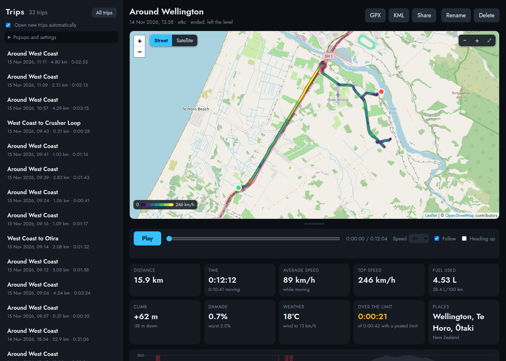
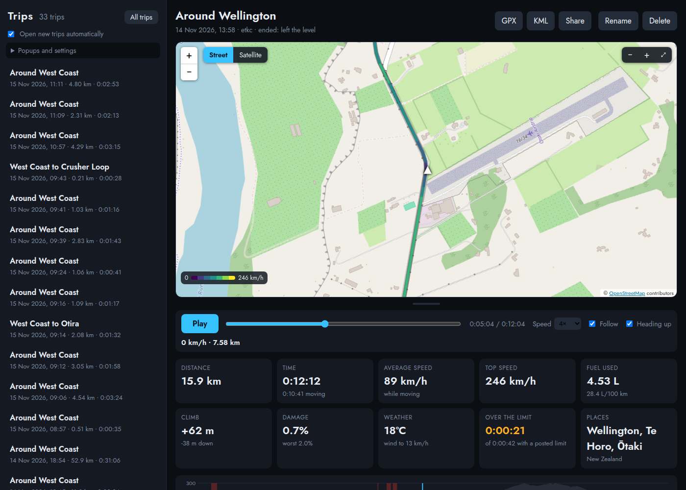
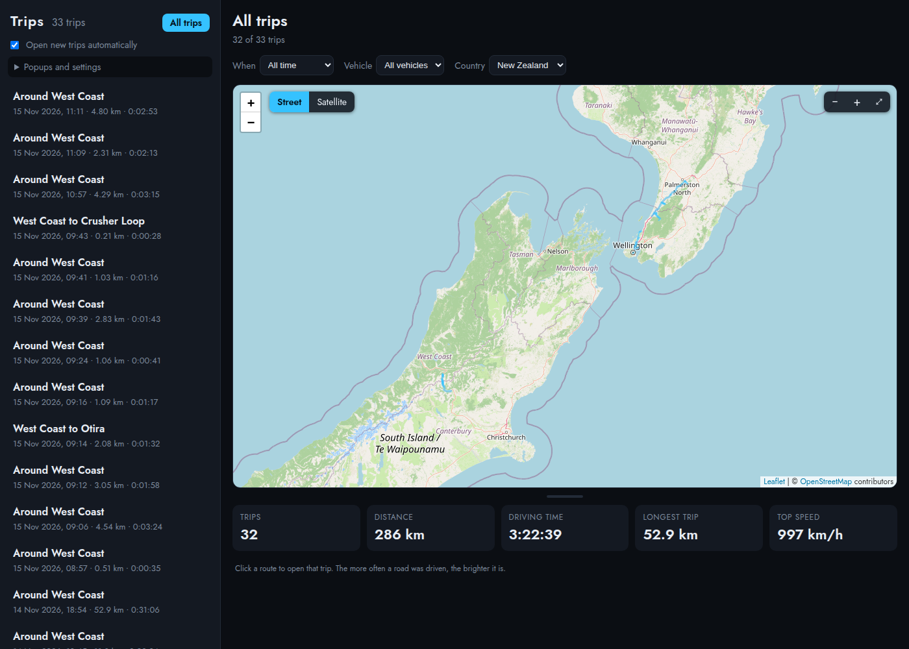
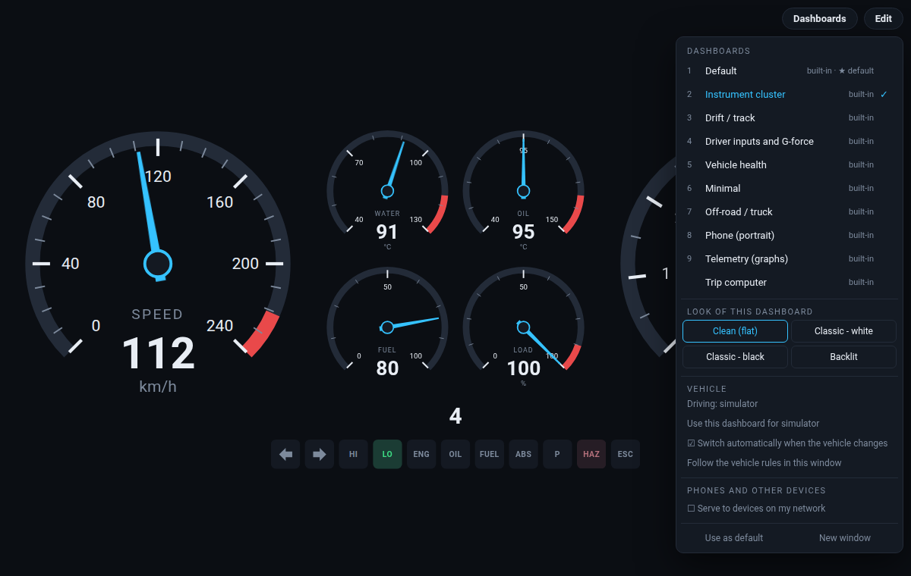
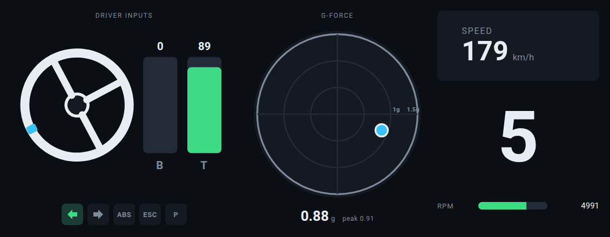

# ThrashDash

**Every drive in BeamNG.Earth, recorded and mapped: replay it, follow it live, share it. With customisable dashboards for everything else the car is doing.**



[BeamNG.Earth](https://github.com/TecnaGamer/BeamNG.Earth) lets you drive anywhere on the real Earth in BeamNG.drive. ThrashDash keeps a log of those drives, and shows them on a map in an ordinary browser window next to the game: where you went, how fast, how much fuel it took, where you were over the speed limit, and what the weather was doing. It also puts the car on the map as it drives, as close to real time as the game allows, and it still does what it did first: live gauges on a second monitor or a phone.

- **A trip log you do not have to think about.** Trips start when the car moves and end when you park, teleport or leave. Each is saved as it is driven, so a crash loses nothing, and gets a name ("Courtenay Place to Hutt Road") and a summary.
- **A map of every trip.** The route coloured by speed, with a red edge where you were over a *posted* limit; a speed and height graph; the figures; and a replay you can scrub, speed up, and watch with the map turning so the car always points up.
- **A live map.** The Trips page opens each new trip by itself and follows the car; the same map can sit on any dashboard as a widget.
- **Take trips with you.** Download a trip as **GPX** or **KML** (Google Earth), or as **one web page** that anyone can open with nothing installed.
- **Popups in the game** when a trip ends (or starts).
- **Dashboards**, the original half: a drag-and-drop editor, thirteen widget types, ten ready-made dashboards, four looks, tyres, damage, alerts, trip meters, per-vehicle dashboards, and phones and tablets over your network.
- **Your windows come back as you left them**, the map window included, and close when ThrashDash does.
- **No accounts and no cloud.** Everything runs on your computer. The one thing that uses the internet is the map pictures (OpenStreetMap, or EOX's satellite picture); nothing about your trips is sent anywhere.

> [!NOTE]
> ThrashDash is at version 0.1.0. It has been developed and tested against BeamNG.drive 0.40.5 and BeamNG.Earth 1.9 on Linux. Windows should work but is untested (see [Known limitations](#known-limitations)).

## Contents

- [How it works](#how-it-works)
- [Requirements](#requirements)
- [Installation](#installation)
- [Quick start](#quick-start)
- [The trip log](#the-trip-log)
- [The Trips page](#the-trips-page)
- [Taking trips with you](#taking-trips-with-you)
- [Windows: remembering, saving and closing](#windows-remembering-saving-and-closing)
- [Dashboards](#dashboards)
- [Phones and tablets](#phones-and-tablets)
- [Privacy and security](#privacy-and-security)
- [More documentation](#more-documentation)
- [Troubleshooting](#troubleshooting)
- [Known limitations](#known-limitations)
- [Licence and credits](#licence-and-credits)

## How it works

```
  BeamNG.drive                       this computer                           any browser window
┌─────────────────────┐  UDP JSON  ┌─────────────────────────────┐ WebSocket ┌──────────────────────┐
│ vehicle mod (Lua)   │ ─────────▶ │ relay (Python)              │ ────────▶ │ Trips page (map)     │
│  the car's data     │ 127.0.0.1  │  writes the trip log,       │  + HTTP   │ dashboards (gauges)  │
│ game extension (Lua)│   :4568    │  works out the summaries,   │  :8765    │ the editor           │
│  position, place,   │ ◀───────── │  serves the pages, remembers│           └──────────────────────┘
│  limit, weather     │   popups   │  your windows               │
└─────────────────────┘            └─────────────────────────────┘
```

| Part | Where | What it does |
|:---|:---|:---|
| **Vehicle mod** | [`mod/lua/vehicle/`](mod/lua/vehicle/) | Loaded into every vehicle. Sends that car's data (30 times a second) for the gauges. It reads, never writes. |
| **Game extension** | [`mod/lua/ge/`](mod/lua/ge/) | Runs in the game itself, only when BeamNG.Earth's level is loaded. Asks BeamNG.Earth where the car is (ten times a second for the live map, once a second for the log), and every second the speed limit, every two the street and place, every ten the weather. It also shows the popups the relay sends back. |
| **Relay** | [`relay/`](relay/) | A small Python program. Cuts the stream of positions into trips and writes them to disk, works out each trip's summary, serves the pages and a JSON API, and remembers your windows. |
| **Pages** | [`web/`](web/) | The Trips page and the dashboards: plain ES modules, no framework, no build step. Everything they need is served by the relay. |

Everything stays on your computer. The game talks only to `127.0.0.1`, and the pages are served on `127.0.0.1` until you choose to switch on [network access for a phone](#phones-and-tablets).

## Requirements

| | The AppImage | From the source |
|:---|:---|:---|
| **Game** | BeamNG.drive (tested on 0.40.5, native Linux build) | the same |
| **Trip log and map** | [BeamNG.Earth](https://github.com/TecnaGamer/BeamNG.Earth) installed and its level loaded (tested with the Earth app 1.9) | the same |
| **Operating system** | Linux, x86_64, any distribution from about 2022 on. A Windows 10/11 64-bit zip is built from the same code (untested). | Linux, or Windows (untested); anything Python runs on |
| **Python** | Not needed: it is inside the AppImage | 3.10 or newer (developed on 3.13), plus [`aiohttp`](https://docs.aiohttp.org/) 3.9 or newer |
| **Browser** | A Chromium-based browser for the borderless windows: Chrome, Edge, Brave or Chromium. Without one, ThrashDash opens your default browser. | the same (Edge comes with Windows) |
| **Internet** | Only for the map pictures. The route, figures and graph work without it. | the same |

The gauges need only BeamNG.drive; the trip log and the map need BeamNG.Earth. Without it the trip log does nothing and costs nothing.

## Installation

There are three ways to get ThrashDash: the single-file **AppImage** for Linux, a **zip for Windows**, or running it **from the source** on any system that has Python. The first two need nothing installed except a browser.

### Option A: the AppImage (Linux)

The AppImage is one file that contains the program, Python and the pages. ThrashDash opens its windows for you.

1. Download `ThrashDash-<version>-x86_64.AppImage` from the project's [Releases page](https://github.com/thrashcardiom/thrashdash/releases). Each release lists the file's SHA-256 checksum; to check your download matches it:

   ```sh
   sha256sum ThrashDash-0.1.0-x86_64.AppImage
   ```

2. Make the file executable (once), then run it:

   ```sh
   chmod +x ThrashDash-0.1.0-x86_64.AppImage
   ./ThrashDash-0.1.0-x86_64.AppImage
   ```

   Or double-click it in your file manager. A window opens by itself.

3. Install the mod into the game, with one command (the mod is inside the AppImage):

   ```sh
   ./ThrashDash-0.1.0-x86_64.AppImage --install-mod
   ```

   It looks for BeamNG.drive's user folder by itself. If it cannot find it, name the folder: `--install-mod /path/to/BeamNG.drive` (in the game launcher, **Manage User Folder** opens it). It never replaces a link, and it only replaces an earlier *copy* of the mod, never a folder it does not recognise. A copy installed under an earlier name of this program is removed too, otherwise the game would load both and every packet would be sent twice.

4. **Restart the game, and remove your car and spawn it again.** The game loads the trip log's extension when it starts and the vehicle part when a car is spawned.

Things to know about the AppImage:

- **It quits by itself** when you close the last window, and there is a **Quit ThrashDash** button in the Dashboards menu. (Phones looking at the pages do not keep it running.) If no window ever opens, it quits after about a minute and a half rather than running unseen.
- **Messages** go to `thrashdash.log` in [the data folder](docs/reference.md#where-things-are-stored) when it is started from a desktop (only the latest run is kept), and to the terminal when started from one.
- **No Chromium-based browser?** ThrashDash opens your default browser instead. It works there too, in an ordinary window rather than a borderless one.
- It needs FUSE to run, like all AppImages. If it will not start, try `./ThrashDash-0.1.0-x86_64.AppImage --appimage-extract-and-run`, or install FUSE 2 (`libfuse2`).
- To update, replace the file and run `--install-mod` again if the release notes say the mod changed.

### Option B: the Windows zip

> [!NOTE]
> The Windows program is built from the same code, but it has not been run on Windows yet. Expect rough edges and please report them.

Download `ThrashDash-<version>-windows-x64.zip` from the project's [Releases page](https://github.com/thrashcardiom/thrashdash/releases) (or build it yourself: [Building the Windows program](docs/reference.md#building-the-windows-program)), unzip it anywhere, and open the folder. It uses Microsoft Edge, Chrome or Brave for its windows; Edge comes with Windows.

1. **Install the mod** into the game. In PowerShell or cmd, in the unzipped folder:

   ```bat
   .\thrashdash-cli.exe --install-mod
   ```

   `thrashdash-cli.exe` is the same program with a console window, for commands that print something (`--help`, `--version`, `--install-mod`). It looks for BeamNG.drive's user folder by itself; if it cannot find it, name the folder: `--install-mod "C:\path\to\BeamNG.drive"` (in the game launcher, **Manage User Folder** opens it).
2. **Restart the game**, and remove your car and spawn it again.
3. **Double-click `thrashdash.exe`.** A window opens. Closing the last window quits ThrashDash (add `--keep-running` to stop that). Try it without the game first: `.\thrashdash-cli.exe --simulate`.

Things to know:

- **Windows SmartScreen** may say "Windows protected your PC" the first time, and some antivirus programs distrust any program made with PyInstaller. The program is not code-signed. Choose *More info, Run anyway*, or check the file against the checksum on the Releases page.
- **Windows Defender Firewall** asks the first time if ThrashDash may accept connections, when you switch on network access for phones. That is Windows' own question, and your decision.
- **Messages** from `thrashdash.exe` (which has no console window) go to `thrashdash.log` in `%LOCALAPPDATA%\ThrashDash`; the same folder holds your dashboards, settings and trips.

### Option C: from the source

#### 1. Get the code

```sh
git clone <this repository> beamng-dash
cd beamng-dash
```

#### 2. Install the mod

BeamNG loads mods from `mods/unpacked/` in its user folder. Put (or link) the [`mod/`](mod/) folder there as `thrashdash`. In the game launcher, **Manage User Folder** opens the user folder.

**Linux** (a symlink works and means updates to the mod are picked up from the repository):

```sh
ln -s "$(pwd)/mod" ~/.local/share/BeamNG/BeamNG.drive/current/mods/unpacked/thrashdash
```

**Windows** (the path is a best guess; use *Manage User Folder* to confirm it, and copy rather than link to avoid needing administrator rights):

```bat
xcopy /E /I mod "%LOCALAPPDATA%\BeamNG\BeamNG.drive\current\mods\unpacked\thrashdash"
```

> [!IMPORTANT]
> The game loads the trip log's extension **when it starts**, and a vehicle loads the mod's vehicle code when it is **spawned**. After installing or updating the mod, restart the game, then remove your car and spawn it again. (Ctrl+L reloads the game's own Lua, not the vehicles', so it is not enough.)

To check that it loaded, look in the game's `beamng.log` for lines like:

```
thrashdash_trips: trip log ready -> 127.0.0.1:4568 (BeamNG.Earth API found)
thrashdash: telemetry ready for /vehicles/etkc/ -> 127.0.0.1:4568 @ 30 Hz
```

(At game start the first line may say the Earth API is *not found*: BeamNG.Earth's level has not loaded yet. It is found once you are in the level.)

#### 3. Install the relay

**Linux**

```sh
python3 -m venv .venv
.venv/bin/pip install -r requirements.txt
```

**Windows** (PowerShell or cmd)

```bat
py -m venv .venv
.venv\Scripts\pip install -r requirements.txt
```

## Quick start

Try it without the game first. The simulator drives a fake car through gears, braking, tyre punctures and damage, so every dashboard comes alive (it keeps no trips):

```sh
./ThrashDash-0.1.0-x86_64.AppImage --simulate                 # the AppImage
.venv/bin/python relay/run.py --simulate                      # from the source (Windows: .venv\Scripts\python relay\run.py --simulate)
```

Then, for real:

1. Install the mod once (see [Installation](#installation)), restart the game, and spawn your car.
2. Start BeamNG, start BeamNG.Earth, and load its level.
3. Start ThrashDash: run the AppImage, or from the source `.venv/bin/python relay/run.py`. A dashboard window opens.
4. Move the mouse over the window and click **Dashboards**, then **Open the trip log**. The Trips window opens.
5. Drive. After a few seconds the Trips page opens the new trip by itself and the car moves along the map. Stop, teleport or leave the level and the trip is finished: it appears in the list with its name and figures, and a message tells you in the game.

## The trip log

The relay turns a stream of positions from BeamNG.Earth into **trips**, one file each, in the `triplog/` folder of [the data folder](docs/reference.md#where-things-are-stored). This is separate from the two trip *meters* A and B on the dashboards, which count until you reset them.

**What starts and ends a trip.** A trip starts when the car moves. It ends when:

| It ends when | Notes |
|:---|:---|
| the car has been **parked** for 2 minutes | Your choice of 1, 2, 5, 10 or 30 minutes in **Popups and settings** on the Trips page; it applies at once, even to a trip being driven. The trip ends at the moment you stopped. |
| you **teleport** | The next drive is a new trip. |
| your position **jumps** | Back to the spawn point, or moved some other way: ThrashDash notices a jump in position even when the game sends no event. |
| you take **another vehicle**, or **leave the level** | |
| the game stops sending | Closed, or on the free camera, for 90 seconds. |

A trip under 50 m or 20 s (a nudge of the car) is not kept. Pressing the R key does not end a trip.

**What a trip holds.** A point about every 4 m, every 10 s, or when the car turns (so corners keep their shape and a parked car still leaves a trace), with its speed, heading and altitude, and fuel or charge and body damage while the car is sending. The **distance** is added up from every sample, so keeping fewer points loses none of it. Alongside the points, the world around the car: the **speed limit every second**, the street, place, region and country every two seconds, and the weather and route progress every ten. A reading is written down only when it changed, or every ten seconds regardless, so reading often costs the file little. Only real **latitude and longitude** are kept: the game moves its own origin when you teleport, so its x and y mean nothing later.

**Crash-safe.** A trip is written one line at a time as it is driven. If ThrashDash is closed or killed mid-trip, it ends the trip where it stopped the next time it starts.

**Summary.** When a trip ends, ThrashDash works out and stores:

- a **name**: from the street at the start (once the game has settled) and at the end, such as "Courtenay Place to Hutt Road", "Around Oriental Parade" for a loop, or the town when the street is a road number. You can rename it.
- distance, time moving and stopped, average and top speed;
- the countries and towns passed through;
- altitude gained and lost;
- fuel or charge used, and per 100 km;
- body damage;
- weather: temperature, wind, time in rain, poorest visibility;
- **time over the speed limit**, counted **only where the limit is posted**. BeamNG.Earth reports a limit for most roads, but only about one in ten is a real posted one (the rest are guessed from the kind of road), so a guess is never counted as speeding. The summary says how many seconds of the trip had a posted limit to check against, with a 3.6 km/h allowance for the game's speed reading.

The summary is worked out again whenever its rules change, so every old trip benefits.

**Popups.** When a trip ends, a message appears in the game (the way BeamNG.Earth shows its own messages) and a banner on your dashboard windows, for 12 seconds: *Trip finished: Courtenay Place to Hutt Road: 2.12 km, 2 min 26 s, top 110 km/h, 1 min 19 s over the limit, 0.45 L*, in your units. Optionally the game also says when a trip starts (off by default; a trip counts as started once it is 50 m and 20 seconds long, so a nudge says nothing). Choose in **Popups and settings** on the Trips page. **Send a test popup** sends one now, whatever is ticked, to see which way works (the game only gets it once it has sent a position, so the Earth level must be loaded). The game writes *message from ThrashDash shown* to `beamng.log` for each one it receives. The relay answers the game at the address its positions come from (the extension binds to `127.0.0.1`, so only this computer can reach it), and the extension believes only that address and shows only plain text, cut short.

## The Trips page

Open it from the Dashboards menu (**Open the trip log**), or go to `http://127.0.0.1:8765/trips`. A phone on your network opens the same address with the PIN. The list of trips is on the left (one screen at a time on a phone); the one you pick is on the right. **Recording now** shows while a trip is being driven.

### The map



- The route is **coloured from slow to fast** (a dark edge makes it show on any map), with the start and end marked, and a **red edge where the car was over a posted limit**.
- **Street** is the default and the one for following a route. **Satellite** is Sentinel-2 imagery; it is about 10 metres a pixel, so it goes blurry when you zoom in close (the map stops adding detail past zoom 13). Your choice is remembered by the browser.
- **Map size.** Drag the bar just under the map to make it taller or shorter (arrow keys work on it too, and double-clicking puts it back). The **−** and **+** buttons at the top right of the map change the height a step at a time, and the third button **fills the window** with the map; **Esc** goes back. The height is remembered by the browser.

### Figures and graph

Distance, time, average and top speed, fuel, climb, damage, weather, time over the limit and places, as tiles under the map. Below them a **speed and height graph** along the trip with the posted limits drawn on it. Move over it (or touch it) and it shows the speed, distance, time and height at that point and marks the place on the map.

### Replay

The bar under the map drives the route again with a car marker pointing the way it was heading.

- **Play** and **Pause** (or the space bar), a **slider** to go anywhere in the trip, and a speed of 1×, 4×, 16× or 64×.
- **Follow** keeps the car in view.
- **Heading up** keeps the car in the middle of the map pointing straight up while the map turns round it (zoom with the + and − buttons or the wheel; the map follows the car, so dragging is off while it is on). The choice is remembered.
- While it runs it shows the speed, the posted limit where one was read, and the distance. The readout turns red where the car was over the limit, and a line on the graph shows the same moment.

### A trip being driven

- **New trips open by themselves.** When a trip starts, the page opens it and takes the map there, once per trip so you can look elsewhere afterwards. A window hidden behind the game notices at once, because the relay tells the page the moment a trip file is made. Untick **Open new trips automatically** above the list to stop it. It does not jump while you are typing a name, and the **All trips** map only adds the new trip in green without switching away.
- **The car is shown as the game reports it**: the game sends its position ten times a second, the page draws it about a tenth of a second behind the newest one and smooths between them, so it keeps up with the game's own minimap. (If no live positions are arriving, it falls back to the recorded points, about two seconds behind.)
- **Follow or heading up** works on it as in a replay. **Pause**, the slider or the space bar leaves the live view to look at something, and **Go live** comes back. When the trip ends the car finishes the stretch it has not yet shown.
- A trip that turns out too short to keep (a nudge) is dropped from the page when it goes.

### All trips



The **All trips** button above the list draws every trip's route on one map (thinned to the route's shape, so hundreds of trips stay quick), so the roads you drive most are brightest. Filter by **when** (last 7 or 30 days, this year), **vehicle** and **country**; totals for what is shown (trips, distance, driving time, longest trip, top speed) are underneath. Hover a route to see which trip it is, click it to open it. A trip being driven shows in green and grows.

### Rename and delete

**Rename** keeps your name as a line added to the trip's file (nothing is rewritten). **Delete** moves the file into a `trash` folder inside `triplog/`; nothing is erased, so a trip can be put back by moving the file out. Both work only on the computer running ThrashDash, like every change; a phone can look but not change.

### A live map on a dashboard

The **Live map (BeamNG.Earth)** widget puts the same map on any dashboard, placed and sized like a gauge and saved with the dashboard. It follows the trip being driven, turns heading up, and opens each new trip by itself. See [the widget reference](docs/dashboards.md#live-map-beamngearth).

## Taking trips with you

Three buttons beside a trip's title (any device that can open the page can use them, a phone included):

- **GPX** is for GPS and mapping programs: a timed track with speed and height, and a start and end point.
- **KML** is for **Google Earth** (the web version works, and no account or key is needed): the route as a line on the ground with a pin at each end, and the trip's summary when you click it. The times are real, and the path is laid on the ground, so a wrong height cannot bury it in the terrain. The file also holds a timed track for the time slider of the desktop version; it is hidden until you tick it, because Earth would draw it over the line.
- **Share** (for a finished trip) downloads **one `.html` file** holding the route on a map, the figures, the speed graph and the replay, with nothing to install and no ThrashDash needed. Send it by email or chat, or put it on a web server.
  - It is the Trips page's own program joined into one script (not a copy that could drift), with the map library, the styles and the trip's data inside.
  - It contains the trip's **positions**, speeds, heights, name and summary. It leaves out the car's id, fuel and damage readings, and your settings except your units.
  - A policy written into the file lets it run only its own scripts, load pictures only from the two map servers, and make no other requests.
  - The map pictures need the internet; the route and figures do not. A file opened from disk starts on the **satellite** picture, because OpenStreetMap refuses tile requests that carry no Referer and a page opened from disk sends none. On a web server the street map works too.

Names are escaped and file names kept plain, so an odd trip name cannot make a file other programs refuse.

## Windows: remembering, saving and closing

ThrashDash can run several windows at once: a dashboard in each (on different monitors, say) and the Trips window. It remembers them.

- **They reopen as you left them.** Every window tells ThrashDash which page it shows and how big it is. Next start, the windows that were open come back. Switch it off with **Reopen my windows when ThrashDash starts** in the editor, under **Windows**.
- **Window config.** The **Window config** section of the Dashboards menu saves the windows open now, the dashboards **and the map window**, each with its size and (where the system reports one) its place, as a named set. **Save** overwrites the config that is loaded; **Save as…** asks for a name and makes a new one (the same way the dashboard editor saves); **Delete** removes the loaded one. The menu says when the windows have changed since the save, and which config Save would overwrite. The config last saved or picked is the one **opened when ThrashDash starts**; with none saved, the windows open last time reopen as before. Picking a config while ThrashDash runs makes it the one that opens and opens its windows that are not open yet (a window that is open stays: ThrashDash cannot close another program's window). What a dashboard window *shows*, its gauges and live map, is saved with the dashboard itself, in the editor.
- **Quit.** **Quit ThrashDash** at the foot of the Dashboards menu stops ThrashDash (it asks again first). Pressing Ctrl-C does the same.
- **Closing ThrashDash closes its windows**, and they stay remembered so they come back next time. Switch it off with **Close my windows when ThrashDash closes** (editor, **Windows**); the windows then stay open, show that ThrashDash has gone, and reconnect when it is back. Phones are never closed. A page in an ordinary browser tab cannot be closed by a page, so it just shows that ThrashDash has stopped.
- **Positions.** Size and page are always restored. *Where* a window goes depends on the system. On Windows, and on Linux under X11, positions are saved and restored. Under **Linux with Wayland** a program cannot place its own windows or read where they are, so the desktop decides. Tick **Place windows exactly** (editor, **Windows**) to run the windows in X11 compatibility mode (`--ozone-platform=x11`, through XWayland): positions are then saved, and each window moves and sizes itself to its own remembered place as it opens. It is off by default because XWayland can look softer on scaled displays.

All of this is for the computer running ThrashDash: phones are never part of it, and cannot save or quit.

## Dashboards

The original half of ThrashDash. A dashboard is a layout of widgets you design yourself, drawn in its own window; you can open as many windows as you like and show a different dashboard in each.



- **A drag-and-drop editor** (press **E**): move and resize widgets, search every channel the game sends, save, import and export your own dashboards.
- **Thirteen widget types**: round gauges, bars, gear, lamps, readouts, history graphs, text, tyres, car damage, driver inputs, a G-force meter, a trip computer, and the live map.
- **Ten ready-made dashboards**, from a full instrument cluster to a minimal speed-and-gear display, and **four looks** that turn any dashboard into chrome-and-glass instruments.
- **Tyres, damage and component states**, with an alert banner when something goes wrong.
- **Two trip meters** (A and B) with fuel or battery economy and range, kept across restarts.
- **Per-vehicle dashboards** that switch by themselves when you change car.

| | |
|:---|:---|
|  |  |
|  |  |

Everything about dashboards (the shortcuts, every widget and its properties, the looks, units, alerts, the layout format) is in **[docs/dashboards.md](docs/dashboards.md)**.

## Phones and tablets

Open the Dashboards menu and find **Phones and other devices**.

1. **Choose a PIN** (4 to 8 digits) and press **Save PIN**. Network access cannot be switched on without one.
2. Tick **Serve to devices on my network**. It takes effect at once (no restart) and is remembered. The menu then shows the address, for example `http://192.168.1.20:8765/?d=minimal`, and a **QR code**.
3. On the phone, **scan the QR code** with its camera: it signs in at once, with no typing, and opens the dashboard you have open. Or type the address into the phone's browser: it asks for the PIN. The Trips page is at the same address with `/trips`.

A phone stays signed in for **30 days**. The QR code carries a sign-in token that works **once and for about 5 minutes**: it is a fresh one each time you open the menu, so for a second phone close and reopen the menu. Saving a new PIN (even the same one) signs every phone out at once. A device that gets the PIN wrong five times in a row is made to wait, and the wait doubles with each further miss.

- The phone and the computer must be on the same network. Guest networks that isolate devices, and some routers' "AP isolation", block this.
- **Firewall:** ThrashDash only opens its own port (8765 unless you changed it). It does not read or change any firewall setting. If a phone shows "unable to connect" while the address is right, the computer's firewall is most likely not letting other devices reach that port, and whether to allow it is a decision for whoever administers the computer. Some systems, such as Windows, ask the first time a program starts listening.
- A phone can **look but not touch**: no Edit button, no deleting or renaming, no saving a window config, no quitting, no resetting trips, no vehicle rules, no default, no opening windows. It can choose which dashboard to show and its own look (remembered on that phone only), browse trips, and download GPX, KML and shared pages. It cannot read or change the PIN. Switch network access off on networks you do not trust.
- **What the PIN does and does not do.** ThrashDash speaks plain http on your network, so the PIN and the sign-in cookie are not encrypted in transit. The PIN keeps out anyone who merely finds the address; it does not stop someone who can watch the network's traffic. The PIN is kept in `auth.json` in [the data folder](docs/reference.md#where-things-are-stored), readable only by your user.
- The built-in **Phone (portrait)** dashboard is laid out for an upright phone; the others suit a phone held sideways. On an iPhone, *Share, Add to Home Screen* gives a full-screen app. Phones may dim their screen, and browsers only allow keeping it awake on secure (https) pages, so set the phone's auto-lock to a longer time while driving.
- If you forget the PIN, open the Dashboards menu on the computer: it is shown in the PIN box, and you can change it there.
- To try the phone view without a phone: start with `--simulate --lan`, choose a PIN in the menu on this computer, and open the printed address in another browser. Network access stays off until a PIN has been chosen.

## Privacy and security

ThrashDash is designed to be safe to leave running on a home computer: it listens on this computer only until you switch on network access, other devices can only look, and other websites cannot reach it.

- **Your trips stay on your computer.** The log, your names and your summaries are files in the data folder. Nothing about a trip is sent anywhere, and there are no accounts. A shared `.html` file contains the trip's positions, so it is only made when you press **Share**.
- **The map pictures are the one thing that uses the internet.** The browser asks OpenStreetMap (street map) or EOX (satellite) for pictures of the area on screen, so they can see your address and the area you are looking at, not your trips. OpenStreetMap refuses requests that carry no Referer, so for the Trips page only, the browser is allowed to send the page's *origin* (for example `http://127.0.0.1:8765/`, never the trip or a sign-in token); every other page sends none. The Trips page may load pictures from those two servers and nothing else.
- **Local by default.** The relay listens on `127.0.0.1` only. With network access on it also listens on this computer's *private* addresses (never `0.0.0.0`, so VPN and public interfaces are not exposed).
- **Devices on the network need the PIN, and can then only view.** Every change needs this computer. Network access cannot be switched on without a PIN. Guessing is slowed, sign-in is a signed cookie, and other websites cannot reach the relay (`Host` and `Origin` checking, and a header on every write that no other website can send).
- **A strict page.** A strict Content-Security-Policy, no `innerHTML`, and imported dashboards checked twice. The game mod only reads and sends UDP to localhost.
- **Not provided:** https. The PIN keeps casual visitors out; it does not protect against someone who can watch your network.

The full list is in [the reference](docs/reference.md#security).

## More documentation

| | |
|:---|:---|
| **[docs/dashboards.md](docs/dashboards.md)** | Dashboards: the editor, every widget and its properties, looks, channels and units, alerts, per-vehicle dashboards, the layout format. |
| **[docs/reference.md](docs/reference.md)** | Settings and files, the command line, the HTTP and WebSocket API, the packets the game sends, the trip file format, the code map, building the AppImage and the Windows program, the tests, security. |

Useful command-line options (the full list is in the reference): `--simulate` (fake data, no game), `--lan` (serve to phones from the start), `--no-window` (do not open windows), `--keep-running`, `--install-mod`, `--http-port` and `--udp-port`.

## Troubleshooting

| Symptom | Likely cause and fix |
|:---|:---|
| The Trips page has no trips and nothing records | The trip log needs BeamNG.Earth's level loaded and the game extension installed. Check `beamng.log` for `thrashdash_trips: trip log ready ... (BeamNG.Earth API found)`. The extension loads when the game **starts**: after installing or updating the mod, restart the game. |
| A new trip does not open on the map by itself | Is **Open new trips automatically** ticked (above the list) and the page not on **All trips**? Reload the Trips page after updating ThrashDash: a window opened before the update keeps its old code. |
| The map is blank, or shows "Access blocked" | The map pictures come from the internet. Offline you still get the route and figures on a blank map. "Access blocked" means a map server refused the request: use the Trips page in ThrashDash (it sends what OpenStreetMap needs); a shared page opened from disk uses the satellite picture for the same reason. |
| The satellite picture is blurry | It is about 10 m a pixel. Use **Street** for anything close up. |
| No popups in the game | Press **Send a test popup** (Trips page, **Popups and settings**). It says whether the game could be reached. The game must be in the Earth level and have sent a position, and must have been restarted since the mod was installed or updated. `beamng.log` shows *message from ThrashDash shown* for each one received. |
| A trip ended when I stopped for a short while | It ends after 2 minutes parked by default. Change it in **Popups and settings** (1, 2, 5, 10 or 30 minutes). |
| Over-the-limit shows "Not checked" | The route had no *posted* speed limit in the map data (only about one road in ten does), and a guess is never counted. |
| Windows reopen at the right size but all in one place | On Wayland programs cannot place windows. Tick **Place windows exactly** (editor, **Windows**), arrange the windows, use **Window config → Save**, and restart ThrashDash. |
| The window says **Waiting for BeamNG...** | The relay is running but no data has arrived. Is a car spawned and are you sitting in it? Is the mod installed (look for `telemetry ready` in `beamng.log`)? Does `--udp-port` match the mod's port? |
| Nothing opens when I start the relay | No Chromium-based browser was found. Pass `--browser /path/to/browser`, or open `http://127.0.0.1:8765/` yourself. |
| *Cannot listen on port 8765* | Another ThrashDash (or program) is using it. Stop it, or pass `--http-port`. |
| *Cannot listen for BeamNG on UDP port 4568* | Another listener has the port (a second ThrashDash, or `spike_listen.py`). |
| I updated the mod but nothing changed | The vehicle part loads when a car is **spawned**; the trip log's extension loads when the **game starts**. Restart the game and respawn the car. Ctrl+L is not enough. |
| `--install-mod` cannot find the game | Name its user folder: `--install-mod /path/to/BeamNG.drive` (the game launcher's *Manage User Folder* opens it). |
| Tyres, damage or states are empty | They come from the mod's slow packets: respawn the car after updating the mod. Some cars have no tyre or state data. |
| Fuel used, economy and range show `--` | The mod has not reported the energy type: respawn the car. Economy and range also need about half a kilometre of driving. |
| Windows says "Windows protected your PC" | The program is not code-signed. *More info*, then *Run anyway*, or check the zip against the checksum on the Releases page. |
| On Windows nothing seems to happen when I double-click `thrashdash.exe` | It has no console window. Look at `thrashdash.log` in `%LOCALAPPDATA%\ThrashDash`. For commands that print something, use `thrashdash-cli.exe`. |
| The AppImage will not start | AppImages need FUSE. Try `./ThrashDash-...AppImage --appimage-extract-and-run`, or install `libfuse2`. Make sure the file is executable (`chmod +x`). |
| The AppImage quit and I did not want it to | It ends when the last window closes, or when you press **Quit ThrashDash**. Keep one open, or run from the source, which keeps running until you stop it. |
| A phone shows the PIN page | That is the PIN doing its job: enter the PIN shown in the Dashboards menu on the computer, or scan the QR code there. A sign-in lasts 30 days, and changing the PIN signs every phone out. |
| A phone shows "unable to connect" | Is network access switched on, are both devices on the same network, and does the computer's firewall let the port through? That last one is for the computer's administrator. |
| An imported dashboard is refused | The message names the property at fault. Layouts must be `format: 1` and within the [limits](docs/dashboards.md#the-layout-format). |

## Known limitations

- **Windows is untested.** There is a Windows build recipe (`packaging/build.ps1`) and the program is meant to run there as a zip with `thrashdash.exe`, but neither has been run on Windows yet. The code is written to work there (paths, launching, positions), and the folder it installs the mod into is a best guess.
- **The trip log needs BeamNG.Earth** and was developed against its modding API, version 1.8 (the Earth app 1.9). A future change to that API could stop the log until ThrashDash is updated: the game extension does nothing, harmlessly, when the API is not there.
- **Speeding is counted only where a limit is posted**, which is about one road in ten in BeamNG.Earth's data. The figure is honest about how much of the trip it covers, but it is not a full picture.
- **Peak G is not recorded.** The position is sampled once a second, which is too coarse to catch a peak.
- **The satellite picture is blurry up close** (about 10 m a pixel), and map pictures need the internet.
- **Wayland** cannot place windows without the opt-in X11 mode.
- **Electric and hybrid cars** are covered by tests but have not been tried in the real game. Hybrids show the percentage of tank or battery used, not litres or kWh.
- **Network access** is protected by a PIN but not encrypted (no https), so it deters casual visitors rather than someone watching the network; and phones cannot keep the screen awake without https.
- **Dashboards:** alerts are a banner only (no sound), looks cannot yet be made from your own images, and a dashboard is a fixed canvas that scales rather than reflowing for different screen shapes. Showing the game's camera views in a separate window was investigated and dropped: the game offers no fast way to read the picture back.
- **Not planned for now:** lap timing, and an in-page Google Maps option (Google Earth works through the KML file).

## Licence and credits

ThrashDash is released under the MIT licence: **Copyright (c) 2026 Thrash Cardiom**. See [LICENSE](LICENSE).

**Map data and pictures.** Street maps: © [OpenStreetMap](https://www.openstreetmap.org/copyright) contributors (ODbL). Satellite picture: [Sentinel-2 cloudless](https://s2maps.eu) 2016 by EOX IT Services GmbH, containing modified Copernicus Sentinel data 2016 (CC BY 4.0). Both credits are shown on the map. The map is drawn with [Leaflet](https://leafletjs.com/) (BSD-2-Clause), bundled in `web/vendor/leaflet/` and inside every shared page, with its licence.

The packaged program (the AppImage) also contains other people's software: Python, its libraries, and the bundled fonts. [THIRD_PARTY_NOTICES.md](THIRD_PARTY_NOTICES.md) lists all of it with each licence, and the complete licence texts travel inside the AppImage. To read them:

```sh
./ThrashDash-0.1.0-x86_64.AppImage --appimage-extract 'usr/share/licenses/*'   # unpacks to ./squashfs-root/usr/share/licenses/thrashdash/
```

The notices file and that folder are generated during the build by [`packaging/collect_licenses.py`](packaging/collect_licenses.py) from what was actually bundled, so they cannot drift from the program. If a build includes a native library the script does not know, the build stops and says which, so nothing is shipped without its licence.

Bundled fonts are used under the SIL Open Font Licence (licences are in [`web/fonts/`](web/fonts/)): **Jost**, **Barlow Condensed** and **DSEG7 Classic**. The QR code encoder in `web/js/qr.js` is ThrashDash's own. BeamNG.drive is a trademark of BeamNG GmbH, and BeamNG.Earth is its own project; ThrashDash is an independent project and is not affiliated with or endorsed by either.
