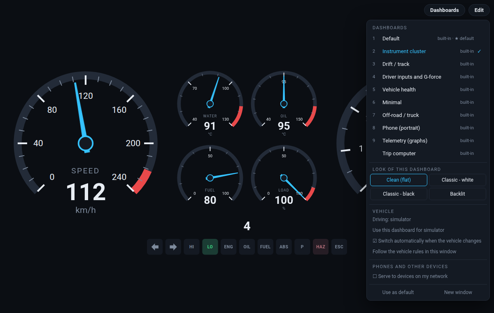
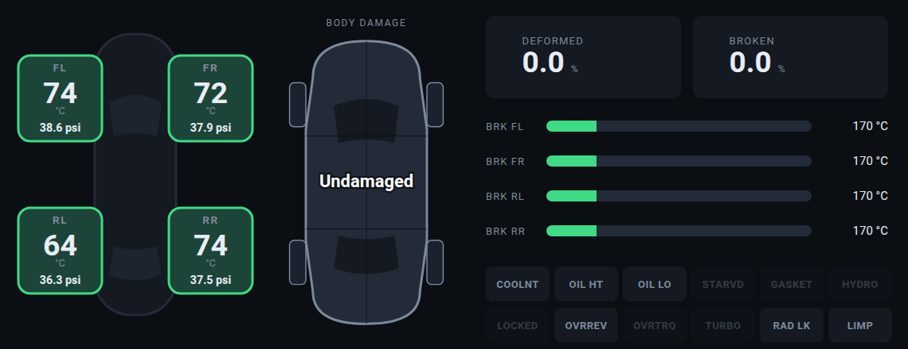
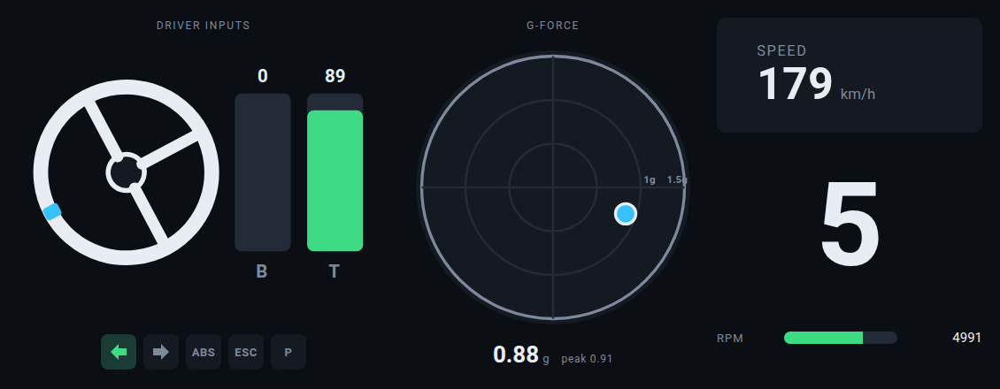
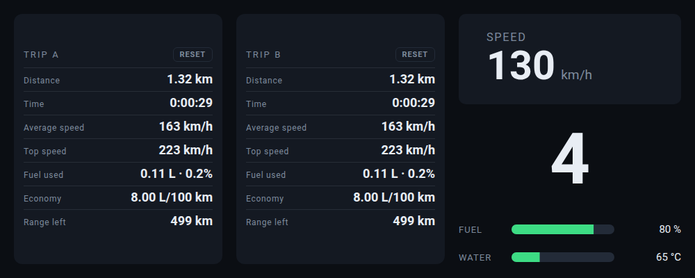
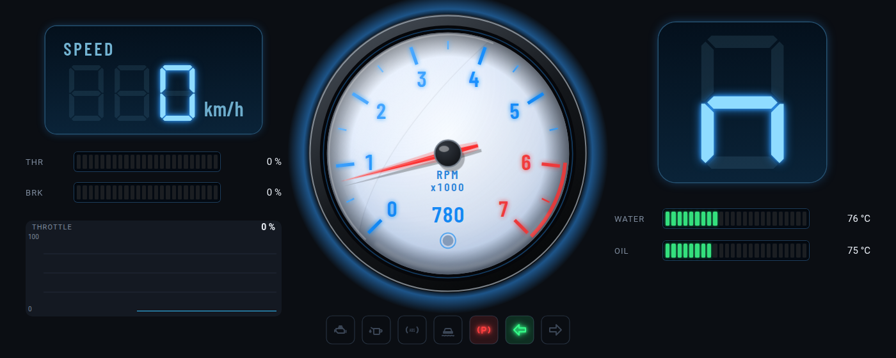
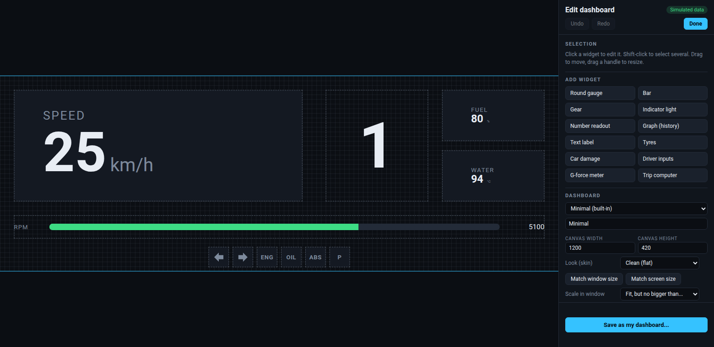
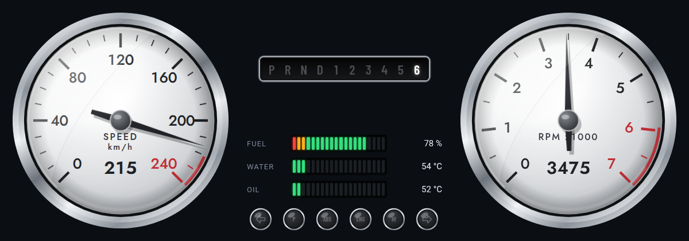
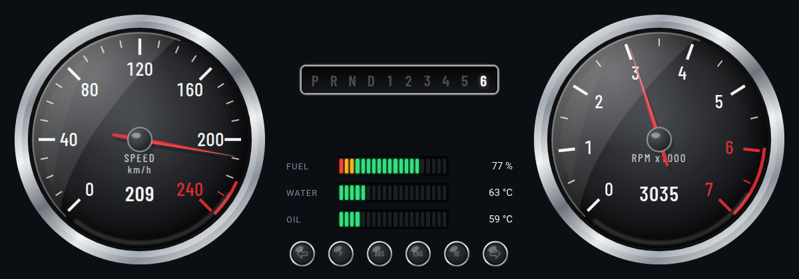
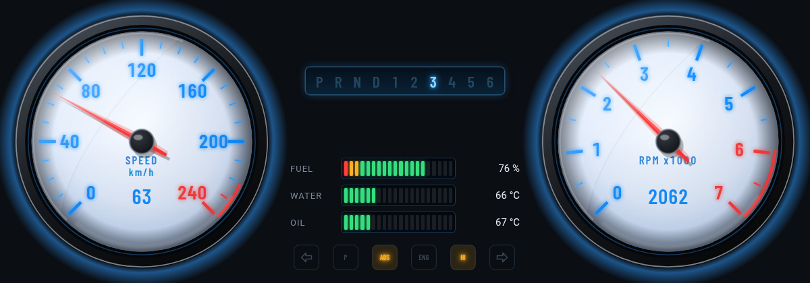
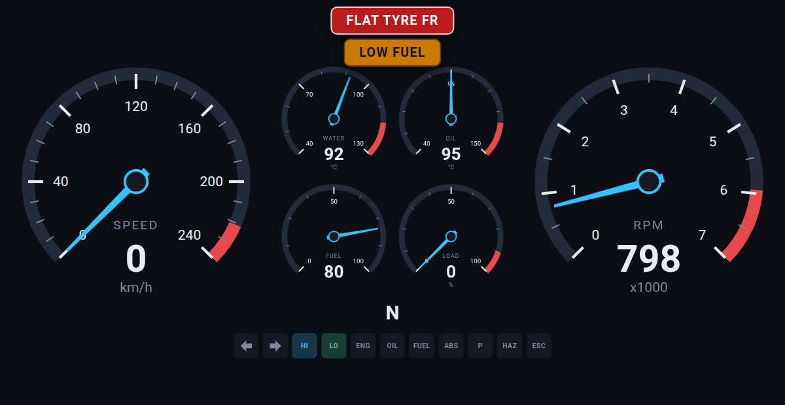

# Dashboards

The original half of ThrashDash: gauges, bars, tyres, damage and more, drawn as dashboards you design yourself, in their own windows, on any monitor or on a phone. For the trip log and the map see the [README](../README.md); for settings, files, the API and building see the [reference](reference.md).

## Contents

- [Using dashboards](#using-dashboards)
- [Built-in dashboards](#built-in-dashboards)
- [The editor](#the-editor)
- [Widget reference](#widget-reference)
- [Looks (skins)](#looks-skins)
- [Data: channels and units](#data-channels-and-units)
- [Features in depth](#features-in-depth)
- [The layout format](#the-layout-format)


## Using dashboards
### The window

The dashboard is drawn on a fixed-size canvas that scales to fit the window. By default a dashboard is shown **no bigger than its design size** and centred (so fullscreen does not blow it up); each dashboard can instead *fill the window* or be a *fixed size* (see [Scale](#scale)). Outside the editor, **+** and **-** (or Ctrl+scroll) zoom the window and **0** resets it. The zoom is remembered per dashboard on this computer.

### Keyboard shortcuts

| Key | In the dashboard window |
|:---|:---|
| **D** | Open or close the Dashboards menu |
| **E** | Edit this dashboard (this computer only) |
| **T** | Open the Trips window (the trip log and map) |
| **S** | Cycle through the looks |
| **N** | Open a new window the same size as this one (this computer only) |
| **+** / **-** / **0** | Zoom in, zoom out, reset (also Ctrl+scroll) |
| **Double-click** or **F11** | Fullscreen |

| Key | In the Dashboards menu |
|:---|:---|
| **1**–**9** | Show that dashboard |
| **Up** / **Down** | Move through the list |
| **Delete** | Delete the selected saved dashboard (after asking) |
| **Esc** | Close the menu |

Move the mouse over a dashboard window and three buttons appear at the top right: **Trips** (the same as **T**), **Edit** (the same as **E**) and **Quit**, which stops ThrashDash after asking again (this computer only).

### The Dashboards menu

Press **D** or click **Dashboards**. From top to bottom:

- **The list**: Default first, then your own dashboards by name, then the built-in templates A to Z. Click one (or press its number) to load it into this window. A trash button deletes a saved dashboard; built-ins cannot be deleted.
- **Look of this dashboard**: the four [looks](#looks-skins).
- **Vehicle**: which car you are driving, *Use this dashboard for this vehicle*, *Switch automatically when the vehicle changes*, and *Follow the vehicle rules in this window*. See [per-vehicle dashboards](#per-vehicle-dashboards).
- **Window config**: save the windows that are open now (the dashboards and the map window, with their sizes and places) as a named set, and pick one to open again. See [windows](../README.md#windows-remembering-saving-and-closing).
- **Phones and other devices**: choose the PIN, switch on network access and get the address and QR code. See [phones and tablets](../README.md#phones-and-tablets).
- **Use as default** and **New window** at the foot. (**Quit** is its own button beside **Edit**, not in the menu.)



### Several windows

**New window** (the menu button, the editor button, or **N**) opens another window **the same size as the one you are in**, slightly down and to the right, showing the same dashboard with the Dashboards menu already open so you can pick something else. A window you pick a dashboard for is **pinned** to it, which is how you keep different dashboards on different monitors. Windows without a pinned dashboard follow your [vehicle rules](#per-vehicle-dashboards).

ThrashDash also [remembers your windows](../README.md#windows-remembering-saving-and-closing) and reopens them next time it starts.

## Built-in dashboards

These are ordinary dashboards that ship with ThrashDash. They are read-only: use **Save as** in the editor to make your own copy. They are generated by [`tools/make_templates.py`](../tools/make_templates.py), and each works in every look.

| Dashboard | What it is for |
|:---|:---|
| **Default** | A plain starter: speed and rpm dials, gear, fuel and temperatures, lamps. |
| **Instrument cluster** | Big speedometer and tachometer, four small gauges, gear strip and warning lamps. |
| **Off-road / truck** | The cluster plus driveline lamps: 4WD, low range, diff locks. |
| **Minimal** | A big speed readout, gear, an rpm bar and a few lamps. |
| **Drift / track** | Big tachometer with shift light, gear digit, speed, throttle and brake bars and a throttle history. |
| **Telemetry (graphs)** | Readouts plus six history graphs. |
| **Phone (portrait)** | Laid out for an upright phone. |
| **Vehicle health** | Tyres, body damage, brake temperatures and engine warning lamps. |
| **Driver inputs and G-force** | Steering wheel, pedals, a G-force meter, speed, gear and rpm. |
| **Trip computer** | Trips A and B with speed, gear, fuel and temperature. |

| | |
|:---|:---|
|  |  |
|  |  |


## The editor

Press **E** (or click **Edit**) to edit in place; the gauges keep running on live data.



**Working on the canvas**

- Click a widget to select it; **Shift-click** to select several, or **drag a box** over empty canvas to select every widget it touches (hold **Shift** to add to what is selected; **Esc** while dragging puts the selection back).
- **Drag** to move (hold **Alt** to skip snapping). Drag a **handle** to resize (hold **Shift** to keep the shape).
- **Arrow keys** nudge by 1 px (**Shift** = 10 px).
- With two or more widgets selected, the panel's **Align** buttons line them up (left, centre, right, top, middle, bottom, against the box around them), and with three or more **Space evenly** (across or down) makes the gaps equal, the outer two staying put. Each is one undo step.
- Copy, paste and duplicate with **Ctrl+C**, **Ctrl+V**, **Ctrl+D**; **Delete** removes. **[** and **]** send a widget backward or forward.
- **Ctrl+Z** and **Ctrl+Y** undo and redo, **Ctrl+S** saves, **Esc** cancels a drag or deselects, **E** or **Done** leaves.

**The right-hand panel**

| Section | What is in it |
|:---|:---|
| **Selection** | The selected widget's properties. Channel properties open the **channel picker**: search every channel the game is sending, with its live value. You can also type a channel name that is not in the current data. |
| **Add widget** | One button per [widget type](#widget-reference). |
| **Dashboard** | Choose, rename, save, save as, create, delete, import, export a dashboard; canvas size, **Look (skin)**, **Match window size** and **Match screen size**, and **Scale in window**. |
| **Colours** | The dashboard's [theme](#themes): a picker for each of seven colours. |
| **Display** | Units and snap-to-grid. |
| **Vehicle dashboards** | Every per-vehicle rule, with a button to remove it. |
| **Windows** | Whether to [reopen your windows](../README.md#windows-remembering-saving-and-closing) at startup, and exact placement. |
| **Alerts** | Which [alerts](#alerts) you want, the over-limit margin, and the [alert sound](#alert-sound). |

The built-in **Default** is read-only; saving it creates your own copy. A dashboard with unsaved changes asks before you leave or switch.

### Scale

Each dashboard has a **Scale in window** setting:

| Mode | Behaviour |
|:---|:---|
| **Fit, but no bigger than N%** (default, 100%) | Shrinks to fit a small window, never grows beyond N% of its design size. Fullscreen stays at design size and is centred. |
| **Always fill the window** | A bigger window means bigger gauges. |
| **Fixed size** | Always N%. |

To use a whole monitor, press **Match screen size** (or **Match window size**) to set the canvas to that resolution, then place the gauges at the size you want. Editing always shows the whole canvas.

### Saving, importing and exporting

Your dashboards are plain JSON files (see [the layout format](#the-layout-format)). **Export** downloads one; **Import** reads one. Imported files are checked twice, once by the relay for structure and size and once by the page for meaning (widget types, value ranges, colours), so a file from a stranger cannot inject anything into the page.

## Widget reference

Every widget has a position and size (`x`, `y`, `w`, `h`, in canvas pixels) plus the properties below. A property marked *look only* appears in the editor only when a [look](#looks-skins) is active; *flat only* only in the original flat look.

Property types: **channel** is a channel name; **number or per-unit** is a number or an object keyed by unit (for example `{"kmh": 240, "mph": 150}`), so one dashboard works in both unit systems; **unit type** chooses how a value is converted (see [units](#units)).

### Round gauge

A dial with a needle, tick scale, optional red zone and the value. In a look it becomes a real instrument. Layout type: `roundGauge`. Default size 300 × 300.

| Property | Type | What it does | Values |
|:---|:---|:---|:---|
| `channel` | channel | Channel |  |
| `kind` | unit type | Unit type | `none`, `speed`, `temp`, `distance`, `pressure`, `fraction` |
| `label` | text | Title |  |
| `showUnit` | text | Unit text |  |
| `decimals` | number | Decimals | 0 to 4 |
| `min` | number or per-unit | Scale minimum |  |
| `max` | number or per-unit | Scale maximum |  |
| `maxChannel` | channel | Scale max from channel |  |
| `maxRound` | number | Round scale up to | 1 to 100000 |
| `majorStep` | number or per-unit | Major tick every |  |
| `minorDiv` | number | Minor ticks per major | 1 to 10 |
| `labelDiv` | number | Divide tick labels by | 0.001 to 100000 |
| `redFrom` | number | Red zone from (0-1) | 0 to 1 |
| `startAngle` | number | Sweep start (deg) (look only) | -180 to 180 |
| `endAngle` | number | Sweep end (deg) (look only) | -180 to 180 |
| `labels` | list of text | Labels (comma separated) (look only) |  |
| `icon` | choice | Face icon (look only) | (none), `fuel`, `temp`, `battery`, `oil`, `engine`, `highbeam`, `lowbeam`, `hazard`, `esc`, `parking`, `brake`, `abs`, `left`, `right` |
| `amberFrom` | number | Amber zone from (0-1) (look only) | 0 to 1 |
| `coldTo` | number | Blue zone up to (0-1) (look only) | 0 to 1 |
| `lowTo` | number | Red low zone up to (0-1) (look only) | 0 to 1 |
| `sub` | choice | Display window (look only) | (none), `odometer`, `lcd` |
| `subChannel` | channel | Window channel (look only) |  |
| `subKind` | unit type | Window unit type (look only) | `none`, `speed`, `temp`, `distance`, `pressure`, `fraction` |
| `subLabel` | text | Window caption (look only) |  |
| `shiftFrom` | number | Shift light from (0-1) (look only) | 0 to 1 |
| `compact` | on/off | Compact (small dial) (look only) |  |
| `showValue` | on/off | Show the value on the face (look only) |  |

### Bar

A horizontal bar (LED segments in a look) with amber and red thresholds. A "low is bad" bar suits fuel. Layout type: `bar`. Default size 340 × 30.

| Property | Type | What it does | Values |
|:---|:---|:---|:---|
| `channel` | channel | Channel |  |
| `kind` | unit type | Unit type | `none`, `speed`, `temp`, `distance`, `pressure`, `fraction` |
| `label` | text | Title |  |
| `decimals` | number | Decimals | 0 to 4 |
| `min` | number or per-unit | Scale minimum |  |
| `max` | number or per-unit | Scale maximum |  |
| `warnFrom` | number or per-unit | Amber at |  |
| `critFrom` | number or per-unit | Red at |  |
| `invert` | on/off | Low is bad (amber/red below) |  |
| `maxChannel` | channel | Scale max from channel |  |
| `maxRound` | number | Round scale up to | 1 to 100000 |
| `segments` | number | LED segments (look only) | 6 to 60 |

### Gear

The current gear. In a look, a P R N D / 1-6 strip or a 7-segment digit. Layout type: `gear`. Default size 300 × 190.

| Property | Type | What it does | Values |
|:---|:---|:---|:---|
| `channel` | channel | Channel |  |
| `label` | text | Caption (flat only) |  |
| `style` | choice | Display (look only) | `strip`, `digit` |
| `letters` | list of text | Strip letters (comma separated) (look only) |  |

### Indicator light

A lamp that lights when its channel is on. It can watch several channels at once. Layout type: `light`. Default size 48 × 40.

| Property | Type | What it does | Values |
|:---|:---|:---|:---|
| `channel` | channel | Channel |  |
| `channels` | list of channels | Any of these channels |  |
| `text` | text | Text |  |
| `arrow` | choice | Arrow | (none), `left`, `right` |
| `color` | colour | Colour when on (flat only) |  |
| `icon` | choice | Symbol (look only) | (none), `fuel`, `temp`, `battery`, `oil`, `engine`, `highbeam`, `lowbeam`, `hazard`, `esc`, `parking`, `brake`, `abs`, `left`, `right` |
| `lampColor` | choice | Lamp colour (look only) | `red`, `amber`, `green`, `blue` |

### Number readout

A number with its unit. Layout type: `readout`. Default size 180 × 90.

| Property | Type | What it does | Values |
|:---|:---|:---|:---|
| `channel` | channel | Channel |  |
| `kind` | unit type | Unit type | `none`, `speed`, `temp`, `distance`, `pressure`, `fraction` |
| `label` | text | Title |  |
| `showUnit` | text | Unit text |  |
| `decimals` | number | Decimals | 0 to 4 |
| `color` | colour | Value colour (flat only) |  |
| `digits` | number | Digits (look only) | 3 to 10 |

### Graph (history)

A line graph of one channel over a history window you choose (5 to 120 seconds). Layout type: `graph`. Default size 360 × 140.

| Property | Type | What it does | Values |
|:---|:---|:---|:---|
| `channel` | channel | Channel |  |
| `kind` | unit type | Unit type | `none`, `speed`, `temp`, `distance`, `pressure`, `fraction` |
| `label` | text | Title |  |
| `min` | number or per-unit | Scale minimum |  |
| `max` | number or per-unit | Scale maximum |  |
| `seconds` | number | History (seconds) | 5 to 120 |
| `decimals` | number | Decimals | 0 to 4 |
| `color` | colour | Line colour |  |

### Text label

A fixed text label. Layout type: `text`. Default size 200 × 40.

| Property | Type | What it does | Values |
|:---|:---|:---|:---|
| `text` | text | Text |  |
| `fontSize` | number | Size (px) | 8 to 300 |
| `align` | choice | Align | `left`, `center`, `right` |
| `bold` | on/off | Bold |  |
| `color` | colour | Colour |  |

### Tyres

A top-down car with a card per wheel: temperature, pressure and a flat marker. Layout type: `tyres`. Default size 230 × 290.

| Property | Type | What it does | Values |
|:---|:---|:---|:---|
| `source` | choice | Temperature of | `temp`, `coreTemp` |
| `showPressure` | on/off | Show pressure |  |
| `coldBelow` | number or per-unit | Cold below |  |
| `warnFrom` | number or per-unit | Hot from |  |
| `critFrom` | number or per-unit | Too hot from |  |
| `lowPressure` | number or per-unit | Low pressure below |  |
| `wheels` | list of text | Wheel names FL, FR, RL, RR |  |

### Car damage

A top-down body coloured by damage per zone, with a one-word summary (see [Tyres, damage and component states](#tyres-damage-and-component-states)). Layout type: `damage`. Default size 200 × 300.

| Property | Type | What it does | Values |
|:---|:---|:---|:---|
| `label` | text | Title |  |
| `showPercent` | on/off | Show the damage summary (e.g. Wrecked) |  |
| `wreckedFrom` | number | Wrecked from (% of beams broken) | 2 to 100 |
| `showTyres` | on/off | Mark flat tyres |  |
| `critFrom` | number | Fully red at (0-1) | 0.05 to 1 |

### Driver inputs

A steering wheel that turns, plus brake, throttle and optional clutch bars. Layout type: `inputs`. Default size 300 × 150.

| Property | Type | What it does | Values |
|:---|:---|:---|:---|
| `label` | text | Title |  |
| `showWheel` | on/off | Show the steering wheel |  |
| `showClutch` | on/off | Show the clutch (manual cars) |  |
| `wheelLock` | number | Wheel turns at full lock (degrees) | 30 to 900 |
| `flipSteering` | on/off | Reverse the steering direction |  |

### G-force meter

A dot that moves with the force on the car, with a trail and a held peak. Layout type: `gmeter`. Default size 240 × 270.

| Property | Type | What it does | Values |
|:---|:---|:---|:---|
| `label` | text | Title |  |
| `range` | number | Outer ring (g) | 0.5 to 6 |
| `showTrail` | on/off | Fading trail |  |
| `flipLateral` | on/off | Reverse left and right |  |
| `flipLongitudinal` | on/off | Reverse up and down |  |

### Live map (BeamNG.Earth)

A live map of the trip being driven, on a dashboard, placed and sized like any other widget and saved with the dashboard (**Save** overwrites it, **Save as** makes a copy). It is the Trips page's own map in a compact form (a frame of `/trips?embed=1`), so it follows the car, can turn **heading up**, and draws the route exactly as the Trips page does; it reads "Waiting for a trip" until one starts, then opens each new trip by itself. It also shows the posted speed limit as a road sign in the corner (flashing while the car is over it), and a **Re-centre on the car** button if you move the map away. Needs BeamNG.Earth and internet for the map pictures (street map, or the satellite picture if ticked). Layout type: `tripmap`. Default size 420 × 300.

| Property | Type | What it does | Values |
|:---|:---|:---|:---|
| `headUp` | on/off | The car points up and the map turns round it | default on |
| `zoom` | number | Zoom while following the car | 12 to 19, default 17 |
| `satellite` | on/off | The satellite picture instead of the street map (blurry close up) |  |

Because the map needs pictures from two map servers, the dashboard page's policy now allows a frame of this site (`frame-src 'self'`); the frame is the Trips page, which alone is allowed to load the map pictures (see [The Trips page](../README.md#the-trips-page)).

### Speed limit sign (BeamNG.Earth)

The speed limit of the road the car is on, drawn as a road sign: **round** with a red ring (European) or a **box** headed "SPEED LIMIT" (North American), with your own speed under it. The limit is shown in your speed unit. BeamNG.Earth only sometimes reads a limit from a real sign; the rest is a guess from the kind of road. The sign says so: a guess is drawn dashed and faded with "est." under it, and the sign turns red (and pulses) only against a **posted** limit, more than 1 m/s over it. With no limit known it fades and says "no limit known". Layout type: `speedlimit`. Default size 200 × 240.

| Property | Type | What it does | Values |
|:---|:---|:---|:---|
| `speedChannel` | channel | Your speed | default `wheelspeed` |
| `style` | choice | The kind of sign | `round`, `box` |
| `showSpeed` | on/off | Your speed under the sign | default on |

### Route and ETA (BeamNG.Earth)

Progress along the GPS route set in BeamNG.Earth: the destination, the **arrival time** (your computer's clock), the **time left** and the **distance left** (in your distance unit), and an "Off the route" warning when the car is more than 50 m from it. While BeamNG.Earth is planning it says **"Re-routing…"** (a new route for one you already had, as after a wrong turn) or "Planning route…" (the first one), for at least 3 seconds, in place of the warning. Earth plans again by itself once you are more than about 120 m off the route or driving back along it, and no more than once every 20 seconds. There is also an optional [alert](#alerts) for leaving the route. With no route set it says "No route set" and dims, so a dashboard that has this widget still looks right on a drive without one.

At the top it shows the **next turn**: an arrow, how far away it is (in your distance unit: `300 m`, `1.2 km`, or `250 ft`, `0.4 mi`, and "Now" when it is here), and in words: "Turn left onto Oriental Parade", "Keep left at the fork onto Aotea Quay", "At the roundabout take the 2nd exit onto Evans Bay Parade", "Arrive: your destination is on the left". A second maneuver that comes within 300 m after it is added as a quieter "then ..." line. A maneuver stays shown until the car is about 15 m past it. It needs a BeamNG.Earth app new enough to send a route's steps (the API's `routeSteps`); with an older one the rest of the panel works and the next turn is simply not shown. After a wrong turn the steps of the old route are never used: the next turn comes back when the new route's steps arrive. Layout type: `route`. Default size 300 × 340.

| Property | Type | What it does | Values |
|:---|:---|:---|:---|
| `label` | text | Title | up to 20 characters |
| `showNext` | on/off | The next turn | default on |
| `showName` | on/off | The destination | default on |
| `showOff` | on/off | The off-route warning | default on |

### Lap timer

This lap's clock, the gap to your best lap, the last and best laps, and each sector. The laps are timed by the relay from the car's position across lines drawn on the Trips page (see [Lap and sector timing](../README.md#lap-and-sector-timing)), so this only shows them; it needs BeamNG.Earth and a circuit. Times are to a tenth of a second. The gap (`+0.4` behind, `-0.3` ahead, green when ahead and red when behind) is against your best lap in the car you are driving, by distance round the lap, so it moves smoothly and needs no sector lines. A new best lap is purple, and so is a sector that was the best yet. A lap that missed a sector line is shown struck through, as "not valid". Before a start line has been crossed it says "Not timing". Layout type: `laptimer`. Default size 320 × 320.

| Property | Type | What it does | Values |
|:---|:---|:---|:---|
| `label` | text | Title (the circuit's name is shown while timing) | up to 20 characters |
| `showDelta` | on/off | The gap to your best lap | default on |
| `showSectors` | on/off | The sector times | default on |

### Trip computer

One of the two trip meters (see [Trip computer](#trip-computer)). Layout type: `trip`. Default size 300 × 340.

| Property | Type | What it does | Values |
|:---|:---|:---|:---|
| `trip` | choice | Which trip | `A`, `B` |
| `label` | text | Title |  |
| `showFuel` | on/off | Show fuel / energy used and economy |  |
| `showRange` | on/off | Show range left |  |


### Themes

A dashboard can carry its own **colours**: the page behind it, its panels, text, quiet text, an accent, and the warning and critical colours. Choose them under **Colours** in the editor; **Default** puts one back and **Reset all colours** takes the whole theme off. Unlike a look, a theme is **part of the dashboard**: it is saved with it, comes and goes with undo, and travels in an exported file. A theme only holds the colours you changed; the rest stay as they are.

A theme is applied to the **canvas**, not to the editor panel, the alert banner or the menus, so those stay readable whatever you choose. The page behind the canvas takes the background colour. The [looks](#looks-skins) other than the flat one draw their instruments in their own colours, so a theme shows most on the flat look. Only plain `#rrggbb` colours are accepted, from the editor or a file.

## Looks (skins)

A **look** changes how the open dashboard *looks*: its widgets are redrawn as real instruments, in place. The layout (which widgets, where, on which channels) is untouched, and a look is never a dashboard of its own.

| Look | Description |
|:---|:---|
| **Clean (flat)** | The original flat look. |
| **Classic - white** | White-faced dials with chrome bezels, glass, a mechanical odometer and jewel lamps. |
| **Classic - black** | The same in black. |
| **Backlit** | A frosted face with a blue glow, red needles and LCD displays. |

| Classic - white | Classic - black | Backlit |
|:---|:---|:---|
|  |  |  |

Change the look from the Dashboards menu, by pressing **S**, or in the editor. It is kept **per dashboard** by the relay (like units), so it works for the read-only Default too, survives restarts and applies in every window showing that dashboard. It is not stored in the dashboard file: changing it never makes a dashboard "unsaved", **Undo** does not touch it, and exported dashboards carry no look (whoever imports one picks their own). **Save as** gives the copy the look the original had, and deleting a dashboard forgets its look. A phone chooses its own look, kept on that phone only.

With a look active, extra properties appear: dial sweep angles, custom labels (for example `E, ½, F`), a face icon, blue/amber/red zones, an odometer or LCD window, a shift light, a compact mode for small dials, LED segment bars, a P R N D / 1-6 gear strip or 7-segment digit, and lamp symbols and colours.

`/skin-preview.html` on the running relay shows every widget in every look, driven by simulated data.


## Data: channels and units

A **channel** is one named value from the game: `rpm`, `wheelspeed`, `tire.FL.temp`. Every widget reads one or more channels. The **channel picker** lists the ones the current car sends, with friendly names and live values. Different cars send different channels (a typical car sends 130 to 210), so a dashboard should tolerate missing ones: a widget whose channel is missing simply shows `--`.

### Where channels come from

| Source | Rate | Channels | Examples |
|:---|:---|:---|:---|
| **Electrics** | 30 per second | The car's own electrics table, flattened with dots | `rpm`, `wheelspeed`, `gear`, `fuel`, `watertemp`, `throttle_input`, `steering_input`, `accXSmooth`, `wheelThermals.FL.brakeSurfaceTemperature` |
| **Tyres** | 4 per second | `tire.<wheel>.<field>` for each wheel (FL, FR, RL, RR, and more on trucks) | `tire.FL.temp`, `.coreTemp`, `.pressure`, `.deflated`, `.punctured`, `.load`, `.slip` |
| **Damage** | 4 per second | `damage.*` | `damage.total`, `damage.brokenPct`, `damage.deformedPct`, `damage.beamsTotal`, `damage.zone.FL` (FL, FR, ML, MR, RL, RR) |
| **Component states** | 4 per second | `state.<group>.<name>`, what the game's damage tracker reports (only those the current car has) | `state.engine.oilOverheating`, `state.engine.coolantOverheating` |
| **Energy kind** | 4 per second | `energy.electric`, `energy.liquid` | whether the car has a battery, a fuel tank, or both |
| **Trip computer** | every frame | `trip.A.*`, `trip.B.*` and `trip.energyKind`, kept by the relay | `trip.A.distance`, `trip.B.consumption`, `trip.A.range` |
| **Road and route** | every second | `geo.limit` (m/s) and `geo.limitPosted`, only while a limit is known; `geo.route.active`, and while a route is set `geo.route.remaining` (m), `.eta` (s), `.off` (m), `.name`, `.planning` (a route is being planned, or just was) and `.replanning` (it replaces one you already had); and, when the route's steps are known, the next maneuver: `geo.route.next.distance` (m), `.type`, `.modifier`, `.street`, `.exit` (a roundabout's exit number) and the one after it: `geo.route.then.gap` (m after the next one), `.type`, `.modifier`, `.street`, `.exit`. From BeamNG.Earth; each is dropped if the game goes quiet for 4 seconds, so a stale limit can never show or alert. | `geo.limit`, `geo.route.remaining` |
| **Lap timing** | with every live position (ten a second) | `lap.active`, `lap.circuit`, `lap.number`, `lap.time`, `lap.delta` (s, + is behind your best), `lap.sector`, `lap.sectors`, `lap.best`, `lap.last`, `lap.lastValid`, `lap.lastDelta`, `lap.lastIsBest`, and per sector `lap.s1.last`, `.best`, `.isBest` (up to nine sectors). Worked out by the relay (`laps.py`); each is dropped if no position has arrived for two seconds. | `lap.time`, `lap.delta`, `lap.s2.last` |

Channels carry numbers, booleans or short text. Lists and other structures are skipped, and `NaN` or infinity are dropped.

### Units

Conversion happens in the dashboard: the game reports SI-ish values and each person picks what they want to see. A widget names a **unit type**; your choice for that type does the conversion. Choose units in the editor under **Display**, or override them for one window with the address, for example `?speed=mph&temp=f`.

| Unit type | Game value | You can show |
|:---|:---|:---|
| `speed` | metres per second | km/h, mph |
| `temp` | degrees Celsius | °C, °F |
| `distance` | metres | km, mi |
| `pressure` | gauge kPa | kPa, psi, bar |
| `fraction` | 0 to 1 | % |
| `none` | as is | (no conversion) |
| *Fuel economy* | litres or kWh per 100 km | follow distance unit, L/100 km, km/L, mpg (US), mpg (UK) (used by the trip computer) |

Facts about the game's data that ThrashDash handles for you, found by measuring a real game:

- Tyre temperatures are in **kelvin**; the mod subtracts 273.15 and sends °C.
- Tyre pressure is **absolute** pascals; the mod sends gauge kPa (a 30 psi tyre reads 206.8 kPa).
- Damage numbers are small: the game divides broken and deformed beams by *all* the beams in a zone. A completely wrecked car read about 12% in its worst zone, and 23.6% of beams broken.
- The acceleration channels are the car's own acceleration in the game's frame, where +x is the car's **left** and +y its **rear**. `accYSmooth` is positive when braking; `accXSmooth` is negative in a right-hand corner; `steering_input` is positive for a right turn.


## Features in depth


### Alerts

A banner across every dashboard (also on phones) when the game reports a problem. Alerts show at once and linger for a couple of seconds after the condition clears, so a flickering flag does not make the banner blink. Switching an alert off clears it immediately. Most follow the game's own flags rather than a threshold of ours. It is banner only: no sound.

| Alert | Level | When |
|:---|:---|:---|
| Flat tyre | Critical (red, pulsing) | A tyre is flat (names the wheels). |
| Engine overheating | Critical (red, pulsing) | The game reports the engine coolant overheating. |
| Oil overheating | Critical (red, pulsing) | The game reports the oil overheating. |
| Low oil | Critical (red, pulsing) | Oil level critical, or the engine starved of oil. |
| Engine damaged | Critical (red, pulsing) | Head gasket damaged, engine hydrolocked, or engine locked up. |
| Body damage (heavy or wrecked) | Warning (amber) | Body damage Heavy (warning) or Wrecked (critical). |
| Low fuel | Warning (amber) | The game's low-fuel warning. |
| Low tyre pressure | Warning (amber) | The game's low tyre pressure warning (not shown on top of a flat). |
| Brakes overheating | Warning (amber) | The game's brake-overheating flag. |
| Over-revving | Warning (amber) | The game reports an over-rev danger. |
| Over the posted speed limit | Warning (amber) | Your speed (`wheelspeed`) stays above a **posted** limit plus a margin for two seconds. Only limits read from a real sign count, never a guess from the kind of road. The text names the limit, for example "Over the speed limit (50 km/h)". Needs BeamNG.Earth. |
| Off the GPS route | Warning (amber) | **Off until you tick it.** The car stays more than 50 m from BeamNG.Earth's GPS route for three seconds. It clears when you are back on the route or Earth has planned a new one. Needs BeamNG.Earth. |

Switch them on or off, all or one by one, in the editor under **Alerts**. It is a display setting kept by the relay, like units.

The **over-limit alert is optional like the others**: untick it under **Alerts** and it never shows (the sign widget still works). The **Over-limit margin** box there sets how far over a posted limit you may go before it shows (default 5 km/h, in your speed unit; 0 means any excess). The margin is saved in metres a second, so it keeps its meaning if you change the speed unit.




### Alert sound

A short **tone** when an alert appears, off until you switch it on: **Alerts → Play a sound when an alert appears**. A warning is one note and a critical alert two, falling, so they can be told apart by ear. It is a setting of **this window** (kept in this browser, not by the relay), because it depends on which screen you are listening at: a second monitor does not chime in step with the first, and a phone has its own (add `?sound=1` to its address). Choose the volume, and use the **Test** buttons to hear them.

- A chime is made for an alert that was not showing and now is; one that stays up chimes once, and one that goes away and comes back chimes again. Chimes are never closer than two seconds, and alerts already showing when a window opens do not chime.
- The tone is made in the browser, so nothing is loaded and the page's security policy is unchanged.
- A browser holds sound back until the page has been clicked once. Windows ThrashDash opens itself are started allowing it. In any other window the editor says "This browser has not allowed sound yet" until you click it once (switching the sound on or pressing a Test button counts).

### Tyres, damage and component states

The mod sends a "slow" packet four times a second with tyre, damage and component-state data (see [the protocol](reference.md#telemetry-protocol)). Each is a complete snapshot: a section that is missing means "none right now", so repairing a car clears its warnings, and changing vehicle clears the old car's data.

- **Tyres** widget: a top-down car with a card per wheel showing temperature (surface or core), pressure and a flat marker. Temperature bands and the low-pressure level are editable.
- **Car damage** widget: a top-down body that turns from green to red per zone. Its centre prints one word and a figure from the share of beams broken: *Undamaged*, *Light* (a car that is only dented, for example 0% broken but 5.7% deformed, counts here), *Moderate*, *Heavy* or *Wrecked* (from 15% broken by default; Heavy and Moderate scale with it). The zones are fully red at 15% damage by default, because zone numbers stay small.

### Driver inputs and the G-force meter

**Driver inputs** shows what the controls are doing: a steering wheel that turns (`steering_input`) and brake and throttle bars, plus a clutch bar for manual cars. **G-force meter** is a dot that moves with the force on you, like a ball hanging in the car: braking moves it up, accelerating down, and a right-hand corner to the left. It has a fading trail and a held peak. Both have properties to reverse the direction.


### Trip computer

Two trip meters, **A** and **B**, like a car has. Each counts distance, time, average and top speed, fuel (or battery) used, economy and the range left, until you reset it. The **Trip computer** widget shows one (choose A or B in its properties); the **Trip computer** template shows both.


- **Kept by the relay**, not the page: every window and phone agrees, closing the dashboard loses nothing, and the trips are saved to `trips.json`, so they survive restarting ThrashDash.
- **Resetting** needs two presses on the widget's *Reset* button ("Sure?" first), and the button appears only on the computer running ThrashDash, so a phone can look but not reset.
- **Distance** is the car's speed added up over the time between frames, as the game's own trip app does. A gap of more than a second (paused, a menu, a loading screen) counts as nothing.
- **Fuel or energy used** comes from the game's `fuelVolume`, which is litres for a tank but kWh for a battery. The mod tells the relay which kind the car has. Refuelling, respawning and repairing are not counted as use (a jump of more than 5% of the tank in one step is ignored). A battery counts net use, so regenerative braking gives energy back. A hybrid mixes both, so only the percentage of the tank or battery used is shown. Litres and kWh are never added together, so a trip that spans a petrol car and an electric one keeps both.
- **Economy and range** need about half a kilometre of driving first. Range is what is left at that trip's average consumption.
- **Units**: *Fuel economy* under the editor's **Display** section. *Follow distance unit* (the default) gives L/100 km with kilometres and mpg (US) with miles; or choose L/100 km, km/L, mpg (US) or mpg (UK). An electric car shows kWh/100 km, km/kWh or mi/kWh instead.
- The trip numbers are also channels (`trip.A.distance`, `trip.B.consumption`, and so on) you can put on any gauge or readout; the picker lists them under **Trip computer**.

### Per-vehicle dashboards

In the Dashboards menu, under **Vehicle**, **Use this dashboard for &lt;vehicle&gt;** remembers which dashboard goes with the car you are driving (the vehicle is the model folder from the game, for example `etkc`). A window that has not been pinned to one dashboard then switches by itself when you change vehicle: to the vehicle's dashboard if it has one, otherwise to the default. A window you pinned (by choosing a dashboard from the menu, or opening it with **New window**) stays on it; **Follow the vehicle rules in this window** hands it back. **Switch automatically when the vehicle changes** turns the whole feature off, and the editor's **Vehicle dashboards** section lists every rule.

To try it without the game: `python relay/run.py --sim-vehicles etkc,midtruck --sim-vehicle-seconds 10`.

## The layout format

A dashboard is a small JSON file. The relay validates it on every write (structure and size) and the page validates it again when it loads it (meaning), and unknown keys are dropped.

```json
{
  "format": 1,
  "name": "Default",
  "width": 1200,
  "height": 420,
  "scaleMode": "max",
  "scalePercent": 100,
  "widgets": [
    {
      "id": "roundGauge-1", "type": "roundGauge",
      "x": 20, "y": 20, "w": 380, "h": 380,
      "channel": "wheelspeed", "kind": "speed", "label": "SPEED",
      "min": 0, "max": { "kmh": 240, "mph": 150 },
      "majorStep": { "kmh": 40, "mph": 20 }, "minorDiv": 4, "redFrom": 0.92
    }
  ]
}
```

| Field | Meaning |
|:---|:---|
| `format` | Always `1` for this version. A newer format is refused with a clear message. |
| `name` | Up to 60 characters. |
| `width`, `height` | Canvas size in pixels: 200 to 4000 wide, 100 to 4000 high. |
| `scaleMode` | `max` (default): fill the window but never go beyond `scalePercent`; `fit`: always fill the window; `fixed`: exactly `scalePercent`. |
| `scalePercent` | 10 to 400. |
| `theme` | Optional: colours for the flat look, any of `bg`, `panel`, `text`, `muted`, `accent`, `warn`, `crit`, each a `#rrggbb` string (see [Themes](#themes)). Other names are dropped; a value that is not a plain hex colour is refused. Absent when no colour was changed. |
| `widgets` | Up to 200. Each has a unique `id` (letters, digits, `-`, `_`), a `type`, `x`, `y`, `w`, `h` and the properties from the [widget reference](#widget-reference). |

A look is deliberately not part of this file. Limits: 100 saved dashboards, and write requests are capped at 256 KB.

